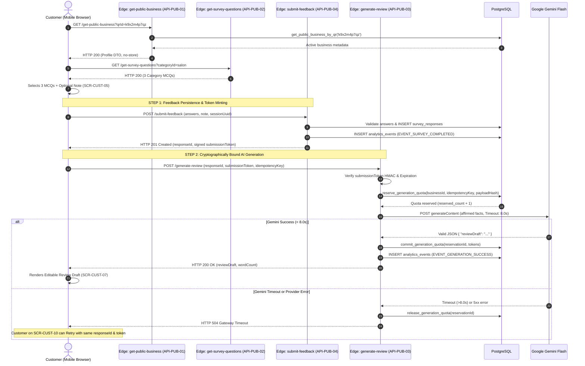
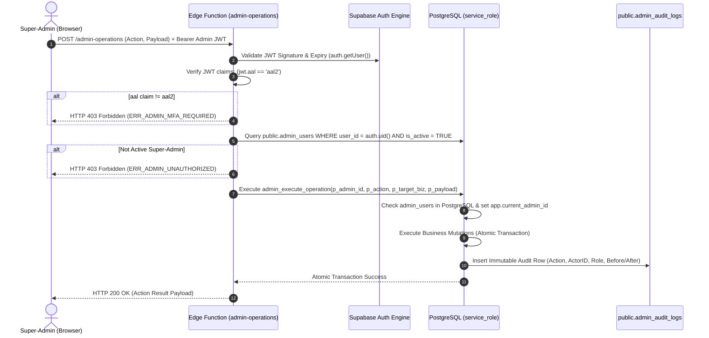

# Production API Specification & Integration Contract
## Multi-Tenant AI-Powered QR Review & Customer Feedback SaaS for Indian SMBs

---

## 1. Document Control & Status

| Attribute | Specification |
| :--- | :--- |
| **Document Reference** | [`docs/API_SPEC.md`](file:///Users/mrugmaythere/work/QRs/docs/API_SPEC.md) |
| **Document Title** | Production API Contract, Edge Function Architecture & Integration Specification |
| **Target SaaS** | Multi-Tenant AI-Powered QR Review & Customer Feedback SaaS for Local Indian SMBs |
| **Document Version** | Version 1.2 (Phase 1: Stage 6 — Final API Implementability & Database Contract Repair) |
| **Requirements Baseline** | [`docs/PRD.md`](file:///Users/mrugmaythere/work/QRs/docs/PRD.md) (Revision 1.1) |
| **Architecture Reference** | [`docs/ARCHITECTURE.md`](file:///Users/mrugmaythere/work/QRs/docs/ARCHITECTURE.md) (Revision 1.1) |
| **Technology Baseline** | [`docs/TECH_STACK.md`](file:///Users/mrugmaythere/work/QRs/docs/TECH_STACK.md) (Revision 1.1) |
| **Database Baseline** | [`docs/DATABASE_SCHEMA.md`](file:///Users/mrugmaythere/work/QRs/docs/DATABASE_SCHEMA.md) (Revision 1.1) |
| **Security Baseline** | [`docs/SECURITY.md`](file:///Users/mrugmaythere/work/QRs/docs/SECURITY.md) (Revision 1.1) |
| **UI/UX Baseline** | [`docs/UI_UX.md`](file:///Users/mrugmaythere/work/QRs/docs/UI_UX.md) (Revision 1.1) |
| **Author** | Principal Supabase Engineer, PostgreSQL Transaction Architect & API Security Reviewer |
| **Target Founder** | Solo Engineering Student (Founder & Lead Developer) |
| **Target Pilot Cohort** | 3–5 Local Brick-and-Mortar Businesses (Salons and Specialty Cafes) |
| **Creation Date** | October 17, 2026 |
| **Last Updated** | October 19, 2026 |
| **Lifecycle State** | `AUDITED & HARDENED CONTRACT — SUBMITTED FOR FOUNDER APPROVAL (NON-EXECUTABLE)` |

### 1.1 Revision History & Audit Log

| Revision | Date | Author | Summary of Changes | Status |
| :---: | :---: | :--- | :--- | :---: |
| **1.0** | Oct 17, 2026 | Principal API Architect | Initial API specification spanning 20 operations across Public Customer Experience, Business Owner Portal, and Super-Admin Console. Defined two-phase atomic quota accounting, canonical analytics event taxonomy, and error catalog. | Superseded |
| **1.1** | Oct 19, 2026 | Principal API Architect & Security Lead | **Stage 6 Audit:** Expanded to 23 operations (5 Public, 9 Owner, 9 Admin) + 8 RPCs. Added zero-second dynamic QR freshness, grounded Gemini drafts, decoupled Gemini Flash models, server-owned analytics events, and server-side logo upload gateway. | Superseded |
| **1.2** | Oct 19, 2026 | Principal Supabase Engineer & PostgreSQL Architect | **Stage 6 Technical Implementability & Database Repair:**<br/>1. **Administrative Operation Transaction Contract (§12, §15):** Replaced non-mutating placeholder with complete transaction semantics and SQL for `CREATE_BUSINESS`, `SET_BUSINESS_STATUS`, `ADJUST_QUOTA`, `UPDATE_SUBSCRIPTION`, and `REASSIGN_OWNER`. Enforced `service_role` execute grants, authoritative database role checks, and hardware-immutable QR enforcement.<br/>2. **Atomic Quota SQL & Idempotency (§10, §15):** Pre-checked idempotency before consuming reservations; associated reservations with exact `quota_id` to eliminate month-end midnight races; added missing-cycle auto-provisioning; prevented negative counters via `GREATEST(0, reserved_count - 1)`; resolved committed replay policy (`ERR_ALREADY_COMMITTED`) aligned with data minimization.<br/>3. **Direct PostgREST Response Field Mapping (§3, §11):** Documented raw `snake_case` JSON responses and requests for direct PostgREST operations (`API-OWN-01`, `02`, `05`, `06`, `09`) alongside centralized client-side camelCase DTO adapters.<br/>4. **Modern Supabase Authentication Architecture (§4):** Specified modern publishable API key (`sb_pub_...`), per-function `verify_jwt` gateway configuration (disabled on public endpoints, enabled on authenticated), and application-level IP rate limiting.<br/>5. **Cryptographic Survey-to-Generation Binding (§7, §8):** Bound `API-PUB-04` feedback submission to `API-PUB-03` generation via signed HMAC `submissionToken` and database row verification; prevented duplicate survey submissions on generation retries.<br/>6. **Merchant Audit Logging Schema Compatibility (§11, §16):** Formulated database amendment renaming `admin_user_id` to `actor_user_id` and adding `actor_role` to `public.admin_audit_logs` for merchant destination change attribution.<br/>7. **Image Storage Contract (§11, §12):** Adopted Strategy B (format-preserving storage with structural header/chunk validation and dimension bounds for PNG, JPEG, WebP).<br/>8. **Gemini Configuration & Grounding Correction (§9):** Configured `thinkingConfig: { thinkingBudget: 0 }` for `gemini-3.5-flash-lite`; marked latency as deployment targets; stripped unsupported claims (e.g. unprompted "Highly recommend") from examples.<br/>9. **Operational Edge Cases (§8, §14):** Formalized multi-step recoverable workflow for owner onboarding, mid-journey business suspensions, CDN question versioning, and N/A option exclusions.<br/>10. **Expanded Contract Test Suite (§20):** Expanded test matrix to 28 traceable scenarios labeled `SPECIFIED (NOT EXECUTED)`. | **Under Review** |

> [!IMPORTANT]
> **Implementation Isolation Notice:**
> This document represents a **specification-only architectural deliverable**. In accordance with Phase 1 protocols, no application code, Edge Functions, database migrations, or third-party SDK calls have been executed. All TypeScript interfaces, Zod schemas, and SQL RPC blocks are strictly illustrative design specifications and marked non-executable.

---

## 2. Architectural Summary & Hybrid API Strategy

Our platform implements a **hybrid backend architecture** combining direct PostgreSQL Row Level Security (RLS) via Supabase PostgREST with isolated serverless compute via Supabase Edge Functions (Deno / TypeScript).

```
+---------------------------------------------------------------------------------------------------+
|                                 HYBRID BACKEND ARCHITECTURE OVERVIEW                              |
+---------------------------------------------------------------------------------------------------+
| 1. PUBLIC GATEWAYS       | Serverless Edge Functions running in Deno. Validates rate limits,      |
|    (Edge Functions)      | sanitizes public inputs, calls internal SECURITY DEFINER RPCs.         |
|                          | Anonymous clients have ZERO direct SELECT/INSERT grants on tables.     |
|--------------------------+------------------------------------------------------------------------|
| 2. AI GENERATION ENGINE  | Dedicated Edge Function (`generate-review`). Manages atomic two-phase  |
|    (Serverless + Vault)  | quota reservations, verifies HMAC submission tokens, invokes Gemini,   |
|                          | and isolates `GEMINI_API_KEY` exclusively within serverless secrets.   |
|--------------------------+------------------------------------------------------------------------|
| 3. AUTHENTICATED OWNER   | Standard CRUD reads/writes route directly to Supabase PostgREST via    |
|    (PostgREST + RLS)     | client SDK. Authorized strictly by JWT claim (`owner_id = auth.uid()`) |
|                          | and column-level permission grants. Payloads use native snake_case.   |
|--------------------------+------------------------------------------------------------------------|
| 4. AUTHENTICATED OWNER   | Privileged or complex merchant actions (logo upload with magic bytes,  |
|    GATEWAYS (Edge Fns)   | Google destination validation) route through dedicated Edge Functions.|
|--------------------------+------------------------------------------------------------------------|
| 5. HIGH-ASSURANCE ADMIN  | Single consolidated Edge Function (`admin-operations`). Validates JWT  |
|    (MFA aal2 Gateway)    | signature, enforces `aal2` TOTP MFA assurance, sets execution context, |
|                          | and executes privileged administrative actions with full audit trails. |
+---------------------------------------------------------------------------------------------------+
```

---

## 3. API Design Principles & Global Standards

1. **RESTful Semantics & JSON Over HTTPS:** All communication uses TLS 1.3 over HTTPS. Request and response bodies use UTF-8 encoded JSON (except the multipart logo upload gateway).
2. **Naming Convention & Wire Contract Law:**
   - **Edge Function Endpoints (Public, Custom Owner & Admin Gateways):** Strict **camelCase** for external JSON request/response properties (e.g., `publicQrId`, `googleReviewUrl`, `monthlyQuotaLimit`, `generationsUsed`). The Edge Function Deno runtime translates internal database snake_case columns into canonical camelCase DTOs.
   - **Direct Supabase PostgREST Endpoints (`API-OWN-01`, `API-OWN-02`, `API-OWN-05`, `API-OWN-06`, `API-OWN-09`):** Direct PostgREST queries return database columns **exactly as defined in PostgreSQL** (`snake_case`, e.g., `vanity_slug`, `google_review_url`, `whatsapp_number`, `billing_cycle`, `max_limit`, `used_count`). Filtering query parameters and PATCH bodies must use strict `snake_case`.
   - **Client-Side Centralized Adapter:** In the React frontend, centralized adapter mappers convert raw PostgREST `snake_case` rows into camelCase TypeScript interfaces.
3. **Strict Runtime Schema Validation:** Every incoming API request to Edge Functions is validated against strict **Zod** schemas at the serverless boundary before any database or AI invocation. Unrecognized properties are rejected (`z.strictObject(...)`).
4. **Standardized Defensive Headers:**
   - All responses include:
     - `X-Content-Type-Options: nosniff`
     - `X-Frame-Options: DENY`
     - `Referrer-Policy: strict-origin-when-cross-origin`
     - `X-Request-Id: <uuid>` (Correlation ID generated per request)
5. **No Technical Data Leaks:** Error payloads return stable error codes and user-safe messages. Database constraints, internal table structures, raw SQL errors, and provider stack traces are suppressed from client responses.

---

## 4. Modern Supabase Authentication Architecture

### 4.1 Modern Key Architecture & Per-Function Gateway Matrix

In modern Supabase, client applications use **Publishable API Keys** (`VITE_SUPABASE_PUBLISHABLE_KEY`, prefixed with `sb_pub_...` or project publishable API key). Modern publishable keys are public client identifiers rather than user-bearing JWTs.

To ensure security while enabling registration-free customer access:

```
+--------------------------------------------------------------------------------------------------------------------------------------+
|                                              EDGE FUNCTION AUTHENTICATION MATRIX                                                     |
+--------------------------------------------------------------------------------------------------------------------------------------+
| Function Name         | Gateway JWT Verify | Accepted Headers                | Anon Access? | User Auth? | Identity & AuthZ Enforcement |
|-----------------------+--------------------+---------------------------------+--------------+------------+------------------------------|
| `get-public-business` | `verify_jwt = false`| `apikey: <publishable_key>`    | YES (Public  | NO         | Edge Function validates apikey|
|                       |                    |                                 | mobile client|            | header; IP rate limited      |
|-----------------------+--------------------+---------------------------------+--------------+------------+------------------------------|
| `get-survey-questions`| `verify_jwt = false`| `apikey: <publishable_key>`    | YES (Public  | NO         | Edge Function validates apikey|
|                       |                    |                                 | mobile client|            | header; public category query|
|-----------------------+--------------------+---------------------------------+--------------+------------+------------------------------|
| `submit-feedback`     | `verify_jwt = false`| `apikey: <publishable_key>`    | YES (Public  | NO         | Validates answers; issues    |
|                       |                    |                                 | mobile client|            | signed HMAC submissionToken  |
|-----------------------+--------------------+---------------------------------+--------------+------------+------------------------------|
| `generate-review`     | `verify_jwt = false`| `apikey: <publishable_key>`    | YES (Public  | NO         | Cryptographically verifies   |
|                       |                    |                                 | mobile client|            | submissionToken & quota lock |
|-----------------------+--------------------+---------------------------------+--------------+------------+------------------------------|
| `track-event`         | `verify_jwt = false`| `apikey: <publishable_key>`    | YES (Public  | NO         | IP rate limited; SHA-256     |
|                       |                    |                                 | mobile client|            | composite deduplication key  |
|-----------------------+--------------------+---------------------------------+--------------+------------+------------------------------|
| `update-destination`  | `verify_jwt = true`| `apikey: <publishable_key>`    | NO           | YES (Role: | Gateway validates user JWT;  |
|                       |                    | `Authorization: Bearer <jwt>`   |              | authed)    | `auth.getUser()` verifies uid|
|-----------------------+--------------------+---------------------------------+--------------+------------+------------------------------|
| `upload-logo`         | `verify_jwt = true`| `apikey: <publishable_key>`    | NO           | YES (Role: | Gateway validates user JWT;  |
|                       |                    | `Authorization: Bearer <jwt>`   |              | authed)    | `auth.getUser()` verifies uid|
|-----------------------+--------------------+---------------------------------+--------------+------------+------------------------------|
| `get-owner-dashboard` | `verify_jwt = true`| `apikey: <publishable_key>`    | NO           | YES (Role: | Gateway validates user JWT;  |
|                       |                    | `Authorization: Bearer <jwt>`   |              | authed)    | `auth.getUser()` verifies uid|
|-----------------------+--------------------+---------------------------------+--------------+------------+------------------------------|
| `admin-operations`    | `verify_jwt = true`| `apikey: <publishable_key>`    | NO           | YES (Role: | Gateway validates user JWT;  |
|                       |                    | `Authorization: Bearer <jwt>`   |              | super_admin| `aal2` TOTP + admin_users DB |
+--------------------------------------------------------------------------------------------------------------------------------------+
```

### 4.2 Gateway vs. Application-Level Responsibilities

1. **Public Customer Endpoints (`verify_jwt = false`):**
   - The Supabase API Gateway allows traffic bearing `apikey: <VITE_SUPABASE_PUBLISHABLE_KEY>`.
   - Because publishable keys are public and do not represent customer identities, they **do not prevent bot abuse**.
   - Application-level defense is mandatory: Every public Edge Function verifies the `apikey` header matches `Deno.env.get('SUPABASE_PUBLISHABLE_KEY')`, enforces weighted sliding-window rate limiting (`RPC-INT-05`) keyed by hashed client IP, and requires strict Zod payload parsing.
2. **Authenticated Owner Endpoints (`verify_jwt = true`):**
   - The API Gateway verifies the JWT signature in `Authorization: Bearer <owner_jwt>`. Unauthenticated requests are rejected with HTTP 401 before compute execution.
   - Inside the Edge Function, `supabaseClient.auth.getUser()` extracts `user.id`. The function queries PostgreSQL to verify that `businesses.owner_id = user.id`. Cross-tenant requests are rejected with HTTP 403 `ERR_PERMISSION_DENIED`.
3. **Super-Admin Console Endpoints (`verify_jwt = true`):**
   - Requires verified Authenticator Assurance Level 2 (TOTP MFA): `jwtClaims.aal === 'aal2'`.
   - Server-side database lookup verifies `auth.uid()` in `public.admin_users WHERE is_active = TRUE AND role = 'super_admin'`.
4. **Internal Service Credentials:**
   - `SUPABASE_SERVICE_ROLE_KEY` is isolated exclusively within serverless environment secrets (`Deno.env.get('SUPABASE_SERVICE_ROLE_KEY')`). It is never bundled into client applications or exposed in client headers.

---

## 5. QR Resolver Caching & Security Freshness Strategy

### 5.1 Dynamic Status Freshness Guarantee

To eliminate the vulnerability where suspended merchants or modified Google review destinations continue serving cached responses, the public resolver implements **zero-second dynamic freshness**:

- **Dynamic Resolver (`API-PUB-01` / `get-public-business`):**
  `Cache-Control: private, no-cache, no-store, max-age=0, must-revalidate`
- **Instant Suspension Visibility:** When an administrator marks a business `account_status = 'suspended'` or `is_active = FALSE`, the very next customer scan to `/functions/v1/get-public-business` receives an immediate HTTP 403 `ERR_BUSINESS_SUSPENDED` with outbound review links stripped to `NULL`.
- **Pre-Loaded Browser Tab Boundary:** `no-store` ensures subsequent HTTP requests receive live data. If a customer already has the survey page open when a business is suspended, the client-side app intercepts the HTTP 403 response on `submit-feedback` or `generate-review` and transitions immediately to `SCR-CUST-13` (Suspended Business Notice).

### 5.2 Decoupled Static Configuration Caching

```
+----------------------------------------------------------------------------------------------------------------------+
|                                            AUDITED CACHING POLICY MATRIX                                             |
+----------------------------------------------------------------------------------------------------------------------+
| Endpoint / Resource          | Data Type       | Cache-Control Header                   | Freshness Guarantee        |
|------------------------------+-----------------+----------------------------------------+----------------------------|
| `API-PUB-01` (get-public-biz)| Dynamic Tenant  | `private, no-cache, no-store, max-age=0`| **0 Seconds (Instant)**    |
|                              | Status & URLs   | `must-revalidate`                      | Live PostgreSQL lookup     |
|------------------------------+-----------------+----------------------------------------+----------------------------|
| `API-PUB-02` (survey-qs)     | Static Question | `public, max-age=3600, s-maxage=86400` | 24 Hours CDN / 1 Hour Web  |
|                              | Reference Data  | `stale-while-revalidate=604800`        | Versioned via query param  |
|------------------------------+-----------------+----------------------------------------+----------------------------|
| Business Logo Objects        | Static Image    | `public, max-age=3600`                 | 1 Hour (Cache-busted via   |
| (Supabase Storage)           | Asset           |                                        | `?v=<updated_at_epoch>`)   |
|------------------------------+-----------------+----------------------------------------+----------------------------|
| Client SPA Static Bundles    | Vite Build      | `public, max-age=31536000, immutable`  | Content-hashed filenames   |
| (JS/CSS/Assets)              | Artifacts       |                                        | e.g. `index.a1b2c3d4.js`   |
+----------------------------------------------------------------------------------------------------------------------+
```

### 5.3 Static Question Versioning
If survey questions are updated in `survey_questions` or `survey_options`:
- Historical question records are soft-deprecated (`is_active = FALSE`) and new records are inserted with new UUIDs (`DATABASE_SCHEMA.md` §8.2).
- The client appends a schema version query parameter (`/get-survey-questions?categoryId=salon&v=2`), bypassing older CDN cache entries without waiting for the 24-hour TTL expiration.

---

## 6. Master Operation & Endpoint Inventory

The platform backend is organized into **23 discrete operations** (5 Public, 9 Owner, 9 Admin) and 8 internal PostgreSQL RPCs:

```
+----------------------------------------------------------------------------------------------------------------------+
|                                              MASTER OPERATION INVENTORY                                              |
+----------------------------------------------------------------------------------------------------------------------+
| Operation ID | Target Route / Channel               | Method | Trust Boundary         | Primary Functionality        |
|--------------+--------------------------------------+--------+------------------------+------------------------------|
| `API-PUB-01` | `/functions/v1/get-public-business`  | GET    | `PUBLIC`               | Resolve public QR profile    |
| `API-PUB-02` | `/functions/v1/get-survey-questions` | GET    | `PUBLIC`               | Retrieve 3 category MCQs     |
| `API-PUB-03` | `/functions/v1/generate-review`      | POST   | `PUBLIC`               | Atomic quota & AI drafting   |
| `API-PUB-04` | `/functions/v1/submit-feedback`      | POST   | `PUBLIC`               | Persist answers & issue token|
| `API-PUB-05` | `/functions/v1/track-event`          | POST   | `PUBLIC`               | Ingest funnel telemetry event|
|--------------+--------------------------------------+--------+------------------------+------------------------------|
| `API-OWN-01` | `/rest/v1/businesses`                | GET    | `OWNER_AUTHENTICATED`  | Read merchant profile via RLS|
| `API-OWN-02` | `/rest/v1/businesses`                | PATCH  | `OWNER_AUTHENTICATED`  | Update safe profile fields   |
| `API-OWN-03` | `/functions/v1/update-destination`   | POST   | `OWNER_AUTHENTICATED`  | Validated Google URL update  |
| `API-OWN-04` | `/functions/v1/get-owner-dashboard`  | GET    | `OWNER_AUTHENTICATED`  | Precomputed funnel metrics   |
| `API-OWN-05` | `/rest/v1/survey_responses`          | GET    | `OWNER_AUTHENTICATED`  | Feedback feed & note status  |
| `API-OWN-06` | `/rest/v1/tenant_quotas`             | GET    | `OWNER_AUTHENTICATED`  | Read monthly quota ledger    |
| `API-OWN-07` | `/functions/v1/upload-logo`          | POST   | `OWNER_AUTHENTICATED`  | Upload logo with magic bytes |
| `API-OWN-08` | `/functions/v1/upload-logo`          | DELETE | `OWNER_AUTHENTICATED`  | Remove custom merchant logo  |
| `API-OWN-09` | `/rest/v1/subscriptions`             | GET    | `OWNER_AUTHENTICATED`  | Read commercial plan status  |
|--------------+--------------------------------------+--------+------------------------+------------------------------|
| `API-ADM-01` | `/functions/v1/admin-operations`     | POST   | `SUPER_ADMIN_AAL2`     | Action: `LIST_BUSINESSES`    |
| `API-ADM-02` | `/functions/v1/admin-operations`     | POST   | `SUPER_ADMIN_AAL2`     | Action: `CREATE_BUSINESS`    |
| `API-ADM-03` | `/functions/v1/admin-operations`     | POST   | `SUPER_ADMIN_AAL2`     | Action: `GET_BUSINESS_DETAIL`|
| `API-ADM-04` | `/functions/v1/admin-operations`     | POST   | `SUPER_ADMIN_AAL2`     | Action: `SET_BUSINESS_STATUS`|
| `API-ADM-05` | `/functions/v1/admin-operations`     | POST   | `SUPER_ADMIN_AAL2`     | Action: `ADJUST_QUOTA`       |
| `API-ADM-06` | `/functions/v1/admin-operations`     | POST   | `SUPER_ADMIN_AAL2`     | Action: `LIST_AUDIT_LOGS`    |
| `API-ADM-07` | `/functions/v1/admin-operations`     | POST   | `SUPER_ADMIN_AAL2`     | Action: `GET_SYSTEM_HEALTH`  |
| `API-ADM-08` | `/functions/v1/admin-operations`     | POST   | `SUPER_ADMIN_AAL2`     | Action: `UPDATE_SUBSCRIPTION`|
| `API-ADM-09` | `/functions/v1/admin-operations`     | POST   | `SUPER_ADMIN_AAL2`     | Action: `REASSIGN_OWNER`     |
|--------------+--------------------------------------+--------+------------------------+------------------------------|
| `RPC-INT-01` | `public.get_public_business_by_qr`   | RPC    | `INTERNAL_ONLY`        | Public QR projection RPC     |
| `RPC-INT-02` | `public.reserve_generation_quota`    | RPC    | `INTERNAL_ONLY`        | Two-phase reservation lock   |
| `RPC-INT-03` | `public.commit_generation_quota`     | RPC    | `INTERNAL_ONLY`        | Exact quota_id commit        |
| `RPC-INT-04` | `public.release_generation_quota`    | RPC    | `INTERNAL_ONLY`        | Release unbilled reservation |
| `RPC-INT-05` | `public.check_rate_limit`            | RPC    | `INTERNAL_ONLY`        | Sliding-window rate limiter  |
| `RPC-INT-06` | `public.admin_execute_operation`     | RPC    | `INTERNAL_ONLY`        | Full admin transaction mutator|
| `RPC-INT-07` | `public.purge_expired_reservations`  | RPC    | `INTERNAL_ONLY`        | Sweeps stale in-flight locks |
| `RPC-INT-08` | `public.purge_expired_notes`         | RPC    | `INTERNAL_ONLY`        | Rolling customer note scrub  |
+----------------------------------------------------------------------------------------------------------------------+
```

---

## 7. Public Customer Experience APIs

### 7.1 `API-PUB-01`: Public Business QR Resolver

- **Stable API ID:** `API-PUB-01`
- **Route & Method:** `GET /functions/v1/get-public-business?qrId=:qrId`
- **Trust Boundary:** `PUBLIC` (Anonymous customer mobile browser)
- **Primary Purpose:** Resolve the immutable QR token (`/q/:public_qr_id`) into public merchant metadata with real-time status freshness.
- **Request Headers:**
  - `apikey: <VITE_SUPABASE_PUBLISHABLE_KEY>` (Required)
- **Gateway Config:** `verify_jwt = false`.
- **Query Parameters:**
  - `qrId`: String, required. Validated via Zod: `z.string().regex(/^[a-z0-9]{8,12}$/)`.
- **Security Controls:** Rate limited via `RPC-INT-05` (60 requests / 10 min per hashed client IP).
- **Backend Execution:** Calls internal RPC `public.get_public_business_by_qr(p_qr_id)` via `service_role`.
- **Response Caching Policy:** `Cache-Control: private, no-cache, no-store, max-age=0, must-revalidate`.
- **Success Response (HTTP 200 OK — Active Business):**
  ```json
  {
    "publicQrId": "k9x2m4p7qz",
    "name": "Green Salon & Spa",
    "logoUrl": "https://xyz.supabase.co/storage/v1/object/public/logos/3fa85f64-5717-4562-b3fc-2c963f66afa6/logo.webp?v=1729350000",
    "categoryId": "salon",
    "googleReviewUrl": "https://search.google.com/local/writereview?placeid=ChIJN1t_tDeuEmsRUsoyG83frY4",
    "whatsappNumber": "9876543210",
    "isActive": true,
    "accountStatus": "active",
    "subscriptionStatus": "active"
  }
  ```
- **Degraded Response (HTTP 200 OK — Lapsed Subscription / Direct-Only Mode):**
  ```json
  {
    "publicQrId": "k9x2m4p7qz",
    "name": "Green Salon & Spa",
    "logoUrl": "https://xyz.supabase.co/storage/v1/object/public/logos/3fa85f64-5717-4562-b3fc-2c963f66afa6/logo.webp?v=1729350000",
    "categoryId": "salon",
    "googleReviewUrl": "https://search.google.com/local/writereview?placeid=ChIJN1t_tDeuEmsRUsoyG83frY4",
    "whatsappNumber": "9876543210",
    "isActive": true,
    "accountStatus": "active",
    "subscriptionStatus": "past_due"
  }
  ```
- **Error Responses:**
  - `HTTP 404 Not Found` (`ERR_QR_NOT_FOUND`): Token does not match any business record. Renders `SCR-CUST-12`.
  - `HTTP 403 Forbidden` (`ERR_BUSINESS_SUSPENDED`): Business `account_status = 'suspended'` or `is_active = FALSE`. Outbound URLs are stripped. Renders `SCR-CUST-13`.
  - `HTTP 429 Too Many Requests` (`ERR_RATE_LIMITED`): Hashed IP exceeded rate limit.
- **Related UI Screens:** `SCR-CUST-01`, `SCR-CUST-12`, `SCR-CUST-13`, `SCR-CUST-14`.
- **Contract Tests:** `TC-API-01`, `TC-API-02`, `TC-API-03`, `TC-API-04`.

---

### 7.2 `API-PUB-02`: Category Questionnaire Retrieval

- **Stable API ID:** `API-PUB-02`
- **Route & Method:** `GET /functions/v1/get-survey-questions?categoryId=:categoryId&v=:version`
- **Trust Boundary:** `PUBLIC`
- **Request Headers:**
  - `apikey: <VITE_SUPABASE_PUBLISHABLE_KEY>`
- **Gateway Config:** `verify_jwt = false`.
- **Query Parameters:**
  - `categoryId`: String, required. Validated via Zod: `z.enum(['salon', 'cafe'])`.
  - `v`: String, optional schema version for cache-busting.
- **Response Caching Policy:** `Cache-Control: public, max-age=3600, s-maxage=86400, stale-while-revalidate=604800`.
- **Success Response (HTTP 200 OK):**
  ```json
  {
    "categoryId": "salon",
    "questions": [
      {
        "id": "8f1a2b3c-4d5e-6f7a-8b9c-0d1e2f3a4b5c",
        "displayOrder": 1,
        "questionText": "How was your hair or beauty service today?",
        "options": [
          { "id": "1a2b3c4d-0001-4000-8000-000000000001", "optionText": "Masterful & Precise", "emojiAnchor": "✂️", "sentiment": "positive", "isNeutralNa": false },
          { "id": "1a2b3c4d-0001-4000-8000-000000000002", "optionText": "Good / Met Expectations", "emojiAnchor": "👍", "sentiment": "positive", "isNeutralNa": false },
          { "id": "1a2b3c4d-0001-4000-8000-000000000003", "optionText": "Standard / Satisfactory", "emojiAnchor": "👌", "sentiment": "neutral", "isNeutralNa": true },
          { "id": "1a2b3c4d-0001-4000-8000-000000000004", "optionText": "Service took too long", "emojiAnchor": "⏳", "sentiment": "negative", "isNeutralNa": false }
        ]
      },
      {
        "id": "8f1a2b3c-4d5e-6f7a-8b9c-0d1e2f3a4b5d",
        "displayOrder": 2,
        "questionText": "How was the staff hospitality and cleanliness?",
        "options": [
          { "id": "1a2b3c4d-0002-4000-8000-000000000001", "optionText": "Warm & Attentive team", "emojiAnchor": "😊", "sentiment": "positive", "isNeutralNa": false },
          { "id": "1a2b3c4d-0002-4000-8000-000000000002", "optionText": "Clean & hygienic station", "emojiAnchor": "✨", "sentiment": "positive", "isNeutralNa": false },
          { "id": "1a2b3c4d-0002-4000-8000-000000000003", "optionText": "Crowded / High waiting time", "emojiAnchor": "👥", "sentiment": "negative", "isNeutralNa": false }
        ]
      },
      {
        "id": "8f1a2b3c-4d5e-6f7a-8b9c-0d1e2f3a4b5e",
        "displayOrder": 3,
        "questionText": "What stood out most about your visit?",
        "options": [
          { "id": "1a2b3c4d-0003-4000-8000-000000000001", "optionText": "Great styling advice", "emojiAnchor": "💡", "sentiment": "positive", "isNeutralNa": false },
          { "id": "1a2b3c4d-0003-4000-8000-000000000002", "optionText": "Calm & relaxing ambience", "emojiAnchor": "🌿", "sentiment": "positive", "isNeutralNa": false },
          { "id": "1a2b3c4d-0003-4000-8000-000000000003", "optionText": "Pricing was higher than expected", "emojiAnchor": "🏷️", "sentiment": "negative", "isNeutralNa": false }
        ]
      }
    ]
  }
  ```
- **Related UI Screens:** `SCR-CUST-02`, `SCR-CUST-03`, `SCR-CUST-04`.
- **Contract Tests:** `TC-API-05`.

---

### 7.3 `API-PUB-04`: Survey Feedback Submission (Persists Answers & Issues Token)

- **Stable API ID:** `API-PUB-04`
- **Route & Method:** `POST /functions/v1/submit-feedback`
- **Trust Boundary:** `PUBLIC`
- **Primary Purpose:** Authoritatively validate customer survey answers, record them in `public.survey_responses`, emit `EVENT_SURVEY_COMPLETED` on the server, and issue a cryptographically signed `submissionToken` required to unlock AI generation.
- **Request Headers:**
  - `apikey: <VITE_SUPABASE_PUBLISHABLE_KEY>` (Required)
  - `Content-Type: application/json`
- **Gateway Config:** `verify_jwt = false`.
- **Request Body Schema (Zod Validated):**
  ```json
  {
    "publicQrId": "k9x2m4p7qz",
    "sessionUuid": "9b1deb4d-3b7d-4bad-9bdd-2b0d7b3dcb6d",
    "responses": [
      {
        "questionId": "8f1a2b3c-4d5e-6f7a-8b9c-0d1e2f3a4b5c",
        "optionId": "1a2b3c4d-0001-4000-8000-000000000001"
      },
      {
        "questionId": "8f1a2b3c-4d5e-6f7a-8b9c-0d1e2f3a4b5d",
        "optionId": "1a2b3c4d-0002-4000-8000-000000000002"
      },
      {
        "questionId": "8f1a2b3c-4d5e-6f7a-8b9c-0d1e2f3a4b5e",
        "optionId": "1a2b3c4d-0003-4000-8000-000000000001"
      }
    ],
    "optionalNote": "Loved the trimmer fade"
  }
  ```
- **Validation Pipeline:**
  1. Resolves `publicQrId` to active `business_id` and vertical category.
  2. Verifies exactly 3 responses. Confirms each `optionId` belongs to the matching active question.
  3. Validates `optionalNote` length ($\le$ 150 characters).
  4. Generates immutable `affirmed_facts_snapshot` array from active option texts.
  5. Idempotent Insert: Computes `submission_hash = SHA-256(business_id + sessionUuid)`. If a response already exists for this session, retrieves the existing `responseId`. Otherwise inserts into `public.survey_responses`.
  6. Server-Authored Analytics: Inserts `EVENT_SURVEY_COMPLETED` into `public.analytics_events` within the same transaction.
  7. Issues `submissionToken`:
     `submissionToken = "<responseId>.<exp>.<hmacSignature>"` signed with the server's HMAC secret key.
- **Success Response (HTTP 201 Created):**
  ```json
  {
    "status": "recorded",
    "responseId": "c9bf9e57-1685-4c89-bafb-ff5af830be8a",
    "submissionToken": "c9bf9e57-1685-4c89-bafb-ff5af830be8a.1729350600.a1b2c3d4e5f6g7h8i9j0k1l2m3n4o5p6"
  }
  ```
- **Error Responses:**
  - `HTTP 400 Bad Request` (`ERR_INVALID_PAYLOAD`): Invalid option IDs or question mismatch.
  - `HTTP 403 Forbidden` (`ERR_BUSINESS_SUSPENDED`): Business is suspended or disabled.
- **Related UI Screens:** `SCR-CUST-05`.
- **Contract Tests:** `TC-API-11`, `TC-API-12`.

---

### 7.4 `API-PUB-03`: AI Review Generation Gateway (Cryptographically Bound)

- **Stable API ID:** `API-PUB-03`
- **Route & Method:** `POST /functions/v1/generate-review`
- **Trust Boundary:** `PUBLIC`
- **Primary Purpose:** Cryptographically verify the survey submission token, execute atomic two-phase quota reservation, invoke the Google Gemini Flash model with grounded affirmed facts, commit quota upon successful drafting, and deliver an editable review draft.
- **Request Headers:**
  - `apikey: <VITE_SUPABASE_PUBLISHABLE_KEY>` (Required)
  - `Content-Type: application/json`
- **Gateway Config:** `verify_jwt = false`.
- **Rate Limit:** 30 requests / 10 min sliding window per hashed IP bucket (`QC-01`).
- **Request Body Schema (Zod Validated):**
  ```json
  {
    "publicQrId": "k9x2m4p7qz",
    "sessionUuid": "9b1deb4d-3b7d-4bad-9bdd-2b0d7b3dcb6d",
    "responseId": "c9bf9e57-1685-4c89-bafb-ff5af830be8a",
    "submissionToken": "c9bf9e57-1685-4c89-bafb-ff5af830be8a.1729350600.a1b2c3d4e5f6g7h8i9j0k1l2m3n4o5p6",
    "idempotencyKey": "9b1deb4d-3b7d-4bad-9bdd-2b0d7b3dcb6d_1"
  }
  ```
- **Binding & Authorization Verification:**
  1. Edge Function verifies the HMAC signature of `submissionToken` and ensures `exp > NOW()`.
  2. Queries `survey_responses WHERE id = responseId AND business_id = resolvedBizId AND session_uuid = sessionUuid`.
  3. Extracts affirmed facts (`affirmed_facts_snapshot`) and `optional_note` directly from the database record (or from the verified token envelope if Option A Ephemeral is adopted).
  4. Client cannot manipulate answers between submission and generation.
- **Quota & Idempotency Pipeline:**
  - Computes `payloadHash = SHA-256(responseId + affirmedFactsSnapshot.join() + (optionalNote || ''))`.
  - Invokes `RPC-INT-02`: `public.reserve_generation_quota(businessId, idempotencyKey, payloadHash)`.
  - If reservation succeeds, calls Gemini API with 8.0s timeout.
  - If Gemini returns valid JSON draft: Calls `RPC-INT-03` (`commit_generation_quota`), inserts server-authored `EVENT_GENERATION_SUCCESS`, and returns draft.
  - If Gemini fails or times out: Calls `RPC-INT-04` (`release_generation_quota`), returns HTTP 504.
- **Grounded Draft Example (No Unsupported Fluff):**
  - Confirmed facts: "Masterful & Precise", "Clean & hygienic station", "Great styling advice", Note: "Loved the trimmer fade".
  - Grounded output contains zero unstated services, staff names, or unprompted "Highly recommend" statements.
- **Success Response (HTTP 200 OK):**
  ```json
  {
    "reviewDraft": "Had a masterful and precise service today. The station was clean and hygienic, and I received great styling advice. Loved the trimmer fade.",
    "wordCount": 24,
    "sentiment": "positive"
  }
  ```
- **Error Responses:**
  - `HTTP 401 Unauthorized` (`ERR_INVALID_SUBMISSION_TOKEN`): Forged, mismatched, or expired `submissionToken`.
  - `HTTP 402 Payment Required` (`ERR_SUBSCRIPTION_LAPSED`): Business subscription is past due. Renders `SCR-CUST-14`.
  - `HTTP 409 Conflict` (`ERR_ALREADY_COMMITTED`): Draft already generated for this attempt sequence. Use new sequence key to retry.
  - `HTTP 409 Conflict` (`ERR_IDEMPOTENCY_MISMATCH`): Same idempotency key used with different payload.
  - `HTTP 409 Conflict` (`ERR_CONCURRENT_REQUEST`): In-flight generation already running for this key.
  - `HTTP 429 Too Many Requests` (`ERR_QUOTA_EXHAUSTED`): Monthly limit reached. Renders `SCR-CUST-11`.
  - `HTTP 504 Gateway Timeout` (`ERR_GEMINI_TIMEOUT`): Gemini exceeded 8.0s timeout. Reservation released without quota charge. Renders `SCR-CUST-10`.
- **Related UI Screens:** `SCR-CUST-06`, `SCR-CUST-07`, `SCR-CUST-10`, `SCR-CUST-11`.
- **Contract Tests:** `TC-API-06`, `TC-API-07`, `TC-API-08`, `TC-API-09`, `TC-API-10`.

---

### 7.5 `API-PUB-05`: Funnel Analytics Event Ingestion

- **Stable API ID:** `API-PUB-05`
- **Route & Method:** `POST /functions/v1/track-event`
- **Trust Boundary:** `PUBLIC`
- **Request Headers:**
  - `apikey: <VITE_SUPABASE_PUBLISHABLE_KEY>`
  - `Content-Type: application/json`
- **Gateway Config:** `verify_jwt = false`.
- **Request Body Schema (Zod Validated):**
  ```json
  {
    "publicQrId": "k9x2m4p7qz",
    "eventName": "EVENT_COPY_SUCCESS",
    "sessionUuid": "9b1deb4d-3b7d-4bad-9bdd-2b0d7b3dcb6d",
    "userAgentCategory": "mobile"
  }
  ```
- **Permitted Client-Reported Events:**
  - `EVENT_QR_PAGE_VIEW`
  - `EVENT_GENERATION_REQUESTED`
  - `EVENT_COPY_ATTEMPTED`
  - `EVENT_COPY_SUCCESS`
  - `EVENT_GOOGLE_REDIRECT_CLICK`
  - `EVENT_GOOGLE_BYPASS_CLICK`
  *(Note: Server-owned events `EVENT_SURVEY_COMPLETED` and `EVENT_GENERATION_SUCCESS` are strictly rejected if submitted via this endpoint).*
- **Server Deduplication:** Computes `deduplication_key = SHA-256(business_id + event_name + session_uuid + date_trunc('minute', NOW()))`. Uses `ON CONFLICT (deduplication_key) DO NOTHING`.
- **Success Response (HTTP 202 Accepted):** `{"status": "accepted"}`.
- **Related UI Screens:** `SCR-CUST-01`, `SCR-CUST-08`, `SCR-CUST-09`.
- **Contract Tests:** `TC-API-13`.

---

## 8. Customer Survey Submission & Feedback Lifecycle

### 8.1 Cryptographically Bound Survey Sequence



### 8.2 Operational Invariants & Edge Cases

1. **Submission-Generation Cryptographic Binding:** `API-PUB-03` cannot be invoked without a valid `submissionToken` minted by `API-PUB-04`. This guarantees that customer feedback is safely persisted before model execution and prevents cross-session tampering.
2. **Retry Without Feedback Duplication:** If generation times out (`SCR-CUST-10`) and the customer taps "Retry Generation", the client resubmits to `API-PUB-03` with the **same `responseId` and `submissionToken`** but an incremented attempt key (`idempotencyKey: "${sessionUuid}_2"`). `API-PUB-04` is **not** called again, preventing duplicate survey rows.
3. **Mid-Journey Suspension Handling:** If a merchant account is suspended while a customer is filling out the survey, the next call (`submit-feedback` or `generate-review`) revalidates account status in PostgreSQL and rejects the call with HTTP 403 `ERR_BUSINESS_SUSPENDED`. The client intercepts this and renders `SCR-CUST-13`.
4. **Exclusion of Not-Applicable (N/A) Choices:** Survey options configured with `is_neutral_na = TRUE` are excluded from the AI prompt envelope, preventing the model from hallucinating services the customer did not experience.

---

## 9. AI Review Generation Integration & Grounding Contract

### 9.1 Configurable Gemini Model Strategy

- **Environment-Decoupled Identifier:**
  `const GEMINI_MODEL = Deno.env.get('GEMINI_MODEL') || 'gemini-3.5-flash-lite';`
- **Approved Default Model: `gemini-3.5-flash-lite` (Founder Decision M0-04)**
  - **Economics:** $0.30 / 1M input tokens, $2.50 / 1M output tokens (standard paid tier).
  - **Structured JSON Schema:** Native schema enforcement via `responseMimeType: "application/json"` and `responseSchema`.
  - **Thinking Configuration:** Configured with `thinkingLevel: "minimal"` as the intended GenerateContent setting (`thinkingBudget = 0` assumption is deprecated; incompatible legacy settings must not be mixed). Note that minimal thinking does not guarantee zero internal reasoning tokens.
  - **Data Privacy Terms:** Commercial paid tier guarantees customer inputs are **never** used to train Google foundational models.
- **Approved Backup Model: `gemini-3.1-flash-lite` (Founder Decision M0-04)**
  - High-speed, cost-efficient Flash model for automatic failover if transient service throttling or regional outages occur.
- **Latency & Timeout Targets:**
  - P50 Target: < 1.8 seconds.
  - P95 Target: < 2.5 seconds.
  - Hard Timeout: 8.0 seconds (initial technical target, not guaranteed latency).
  *(Note: All latency figures represent engineering targets; pre-production benchmarking of latency, draft quality, token usage, thinking tokens, and backup behavior is required upon deployment).*

### 9.2 Grounded Prompt Architecture

```
[SYSTEM INSTRUCTION - DEVELOPER ROLE]
You are an authentic, honest customer review drafting assistant for a local business.
Your sole job is to craft a brief, natural review draft (under 50 words) based STRICTLY and ONLY on the customer's affirmed questionnaire answers and optional note enclosed in <USER_INPUT>.

STRICT GROUNDING RULES:
1. NEVER invent staff names, prices, specific dishes, companion details, or services that were not explicitly affirmed.
2. PRESERVE CUSTOMER SENTIMENT EXACTLY. If the customer selected critical options (e.g. "Service took too long" or "Pricing was higher than expected"), reflect that honest criticism. NEVER launder negative feedback into false praise.
3. DO NOT include unprompted recommendations (e.g., "Highly recommend!") unless explicitly affirmed by the customer.
4. DO NOT use hyperbole or exaggerated adjectives (e.g., "completely spotless", "absolute perfection", "life-changing").
5. Output valid JSON matching the schema {"reviewDraft": "string", "wordCount": number, "sentiment": "positive"|"neutral"|"negative"}.

[USER DATA ENVELOPE]
<USER_INPUT>
Business Name: "Green Salon & Spa"
Vertical Category: "salon"
Affirmed Answers:
- Question 1 (Service): "Masterful & Precise"
- Question 2 (Facility/Staff): "Clean & hygienic station"
- Question 3 (Highlight): "Great styling advice"
Optional Customer Note: "Loved the trimmer fade"
</USER_INPUT>
```

### 9.3 Corrected Grounded AI Test Fixtures

```
+----------------------------------------------------------------------------------------------------------------------+
|                                            GROUNDED AI TEST FIXTURES MATRIX                                          |
+----------------------------------------------------------------------------------------------------------------------+
| Fixture ID     | Input MCQ Selections & Notes            | Confirmed Customer Facts            | Forbidden Claims    |
|----------------+-----------------------------------------+-------------------------------------+---------------------|
| `FIX-AI-POS`   | Q1: "Masterful & Precise"               | - Service was masterful & precise   | - Do not invent     |
| (Positive)     | Q2: "Clean & hygienic station"          | - Station was clean & hygienic      |   "haircut/beard"   |
|                | Q3: "Great styling advice"              | - Received great styling advice     | - Do not invent     |
|                | Note: "Loved the trimmer fade"          | - Loved the trimmer fade            |   staff name "Priya"|
|                |                                         |                                     | - Do not add        |
|                | *Draft Result (<50 words):*             |                                     |   "Highly recommend"|
|                | "Had a masterful and precise service    |                                     |                     |
|                | today. The station was clean and        |                                     |                     |
|                | hygienic, and I received great styling  |                                     |                     |
|                | advice. Loved the trimmer fade."        |                                     |                     |
|                | (24 words)                              |                                     |                     |
|----------------+-----------------------------------------+-------------------------------------+---------------------|
| `FIX-AI-NEU`   | Q1: "Standard / Satisfactory"           | - Service was standard/satisfactory | - Do not invent     |
| (Neutral)      | Q2: "Clean & hygienic station"          | - Station was clean                 |   dishes or coffee  |
|                | Q3: "Calm & relaxing ambience"          | - Ambience was calm & relaxing      | - Do not invent     |
|                | Note: "AC was set a bit too cold"       | - Customer felt AC was too cold     |   staff attitude    |
|                |                                         |                                     |                     |
|                | *Draft Result (<50 words):*             |                                     |                     |
|                | "My visit was satisfactory and the      |                                     |                     |
|                | station was clean. The ambience was calm|                                     |                     |
|                | and relaxing, although the AC was set a |                                     |                     |
|                | bit too cold during my service."        |                                     |                     |
|                | (28 words)                              |                                     |                     |
|----------------+-----------------------------------------+-------------------------------------+---------------------|
| `FIX-AI-NEG`   | Q1: "Service took too long"             | - Service took too long             | - Do not launder    |
| (Critical)     | Q2: "Warm & Attentive team"             | - Staff team was warm & attentive   |   into praise       |
|                | Q3: "Pricing was higher than expected"  | - Pricing was higher than expected  | - Do not invent     |
|                | Note: "Waited 45 mins past appointment" | - Waited 45 mins past appointment   |   excuses for delay |
|                |                                         |                                     |                     |
|                | *Draft Result (<50 words):*             |                                     |                     |
|                | "The staff was warm and attentive, but  |                                     |                     |
|                | my service took too long as I waited 45 |                                     |                     |
|                | minutes past my appointment time. Also  |                                     |                     |
|                | felt pricing was higher than expected." |                                     |                     |
|                | (33 words)                              |                                     |                     |
|----------------+-----------------------------------------+-------------------------------------+---------------------|
| `FIX-AI-ERR`   | Empty / Malformed Model Output          | - Model returned invalid JSON or 5xx| - DO NOT FABRICATE  |
| (Failure)      |                                         | - Edge Function catches exception   |   A FAKE REVIEW     |
|                |                                         | - Releases quota reservation        | - Client shows      |
|                |                                         | - Returns HTTP 504/502 to client    |   SCR-CUST-10       |
+----------------------------------------------------------------------------------------------------------------------+
```

---

## 10. Two-Phase Atomic Quota & Idempotency Hardening

### 10.1 Quota Invariants & Transaction Boundaries

1. **Pre-Check Idempotency Before Locking:** Before querying or locking quota records, `public.reserve_generation_quota` checks `public.quota_reservations WHERE idempotency_key = p_idempotency_key`:
   - If an existing reservation exists:
     - If `payload_hash != p_payload_hash`: Rejects with `ERR_IDEMPOTENCY_MISMATCH` (HTTP 409).
     - If `status = 'pending'`: Rejects with `ERR_CONCURRENT_REQUEST` (HTTP 409).
     - If `status = 'committed'`: Rejects with `ERR_ALREADY_COMMITTED` (HTTP 409). Because review drafts are never stored in the database, the server cannot return a cached review draft. The customer must use a new attempt sequence key (e.g., `${sessionUuid}_2`) to regenerate.
2. **Missing Quota-Cycle Auto-Provisioning:** If the merchant does not yet have a quota record for the current `YYYY-MM` billing cycle, `reserve_generation_quota` atomically provisions one (`ON CONFLICT DO NOTHING`) with default `max_limit = 150`.
3. **Exact Quota-Period Association:**
   - At reservation time, the reservation row stores `quota_id UUID REFERENCES tenant_quotas(id)`.
   - `commit_generation_quota` and `release_generation_quota` update the exact `tenant_quotas` record identified by `quota_id`.
   - **Elimination of Month-End Race Conditions:** If a reservation is created at 23:59:58 on October 31 and committed at 00:00:03 on November 1, the commit is applied to the October quota ledger where the reservation was created, preventing quota cross-contamination.
4. **Negative Counter Prevention:** All release and sweep operations enforce `reserved_count = GREATEST(0, reserved_count - 1)`.

---

## 11. Authenticated Business Owner APIs

Standard merchant CRUD operations query Supabase PostgREST directly using the merchant's Supabase Auth JWT (`Authorization: Bearer <owner_jwt>`).

> [!IMPORTANT]
> **PostgREST Wire Format Law:**
> Direct PostgREST API requests and responses use **native PostgreSQL `snake_case`**. Frontend applications must use the centralized TypeScript adapter mapping (`toCamelCaseBusiness`, `toCamelCaseFeedback`, etc.) to interface with camelCase UI components.

### 11.1 `API-OWN-01`: Merchant Profile Read

- **Stable API ID:** `API-OWN-01`
- **Route & Method:** `GET /rest/v1/businesses?select=id,name,vanity_slug,logo_url,category_id,google_place_id,google_review_url,whatsapp_number,account_status,created_at`
- **Trust Boundary:** `OWNER_AUTHENTICATED` (Direct PostgREST via RLS: `owner_id = auth.uid()`).
- **Request Headers:**
  - `apikey: <VITE_SUPABASE_PUBLISHABLE_KEY>`
  - `Authorization: Bearer <owner_jwt>`
- **Actual Raw PostgREST Response (HTTP 200 OK — `snake_case`):**
  ```json
  [
    {
      "id": "3fa85f64-5717-4562-b3fc-2c963f66afa6",
      "name": "Green Salon & Spa",
      "vanity_slug": "green-salon-koramangala",
      "logo_url": "https://xyz.supabase.co/storage/v1/object/public/logos/3fa85f64-5717-4562-b3fc-2c963f66afa6/logo.png?v=1729350000",
      "category_id": "salon",
      "google_place_id": "ChIJN1t_tDeuEmsRUsoyG83frY4",
      "google_review_url": "https://search.google.com/local/writereview?placeid=ChIJN1t_tDeuEmsRUsoyG83frY4",
      "whatsapp_number": "9876543210",
      "account_status": "active",
      "created_at": "2026-10-17T10:00:00Z"
    }
  ]
  ```
- **Related UI Screens:** `SCR-OWN-04`.
- **Contract Tests:** `TC-API-14`.

---

### 11.2 `API-OWN-02`: Merchant Profile Update

- **Stable API ID:** `API-OWN-02`
- **Route & Method:** `PATCH /rest/v1/businesses?id=eq.:businessId`
- **Trust Boundary:** `OWNER_AUTHENTICATED`
- **Authorization:** PostgreSQL RLS + column-level UPDATE grants.
- **Permitted Columns on PATCH:** `name`, `vanity_slug`, `whatsapp_number`.
- **Protected Columns:** `owner_id`, `public_qr_id`, `category_id`, `google_review_url`, `account_status`, `is_active` (Trigger `enforce_business_field_protection` raises an exception if altered).
- **Actual Raw PostgREST Request Body (`snake_case`):**
  ```json
  {
    "name": "Green Salon & Luxury Spa",
    "vanity_slug": "green-salon-luxury",
    "whatsapp_number": "9876543211"
  }
  ```
- **Success Response:** HTTP 204 No Content.
- **Related UI Screens:** `SCR-OWN-04`.
- **Contract Tests:** `TC-API-15`.

---

### 11.3 `API-OWN-03`: Secure Destination Update Gateway

- **Stable API ID:** `API-OWN-03`
- **Route & Method:** `POST /functions/v1/update-destination`
- **Trust Boundary:** `OWNER_AUTHENTICATED` (Edge Function gateway)
- **Primary Purpose:** Update merchant Google review link with strict server-side URL parsing, approved domain whitelisting, Place ID format checking, and merchant audit logging.
- **Request Headers:**
  - `apikey: <VITE_SUPABASE_PUBLISHABLE_KEY>`
  - `Authorization: Bearer <owner_jwt>`
  - `Content-Type: application/json`
- **Gateway Config:** `verify_jwt = true`.
- **Request Body Schema (Zod Validated):**
  ```json
  {
    "businessId": "3fa85f64-5717-4562-b3fc-2c963f66afa6",
    "googleReviewUrl": "https://search.google.com/local/writereview?placeid=ChIJN1t_tDeuEmsRUsoyG83frY4",
    "googlePlaceId": "ChIJN1t_tDeuEmsRUsoyG83frY4"
  }
  ```
- **Validation Pipeline:**
  1. Verifies caller owns `businessId` (`businesses.owner_id = auth.uid()`).
  2. Protocol must be strictly `https:`.
  3. Hostname must match approved Google review domains:
     `search.google.com`, `maps.app.goo.gl`, `g.page`, `www.google.com`, `maps.google.com`.
  4. Place ID format validated: `^[A-Za-z0-9_-]{20,100}$` (does not assume `ChIJ` prefix).
  5. Updates `businesses.google_review_url` and `google_place_id`.
  6. Writes to `public.admin_audit_logs` with `actor_user_id = auth.uid()` and `actor_role = 'merchant_owner'`.
- **Success Response (HTTP 200 OK — `camelCase` DTO):**
  ```json
  {
    "status": "updated",
    "businessId": "3fa85f64-5717-4562-b3fc-2c963f66afa6",
    "googleReviewUrl": "https://search.google.com/local/writereview?placeid=ChIJN1t_tDeuEmsRUsoyG83frY4"
  }
  ```
- **Error Response (HTTP 422 Unprocessable Entity):**
  ```json
  {
    "error": {
      "code": "ERR_INVALID_DESTINATION_URL",
      "message": "URL must be an approved Google Maps review link (e.g. search.google.com, maps.app.goo.gl, or g.page/r/).",
      "correlationId": "req_8f1a2b3c4d5e",
      "retryable": false
    }
  }
  ```
- **Related UI Screens:** `SCR-OWN-05`.
- **Contract Tests:** `TC-API-16`, `TC-API-17`.

---

### 11.4 `API-OWN-04`: Consolidated Owner Dashboard Summary

- **Stable API ID:** `API-OWN-04`
- **Route & Method:** `GET /functions/v1/get-owner-dashboard?businessId=:id&period=30d`
- **Trust Boundary:** `OWNER_AUTHENTICATED` (Edge Function gateway)
- **Request Headers:**
  - `apikey: <VITE_SUPABASE_PUBLISHABLE_KEY>`
  - `Authorization: Bearer <owner_jwt>`
- **Gateway Config:** `verify_jwt = true`.
- **Success Response (HTTP 200 OK — `camelCase` DTO):**
  ```json
  {
    "businessId": "3fa85f64-5717-4562-b3fc-2c963f66afa6",
    "period": "30d",
    "metrics": {
      "qrVisits": 142,
      "surveysCompleted": 98,
      "surveyCompletionRate": 0.6901,
      "reviewsDrafted": 84,
      "draftSuccessRate": 0.8571,
      "clipboardCopies": 72,
      "copyRate": 0.8571,
      "googleHandoffClicks": 62,
      "handoffRate": 0.8611,
      "directBypassClicks": 14,
      "directBypassRate": 0.0986
    },
    "quota": {
      "billingCycle": "2026-10",
      "monthlyQuotaLimit": 150,
      "generationsUsed": 84,
      "generationsRemaining": 66,
      "resetDate": "2026-11-01T00:00:00Z"
    },
    "disclaimer": "Google Handoffs measure customers directed to Google Maps. Final review publication cannot be tracked due to Google privacy boundaries."
  }
  ```
- **Related UI Screens:** `SCR-OWN-03`, `SCR-OWN-09`.
- **Contract Tests:** `TC-API-18`.

---

### 11.5 `API-OWN-05`: Customer Feedback Feed

- **Stable API ID:** `API-OWN-05`
- **Route & Method:** `GET /rest/v1/survey_responses?business_id=eq.:id&select=id,category_id,selected_options,affirmed_facts_snapshot,optional_note,purged_at,created_at&order=created_at.desc&limit=50`
- **Trust Boundary:** `OWNER_AUTHENTICATED` (Direct PostgREST via RLS: `business_id IN (SELECT id FROM businesses WHERE owner_id = auth.uid())`).
- **Actual Raw PostgREST Response (HTTP 200 OK — `snake_case`):**
  ```json
  [
    {
      "id": "c9bf9e57-1685-4c89-bafb-ff5af830be8a",
      "category_id": "salon",
      "selected_options": [
        { "question_id": "8f1a2b3c-4d5e-6f7a-8b9c-0d1e2f3a4b5c", "option_id": "1a2b3c4d-0001-4000-8000-000000000001" },
        { "question_id": "8f1a2b3c-4d5e-6f7a-8b9c-0d1e2f3a4b5d", "option_id": "1a2b3c4d-0002-4000-8000-000000000002" },
        { "question_id": "8f1a2b3c-4d5e-6f7a-8b9c-0d1e2f3a4b5e", "option_id": "1a2b3c4d-0003-4000-8000-000000000001" }
      ],
      "affirmed_facts_snapshot": [
        "Masterful & Precise",
        "Clean & hygienic station",
        "Great styling advice"
      ],
      "optional_note": "Loved the trimmer fade",
      "purged_at": null,
      "created_at": "2026-10-19T14:30:00Z"
    }
  ]
  ```
- **Related UI Screens:** `SCR-OWN-08`.
- **Contract Tests:** `TC-API-19`.

---

### 11.6 `API-OWN-06`: Quota Consumption Ledger

- **Stable API ID:** `API-OWN-06`
- **Route & Method:** `GET /rest/v1/tenant_quotas?business_id=eq.:id&select=billing_cycle,max_limit,used_count,reserved_count,reset_at&order=billing_cycle.desc&limit=12`
- **Trust Boundary:** `OWNER_AUTHENTICATED` (Direct PostgREST via RLS: `tenant_quotas_owner_read`).
- **Actual Raw PostgREST Response (HTTP 200 OK — `snake_case`):**
  ```json
  [
    {
      "billing_cycle": "2026-10",
      "max_limit": 150,
      "used_count": 84,
      "reserved_count": 0,
      "reset_at": "2026-11-01T00:00:00Z"
    }
  ]
  ```
- **Related UI Screens:** `SCR-OWN-10`.
- **Contract Tests:** `TC-API-20`.

---

### 11.7 `API-OWN-07`: Authenticated Logo Upload Gateway (Format Preserving)

- **Stable API ID:** `API-OWN-07`
- **Route & Method:** `POST /functions/v1/upload-logo`
- **Trust Boundary:** `OWNER_AUTHENTICATED` (Edge Function gateway)
- **Primary Purpose:** Authenticated logo upload gateway with file size checking, binary magic-byte inspection, structural image decoding, and format-preserving storage.
- **Request Headers:**
  - `apikey: <VITE_SUPABASE_PUBLISHABLE_KEY>`
  - `Authorization: Bearer <owner_jwt>`
  - `Content-Type: multipart/form-data`
- **Gateway Config:** `verify_jwt = true`.
- **Request Body:** Form data containing:
  - `businessId`: UUID
  - `file`: Binary image file (PNG, JPEG, WebP)
- **Validation Pipeline (Strategy B):**
  1. Gateway verifies caller owns `businessId`.
  2. File size verified: Maximum **2,097,152 bytes (2 MB)**.
  3. Binary magic-byte signature verified against first 16 bytes:
     - PNG: `89 50 4E 47 0D 0A 1A 0A`
     - JPEG: `FF D8 FF`
     - WebP: `52 49 46 46 ... 57 45 42 50`
     - SVG or executable: Strictly rejected with HTTP 415 (`ERR_INVALID_IMAGE_TYPE`).
  4. Structural Decoding: Validates image chunk headers, confirms pixel dimensions are $\le 2048 \times 2048$, and ensures aspect ratio is between 1:3 and 3:1.
  5. Format Preservation: Uploads file to Supabase Storage bucket `logos` preserving its native validated extension: `${businessId}/logo.${ext}` (e.g. `.png`).
  6. Deletes any previous logo file with a differing extension (e.g. deletes existing `logo.jpeg` when uploading `logo.png`).
  7. Updates `businesses.logo_url` with cache-busting timestamp: `?v=${Date.now()}`.
- **Success Response (HTTP 200 OK — `camelCase` DTO):**
  ```json
  {
    "status": "uploaded",
    "businessId": "3fa85f64-5717-4562-b3fc-2c963f66afa6",
    "logoUrl": "https://xyz.supabase.co/storage/v1/object/public/logos/3fa85f64-5717-4562-b3fc-2c963f66afa6/logo.png?v=1729350000"
  }
  ```
- **Error Responses:**
  - `HTTP 413 Payload Too Large` (`ERR_FILE_TOO_LARGE`): File exceeds 2 MB.
  - `HTTP 415 Unsupported Media Type` (`ERR_INVALID_IMAGE_TYPE`): Missing valid PNG/JPEG/WebP magic bytes.
- **Related UI Screens:** `SCR-OWN-04`.
- **Contract Tests:** `TC-API-21`, `TC-API-22`.

---

### 11.8 `API-OWN-08`: Logo Removal Gateway

- **Stable API ID:** `API-OWN-08`
- **Route & Method:** `DELETE /functions/v1/upload-logo?businessId=:businessId`
- **Trust Boundary:** `OWNER_AUTHENTICATED` (Edge Function gateway)
- **Request Headers:**
  - `apikey: <VITE_SUPABASE_PUBLISHABLE_KEY>`
  - `Authorization: Bearer <owner_jwt>`
- **Gateway Config:** `verify_jwt = true`.
- **Success Response (HTTP 200 OK):**
  ```json
  {
    "status": "deleted",
    "businessId": "3fa85f64-5717-4562-b3fc-2c963f66afa6"
  }
  ```
- **Related UI Screens:** `SCR-OWN-04`.
- **Contract Tests:** `TC-API-23`.

---

### 11.9 `API-OWN-09`: Subscription & Billing Status

- **Stable API ID:** `API-OWN-09`
- **Route & Method:** `GET /rest/v1/subscriptions?business_id=eq.:id&select=id,plan_tier,subscription_status,trial_ends_at,current_period_starts_at,current_period_ends_at,billing_currency,last_payment_amount,last_payment_recorded_at`
- **Trust Boundary:** `OWNER_AUTHENTICATED` (Direct PostgREST via RLS: `subscriptions.business_id IN (SELECT id FROM businesses WHERE owner_id = auth.uid())`).
- **Actual Raw PostgREST Response (HTTP 200 OK — `snake_case`):**
  ```json
  [
    {
      "id": "7d2b3c4e-5f6a-7b8c-9d0e-1f2a3b4c5d6e",
      "plan_tier": "setup_package",
      "subscription_status": "pilot",
      "trial_ends_at": "2026-10-31",
      "current_period_starts_at": "2026-10-17",
      "current_period_ends_at": "2026-11-16",
      "billing_currency": "INR",
      "last_payment_amount": 999.00,
      "last_payment_recorded_at": "2026-10-17T10:00:00Z"
    }
  ]
  ```
- **Related UI Screens:** `SCR-OWN-10`.
- **Contract Tests:** `TC-API-24`.

---

## 12. Super-Admin Console APIs (`admin-operations`)

All privileged administrative actions are routed through a single hardened Edge Function gateway: `POST /functions/v1/admin-operations`.

### 12.1 Execution Context & Trigger Compatibility Resolution



---

### 12.2 Administrative Action Catalog (9 Operations)

#### `API-ADM-01`: Action `LIST_BUSINESSES`
- Request: `{ "action": "LIST_BUSINESSES", "status": "all", "limit": 50, "offset": 0 }`
- Returns paginated directory joined with `tenant_quotas` usage and owner emails.

#### `API-ADM-02`: Action `CREATE_BUSINESS` (Onboard Merchant)
- **Recoverable Multi-Step Onboarding Workflow:**
  - **Step 1 (Auth Provisioning):** Checks if `ownerEmail` exists in `auth.users`. If not, creates user via `supabase.auth.admin.createUser({ email, email_confirm: false })`.
  - **Step 2 (Atomic Database Transaction):** Calls `public.admin_execute_operation('CREATE_BUSINESS', ...)` to insert `businesses` (with 10-char immutable `public_qr_id`), `subscriptions`, and `tenant_quotas`.
  - **Step 3 (Invitation Dispatch):** Sends email invitation via `supabase.auth.admin.inviteUserByEmail()`. If Step 3 fails (e.g. SMTP drop), the tenant remains safely provisioned in database in `account_status = 'pilot'`, and the admin can click "Resend Invite" in `SCR-ADM-05` without creating duplicate tenant records.

#### `API-ADM-03`: Action `GET_BUSINESS_DETAIL`
- Returns deep-dive inspection: profile, subscription, quota ledger, audit trail.

#### `API-ADM-04`: Action `SET_BUSINESS_STATUS` (Suspend / Reactivate)
- Sets `businesses.account_status` (`'active'`, `'pilot'`, `'suspended'`) and updates `is_active`. Audit log records mandatory reason string. Instant zero-second effect on public QR resolver.

#### `API-ADM-05`: Action `ADJUST_QUOTA`
- Adjusts monthly `max_limit` or resets `used_count` for a specific billing cycle.

#### `API-ADM-06`: Action `LIST_AUDIT_LOGS`
- Paginated stream of `public.admin_audit_logs` with action and target filtering.

#### `API-ADM-07`: Action `GET_SYSTEM_HEALTH`
- Global metrics: tenant counts, active vs suspended, global Gemini token usage, error rates.

#### `API-ADM-08`: Action `UPDATE_SUBSCRIPTION` (Manual Billing Management)
- Records cash/UPI payment (`last_payment_amount`, `payment_reference`, `last_payment_recorded_at`), updates billing period dates, and transitions status (`pilot` $\to$ `active` $\to$ `past_due`).

#### `API-ADM-09`: Action `REASSIGN_OWNER` (Tenant Ownership Transfer)
- Reassigns `businesses.owner_id` to a new `auth.users(id)`. Validates `public_qr_id` remains unchanged. Audit log records before/after ownership snapshot.

---

## 13. Internal PostgreSQL RPC Specifications

The following internal RPC functions execute in PostgreSQL under `SECURITY DEFINER` with fixed empty search paths (`SET search_path = ''`).

```sql
-- (NON-EXECUTABLE DESIGN SPECIFICATION)

-- RPC-INT-01: Public QR Resolution
CREATE OR REPLACE FUNCTION public.get_public_business_by_qr(p_qr_id TEXT)
RETURNS TABLE (
    public_qr_id TEXT,
    name TEXT,
    logo_url TEXT,
    category_id TEXT,
    google_review_url TEXT,
    whatsapp_number TEXT,
    is_active BOOLEAN,
    account_status TEXT,
    subscription_status TEXT
)
SECURITY DEFINER
SET search_path = ''
LANGUAGE plpgsql
AS $$
BEGIN
    RETURN QUERY
    SELECT
        b.public_qr_id,
        b.name,
        b.logo_url,
        b.category_id,
        CASE WHEN b.account_status = 'suspended' THEN NULL ELSE b.google_review_url END,
        CASE WHEN b.account_status = 'suspended' THEN NULL ELSE b.whatsapp_number END,
        b.is_active,
        b.account_status,
        COALESCE(s.subscription_status, 'past_due')
    FROM public.businesses b
    LEFT JOIN public.subscriptions s ON s.business_id = b.id
    WHERE b.public_qr_id = p_qr_id;
END;
$$;

-- RPC-INT-02: Two-Phase Quota Reservation Lock with Pre-Idempotency Check
CREATE OR REPLACE FUNCTION public.reserve_generation_quota(
    p_business_id UUID,
    p_idempotency_key TEXT,
    p_payload_hash TEXT
)
RETURNS UUID
SECURITY DEFINER
SET search_path = ''
LANGUAGE plpgsql
AS $$
DECLARE
    v_cycle TEXT := to_char(CLOCK_TIMESTAMP(), 'YYYY-MM');
    v_existing_id UUID;
    v_existing_status TEXT;
    v_existing_hash TEXT;
    v_quota_id UUID;
    v_max INT;
    v_used INT;
    v_reserved INT;
    v_res_id UUID;
BEGIN
    -- 1. Check idempotency BEFORE consuming quota
    SELECT id, status, payload_hash, quota_id
    INTO v_existing_id, v_existing_status, v_existing_hash, v_quota_id
    FROM public.quota_reservations
    WHERE idempotency_key = p_idempotency_key;

    IF v_existing_id IS NOT NULL THEN
        IF v_existing_hash IS DISTINCT FROM p_payload_hash THEN
            RAISE EXCEPTION 'ERR_IDEMPOTENCY_MISMATCH';
        END IF;

        IF v_existing_status = 'pending' THEN
            RAISE EXCEPTION 'ERR_CONCURRENT_REQUEST';
        END IF;

        IF v_existing_status = 'committed' THEN
            -- Data minimization: drafts are not stored in DB, cannot return cached draft
            RAISE EXCEPTION 'ERR_ALREADY_COMMITTED';
        END IF;

        IF v_existing_status IN ('released', 'expired') THEN
            RAISE EXCEPTION 'ERR_RESERVATION_TERMINATED';
        END IF;
    END IF;

    -- 2. Auto-provision quota record for current billing cycle if missing
    INSERT INTO public.tenant_quotas (business_id, billing_cycle, max_limit, used_count, reserved_count, reset_at)
    VALUES (p_business_id, v_cycle, 150, 0, 0, date_trunc('month', NOW() + INTERVAL '1 month'))
    ON CONFLICT (business_id, billing_cycle) DO NOTHING;

    -- 3. Lock quota row FOR UPDATE
    SELECT id, max_limit, used_count, reserved_count
    INTO v_quota_id, v_max, v_used, v_reserved
    FROM public.tenant_quotas
    WHERE business_id = p_business_id AND billing_cycle = v_cycle
    FOR UPDATE;

    IF (v_used + v_reserved) >= v_max THEN
        RAISE EXCEPTION 'ERR_QUOTA_EXHAUSTED';
    END IF;

    -- 4. Increment in-flight counter
    UPDATE public.tenant_quotas
    SET reserved_count = reserved_count + 1
    WHERE id = v_quota_id;

    -- 5. Insert reservation associated with exact quota_id
    INSERT INTO public.quota_reservations (
        business_id, quota_id, idempotency_key, payload_hash, status, ttl_expires_at
    ) VALUES (
        p_business_id, v_quota_id, p_idempotency_key, p_payload_hash, 'pending', CLOCK_TIMESTAMP() + INTERVAL '60 seconds'
    ) RETURNING id INTO v_res_id;

    RETURN v_res_id;
END;
$$;

-- RPC-INT-03: Two-Phase Quota Commit (Exact quota_id Target)
CREATE OR REPLACE FUNCTION public.commit_generation_quota(
    p_reservation_id UUID,
    p_tokens_billed INT
)
RETURNS VOID
SECURITY DEFINER
SET search_path = ''
LANGUAGE plpgsql
AS $$
DECLARE
    v_quota_id UUID;
BEGIN
    UPDATE public.quota_reservations
    SET status = 'committed', tokens_billed = p_tokens_billed, updated_at = CLOCK_TIMESTAMP()
    WHERE id = p_reservation_id AND status = 'pending'
    RETURNING quota_id INTO v_quota_id;

    IF v_quota_id IS NOT NULL THEN
        -- Targets the exact quota row locked at reservation, preventing month-end races
        UPDATE public.tenant_quotas
        SET used_count = used_count + 1,
            reserved_count = GREATEST(0, reserved_count - 1),
            updated_at = CLOCK_TIMESTAMP()
        WHERE id = v_quota_id;
    END IF;
END;
$$;

-- RPC-INT-04: Two-Phase Quota Release (Exact quota_id Target)
CREATE OR REPLACE FUNCTION public.release_generation_quota(
    p_reservation_id UUID
)
RETURNS VOID
SECURITY DEFINER
SET search_path = ''
LANGUAGE plpgsql
AS $$
DECLARE
    v_quota_id UUID;
BEGIN
    UPDATE public.quota_reservations
    SET status = 'released', updated_at = CLOCK_TIMESTAMP()
    WHERE id = p_reservation_id AND status = 'pending'
    RETURNING quota_id INTO v_quota_id;

    IF v_quota_id IS NOT NULL THEN
        UPDATE public.tenant_quotas
        SET reserved_count = GREATEST(0, reserved_count - 1),
            updated_at = CLOCK_TIMESTAMP()
        WHERE id = v_quota_id;
    END IF;
END;
$$;

-- RPC-INT-06: Administrative Mutation Execution Context
CREATE OR REPLACE FUNCTION public.admin_execute_operation(
    p_admin_user_id UUID,
    p_action TEXT,
    p_target_business_id UUID,
    p_payload JSONB
)
RETURNS JSONB
SECURITY DEFINER
SET search_path = ''
LANGUAGE plpgsql
AS $$
DECLARE
    v_role TEXT;
    v_active BOOLEAN;
    v_before JSONB;
    v_after JSONB;
    v_res JSONB;
    v_qr TEXT;
BEGIN
    -- 1. Authoritative admin verification against admin_users table
    SELECT role, is_active INTO v_role, v_active
    FROM public.admin_users
    WHERE user_id = p_admin_user_id;

    IF v_role IS DISTINCT FROM 'super_admin' OR v_active IS NOT TRUE THEN
        RAISE EXCEPTION 'ERR_ADMIN_UNAUTHORIZED';
    END IF;

    -- 2. Set transaction-scoped session variable for trigger compatibility
    PERFORM set_config('app.current_admin_id', p_admin_user_id::text, true);

    -- 3. Execute requested mutation within atomic transaction
    CASE p_action

        WHEN 'CREATE_BUSINESS' THEN
            -- Generate 10-char immutable public_qr_id
            v_qr := lower(substr(replace(gen_random_uuid()::text, '-', ''), 1, 10));

            INSERT INTO public.businesses (
                owner_id, category_id, public_qr_id, vanity_slug, name, account_status, is_active
            ) VALUES (
                (p_payload->>'ownerId')::uuid,
                p_payload->>'categoryId',
                v_qr,
                p_payload->>'vanitySlug',
                p_payload->>'name',
                'pilot',
                TRUE
            ) RETURNING id INTO p_target_business_id;

            INSERT INTO public.subscriptions (
                business_id, plan_tier, subscription_status, current_period_starts_at, current_period_ends_at
            ) VALUES (
                p_target_business_id,
                COALESCE(p_payload->>'planTier', 'setup_package'),
                'pilot',
                CURRENT_DATE,
                CURRENT_DATE + INTERVAL '30 days'
            );

            INSERT INTO public.tenant_quotas (
                business_id, billing_cycle, max_limit, used_count, reserved_count, reset_at
            ) VALUES (
                p_target_business_id,
                to_char(CURRENT_DATE, 'YYYY-MM'),
                COALESCE((p_payload->>'initialQuota')::int, 150),
                0,
                0,
                date_trunc('month', NOW() + INTERVAL '1 month')
            );

            v_after := jsonb_build_object('business_id', p_target_business_id, 'public_qr_id', v_qr);

        WHEN 'SET_BUSINESS_STATUS' THEN
            SELECT to_jsonb(b) INTO v_before FROM public.businesses b WHERE id = p_target_business_id;

            UPDATE public.businesses
            SET account_status = p_payload->>'accountStatus',
                is_active = (p_payload->>'accountStatus' != 'suspended'),
                updated_at = CLOCK_TIMESTAMP()
            WHERE id = p_target_business_id;

            SELECT to_jsonb(b) INTO v_after FROM public.businesses b WHERE id = p_target_business_id;

        WHEN 'ADJUST_QUOTA' THEN
            SELECT to_jsonb(q) INTO v_before FROM public.tenant_quotas q
            WHERE business_id = p_target_business_id AND billing_cycle = (p_payload->>'billingCycle');

            UPDATE public.tenant_quotas
            SET max_limit = (p_payload->>'maxLimit')::int,
                updated_at = CLOCK_TIMESTAMP()
            WHERE business_id = p_target_business_id AND billing_cycle = (p_payload->>'billingCycle');

            SELECT to_jsonb(q) INTO v_after FROM public.tenant_quotas q
            WHERE business_id = p_target_business_id AND billing_cycle = (p_payload->>'billingCycle');

        WHEN 'UPDATE_SUBSCRIPTION' THEN
            SELECT to_jsonb(s) INTO v_before FROM public.subscriptions s WHERE business_id = p_target_business_id;

            UPDATE public.subscriptions
            SET subscription_status = p_payload->>'subscriptionStatus',
                current_period_starts_at = (p_payload->>'currentPeriodStartsAt')::date,
                current_period_ends_at = (p_payload->>'currentPeriodEndsAt')::date,
                last_payment_amount = (p_payload->>'lastPaymentAmount')::numeric,
                last_payment_recorded_at = CLOCK_TIMESTAMP(),
                payment_reference = p_payload->>'paymentReference',
                updated_at = CLOCK_TIMESTAMP()
            WHERE business_id = p_target_business_id;

            SELECT to_jsonb(s) INTO v_after FROM public.subscriptions s WHERE business_id = p_target_business_id;

        WHEN 'REASSIGN_OWNER' THEN
            SELECT to_jsonb(b) INTO v_before FROM public.businesses b WHERE id = p_target_business_id;

            UPDATE public.businesses
            SET owner_id = (p_payload->>'newOwnerId')::uuid,
                updated_at = CLOCK_TIMESTAMP()
            WHERE id = p_target_business_id;

            SELECT to_jsonb(b) INTO v_after FROM public.businesses b WHERE id = p_target_business_id;

        ELSE
            RAISE EXCEPTION 'ERR_UNKNOWN_ADMIN_ACTION: %', p_action;
    END CASE;

    -- 4. Record immutable audit row in the same transaction
    INSERT INTO public.admin_audit_logs (
        actor_user_id, target_business_id, action, actor_role, payload_before, payload_after, ip_hash
    ) VALUES (
        p_admin_user_id, p_target_business_id, p_action, 'super_admin', v_before, v_after, 'internal_gateway'
    );

    RETURN jsonb_build_object('status', 'success', 'action', p_action, 'businessId', p_target_business_id);
END;
$$;

-- Restrict RPC execution strictly to service_role (Edge Function gateway only)
REVOKE ALL ON FUNCTION public.admin_execute_operation(UUID, TEXT, UUID, JSONB) FROM PUBLIC, anon, authenticated;
GRANT EXECUTE ON FUNCTION public.admin_execute_operation(UUID, TEXT, UUID, JSONB) TO service_role;
```

---

## 14. Customer Privacy, Data Minimization & Retention Specifications

### 14.1 Pseudonymous Customer Note Handling

Free-text notes voluntarily typed by customers are classified as **pseudonymous personal data** under India's Digital Personal Data Protection Act (DPDPA).

```
+---------------------------------------------------------------------------------------------------+
|                                 CUSTOMER NOTE RETENTION POLICIES                                  |
+---------------------------------------------------------------------------------------------------+
| Policy Option              | Database Storage Behavior         | Automated Purge Cadence          |
|----------------------------+-----------------------------------+----------------------------------|
| **Option A (Ephemeral)**   | Note held strictly in serverless  | Zero database storage; note      |
|                            | memory during AI call; NOT saved  | discarded immediately upon HTTP  |
|                            | to `public.survey_responses`.     | 200 response delivery.           |
|----------------------------+-----------------------------------+----------------------------------|
| **Option B (30 Days)**     | Note saved to `survey_responses`; | Daily cron updates:              |
| *(Provisional Recommended)*| visible to merchant in dashboard  | `UPDATE survey_responses         |
|                            | for 30 days.                      |  SET optional_note = NULL,       |
|                            |                                   |      purged_at = NOW()           |
|                            |                                   |  WHERE created_at < NOW()-30d`   |
|----------------------------+-----------------------------------+----------------------------------|
| **Option C (90 Days)**     | Note saved to `survey_responses`; | Daily cron executes identical    |
| *(PRD Baseline)*           | visible to merchant for 90 days.  | purge with 90-day threshold.     |
+---------------------------------------------------------------------------------------------------+
```

### 14.2 Universal Privacy & Data Minimization Rules
1. **Zero Customer Draft Storage:** The generated review draft is **never stored in the database**. It exists exclusively in client browser state until copied or discarded.
2. **Log Sanitization Law:** Supabase Edge Function logs and PostgreSQL log streams are strictly forbidden from logging the contents of `optionalNote`.
3. **No Customer Account Creation:** Patrons never provide email, telephone numbers, or authentication credentials.
4. **Transparent Customer Notice:** Screen `SCR-CUST-05` renders an explicit data notice: *"Your answers help craft your review draft. Feedback is shared with store management in accordance with privacy policies."*

---

## 15. Canonical Analytics Taxonomy, Denominators & Integrity

### 15.1 Event Source of Truth Delineation

```
+----------------------------------------------------------------------------------------------------------------------+
|                                            CANONICAL ANALYTICS TAXONOMY                                              |
+----------------------------------------------------------------------------------------------------------------------+
| Canonical Event Name         | Event Origin    | Ingestion Route     | Primary Conversion Metric Tracked             |
|------------------------------+-----------------+---------------------+-----------------------------------------------|
| `EVENT_QR_PAGE_VIEW`         | Client Telemetry| `API-PUB-05`        | Public QR Page Load / Funnel Top (Not Verified Scan)|
| `EVENT_SURVEY_COMPLETED`     | Server Authoritative| `API-PUB-04`    | Verified 3-MCQ Questionnaire Submissions      |
| `EVENT_GENERATION_REQUESTED` | Client Telemetry| `API-PUB-05`        | AI Review Draft Demand                        |
| `EVENT_GENERATION_SUCCESS`   | Server Authoritative| `API-PUB-03`    | Verified Quota-Committed Draft Deliveries     |
| `EVENT_COPY_ATTEMPTED`       | Client Telemetry| `API-PUB-05`        | High-Intent Clipboard Tap                     |
| `EVENT_COPY_SUCCESS`         | Client Telemetry| `API-PUB-05`        | Browser Clipboard API Write Confirmed         |
| `EVENT_GOOGLE_REDIRECT_CLICK`| Client Telemetry| `API-PUB-05`        | Assisted Google Maps Handoff Click            |
| `EVENT_GOOGLE_BYPASS_CLICK`  | Client Telemetry| `API-PUB-05`        | Direct Non-Gated Review Click                 |
+----------------------------------------------------------------------------------------------------------------------+
```

### 15.2 Conversion Denominators Law
Merchant dashboards must display mathematically honest conversion rates using standardized denominators:
1. **Survey Completion Rate:** `COUNT(EVENT_SURVEY_COMPLETED) / COUNT(EVENT_QR_PAGE_VIEW)`
2. **Draft Success Rate:** `COUNT(EVENT_GENERATION_SUCCESS) / COUNT(EVENT_SURVEY_COMPLETED)`
3. **Clipboard Copy Rate:** `COUNT(EVENT_COPY_SUCCESS) / COUNT(EVENT_GENERATION_SUCCESS)`
4. **Assisted Google Handoff Rate:** `COUNT(EVENT_GOOGLE_REDIRECT_CLICK) / COUNT(EVENT_COPY_SUCCESS)`
5. **Direct Bypass Rate:** `COUNT(EVENT_GOOGLE_BYPASS_CLICK) / COUNT(EVENT_QR_PAGE_VIEW)`
6. **Total Google Handoff Rate:** `(COUNT(EVENT_GOOGLE_REDIRECT_CLICK) + COUNT(EVENT_GOOGLE_BYPASS_CLICK)) / COUNT(EVENT_QR_PAGE_VIEW)`

---

## 16. Canonical Data Contract & Field Mapping

### 16.1 Field Mapping Matrix (External camelCase DTOs $\to$ Internal snake_case DB)

```
+----------------------------------------------------------------------------------------------------------------------+
|                                            CANONICAL DATA CONTRACT TABLE                                             |
+----------------------------------------------------------------------------------------------------------------------+
| Concept / Field          | Database Column (PostgreSQL)      | API DTO Property (JSON)   | Data Type in DB  | Constraints    |
|--------------------------+-----------------------------------+---------------------------+------------------+----------------|
| Business Surrogate PK    | `businesses.id`                   | `businessId` / `id`       | `UUID`           | Primary Key    |
| Owner Auth Foreign Key   | `businesses.owner_id`             | `ownerId`                 | `UUID`           | FK auth.users  |
| Vertical Category PK/FK  | `business_categories.id`          | `categoryId`              | `TEXT`           | 'salon'|'cafe' |
| Permanent QR Token       | `businesses.public_qr_id`         | `publicQrId`              | `TEXT`           | 10-char URL-safe nano-id|
| Vanity Web URL Slug      | `businesses.vanity_slug`          | `vanitySlug`              | `TEXT`           | URL slug regex |
| Business Display Name    | `businesses.name`                 | `name`                    | `TEXT`           | 1-100 chars    |
| Logo Public URL          | `businesses.logo_url`             | `logoUrl`                 | `TEXT`           | HTTPS URL      |
| Google Place Identifier  | `businesses.google_place_id`      | `googlePlaceId`           | `TEXT`           | 20-100 chars   |
| Google Review URL        | `businesses.google_review_url`    | `googleReviewUrl`         | `TEXT`           | Approved hosts |
| WhatsApp Mobile Number   | `businesses.whatsapp_number`      | `whatsappNumber`          | `TEXT`           | 10-digit phone |
| Account Lifecycle Status | `businesses.account_status`       | `accountStatus`           | `TEXT`           | active|pilot|..|
| Administrative Active    | `businesses.is_active`            | `isActive`                | `BOOLEAN`        | Killswitch     |
| Survey Question PK       | `survey_questions.id`             | `questionId` / `id`       | `UUID`           | Primary Key    |
| Survey Option PK         | `survey_options.id`               | `optionId` / `id`         | `UUID`           | Primary Key    |
| Survey Response PK       | `survey_responses.id`             | `responseId` / `id`       | `UUID`           | Primary Key    |
| Free-Text Customer Note  | `survey_responses.optional_note`  | `optionalNote`            | `TEXT`           | Max 150 chars  |
| Client Session Token     | `survey_responses.session_uuid`   | `sessionUuid`             | `UUID`           | Correlation ID |
| Monthly Quota Limit      | `tenant_quotas.max_limit`         | `monthlyQuotaLimit`       | `INT`            | Default 150    |
| Committed Generations    | `tenant_quotas.used_count`        | `generationsUsed`         | `INT`            | Count >= 0     |
| In-Flight Reservations   | `tenant_quotas.reserved_count`    | `generationsReserved`     | `INT`            | Count >= 0     |
| Quota Rollover Timestamp | `tenant_quotas.reset_at`          | `resetDate`               | `TIMESTAMPTZ`    | 1st of month   |
| Billing Cycle Month      | `tenant_quotas.billing_cycle`     | `billingCycle`            | `TEXT`           | 'YYYY-MM'      |
| Subscription Tier        | `subscriptions.plan_tier`         | `planTier`                | `TEXT`           | setup_package..|
| Subscription Status      | `subscriptions.subscription_status`|`subscriptionStatus`      | `TEXT`           | pilot|active.. |
| Customer Final Review    | **NOT STORED IN DATABASE**        | `reviewDraft`             | **CLIENT MEMORY**| Data Minimized |
+----------------------------------------------------------------------------------------------------------------------+
```

### 16.2 Required Database Amendments
To implement this audited specification without breaking schema integrity, the following amendments to [`docs/DATABASE_SCHEMA.md`](file:///Users/mrugmaythere/work/QRs/docs/DATABASE_SCHEMA.md) are formally recorded:
1. **`quota_reservations.quota_id`:** Add column `quota_id UUID NOT NULL REFERENCES public.tenant_quotas(id) ON DELETE CASCADE` to lock reservations to their exact billing ledger record.
2. **`quota_reservations.payload_hash`:** Add column `payload_hash TEXT NOT NULL DEFAULT ''` to `public.quota_reservations` to prevent returning a previous draft when survey answers are changed under the same idempotency key.
3. **`admin_audit_logs.actor_user_id` & `actor_role`:**
   ```sql
   ALTER TABLE public.admin_audit_logs RENAME COLUMN admin_user_id TO actor_user_id;
   ALTER TABLE public.admin_audit_logs ADD COLUMN actor_role TEXT NOT NULL DEFAULT 'super_admin' CHECK (actor_role IN ('super_admin', 'merchant_owner'));
   ```
4. **`admin_users.is_active`:** Add column `is_active BOOLEAN NOT NULL DEFAULT TRUE` to `public.admin_users` to enable instantaneous administrative deactivation.
5. **Administrative Trigger Compatibility:** Update trigger `enforce_business_field_protection()` to check `current_setting('app.current_admin_id', true)` for `service_role` Edge Function compatibility.

---

## 17. Unified Error Code Catalog & Safe Error Envelope

Every API error returns a typed JSON response matching this canonical schema:

```json
{
  "error": {
    "code": "ERR_QUOTA_EXHAUSTED",
    "message": "This business has reached its monthly AI review drafting limit.",
    "correlationId": "req_8f1a2b3c4d5e",
    "retryable": false
  }
}
```

```
+----------------------------------------------------------------------------------------------------------------------+
|                                              MASTER ERROR CODE CATALOG                                               |
+----------------------------------------------------------------------------------------------------------------------+
| Error Code                   | HTTP Status | Trigger Condition                                 | Client Guidance / Action    |
|------------------------------+-------------+---------------------------------------------------+-----------------------------|
| `ERR_INVALID_PAYLOAD`        | 400         | Request failed Zod schema validation              | Correct request format      |
| `ERR_UNAUTHORIZED`           | 401         | Missing or expired Supabase Auth Bearer JWT       | Redirect to login           |
| `ERR_INVALID_SUBMISSION_TOKEN`| 401        | Forged or expired HMAC submissionToken            | Resubmit survey feedback    |
| `ERR_SUBSCRIPTION_LAPSED`    | 402         | Business subscription is past due or unpaid       | Route to direct Google mode |
| `ERR_PERMISSION_DENIED`      | 403         | Caller does not own the requested resource        | Access denied               |
| `ERR_ADMIN_MFA_REQUIRED`     | 403         | Admin JWT lacks verified `aal2` TOTP claim        | Challenge 6-digit TOTP code |
| `ERR_ADMIN_UNAUTHORIZED`     | 403         | Caller not registered in `public.admin_users`     | Access denied               |
| `ERR_BUSINESS_SUSPENDED`     | 403         | Business `account_status = 'suspended'` or !active| Render SCR-CUST-13          |
| `ERR_QR_NOT_FOUND`           | 404         | Scanned `public_qr_id` not found in database      | Render SCR-CUST-12          |
| `ERR_IDEMPOTENCY_MISMATCH`   | 409         | Same key submitted with different survey answers  | Generate new attempt key    |
| `ERR_CONCURRENT_REQUEST`     | 409         | Generation request already in-flight for this key | Wait for current request    |
| `ERR_ALREADY_COMMITTED`      | 409         | Review already generated for this attempt sequence| Use new attempt sequence key|
| `ERR_FILE_TOO_LARGE`         | 413         | Uploaded logo exceeds 2,097,152 bytes (2 MB)      | Compress image under 2 MB   |
| `ERR_INVALID_IMAGE_TYPE`     | 415         | Uploaded file is SVG or lacks PNG/JPG/WebP magic  | Upload PNG, JPEG, or WebP   |
| `ERR_INVALID_DESTINATION_URL`| 422         | URL failed approved Google domain whitelist       | Fix URL in merchant settings|
| `ERR_QUOTA_EXHAUSTED`        | 429         | Tenant quota used + reserved >= max_limit (150)   | Render SCR-CUST-11          |
| `ERR_RATE_LIMITED`           | 429         | IP sliding window exceeded 30 req / 10 min        | Retry-After countdown       |
| `ERR_GEMINI_INVALID_OUTPUT`  | 502         | Gemini returned unparseable or empty output       | Render SCR-CUST-10 (Retry)  |
| `ERR_DATABASE_UNAVAILABLE`   | 503         | Supabase PostgreSQL connection pool exhausted     | Retry request               |
| `ERR_GEMINI_TIMEOUT`         | 504         | Gemini call exceeded 8.0s timeout                 | Render SCR-CUST-10 (Retry)  |
| `ERR_INTERNAL_SERVER_ERROR`  | 500         | Unhandled serverless runtime exception            | Try again later             |
+----------------------------------------------------------------------------------------------------------------------+
```

---

## 18. API Contract Testing Suite

The following 28 test scenarios verify API contracts prior to release. In accordance with Phase 1 protocols, all tests are marked `SPECIFIED (NOT EXECUTED)`:

```
+----------------------------------------------------------------------------------------------------------------------+
|                                             API CONTRACT TEST MATRIX                                                 |
+----------------------------------------------------------------------------------------------------------------------+
| Test ID     | Target Operation / Endpoint          | Input Scenario & Injected State        | Expected Contract Assertion    |
|-------------+--------------------------------------+----------------------------------------+--------------------------------|
| `TC-API-01` | `API-PUB-01` (get-public-business)   | Valid active `public_qr_id`            | HTTP 200, no-store, active DTO |
| `TC-API-02` | `API-PUB-01` (get-public-business)   | Non-existent `qrId`                    | HTTP 404, ERR_QR_NOT_FOUND     |
| `TC-API-03` | `API-PUB-01` (get-public-business)   | Business marked `account_status=sus..` | HTTP 403, stripped URLs        |
| `TC-API-04` | `API-PUB-01` (get-public-business)   | Business with lapsed subscription      | HTTP 200, status = 'past_due'  |
| `TC-API-05` | `API-PUB-02` (get-survey-questions)  | Valid `categoryId = 'salon'`           | HTTP 200, 3 MCQs, 24h cache    |
| `TC-API-06` | `API-PUB-03` (generate-review)       | 10 concurrent requests at 148 used     | Exactly 2 succeed, 8 get 429   |
| `TC-API-07` | `API-PUB-03` (generate-review)       | Identical idempotency key resent       | HTTP 409, ALREADY_COMMITTED    |
| `TC-API-08` | `API-PUB-03` (generate-review)       | Note with 151 characters submitted     | HTTP 400, Zod schema reject    |
| `TC-API-09` | `API-PUB-03` (generate-review)       | Mock Gemini timeout (> 8.0s)           | HTTP 504, reservation released |
| `TC-API-10` | `API-PUB-03` (generate-review)       | Invalid/forged `submissionToken`       | HTTP 401, INVALID_SUBMISSION   |
| `TC-API-11` | `API-PUB-04` (submit-feedback)       | Submitted `optionId` from wrong vertical| HTTP 400 Validation Exception  |
| `TC-API-12` | `API-PUB-04` (submit-feedback)       | Duplicate submit with same sessionUuid | HTTP 201, returns existing ID   |
| `TC-API-13` | `API-PUB-05` (track-event)           | Duplicate event sent within 60s        | HTTP 202 Accepted, 1 DB row    |
| `TC-API-14` | `API-OWN-01` (read profile)          | Merchant calls direct PostgREST        | HTTP 200, raw snake_case JSON  |
| `TC-API-15` | `API-OWN-02` (update profile)        | Merchant attempts `PATCH public_qr_id` | HTTP 400 (Trigger exception)   |
| `TC-API-16` | `API-OWN-03` (update destination)    | URL: `https://google.com.attacker.com` | HTTP 422 (Domain whitelist)    |
| `TC-API-17` | `API-OWN-03` (update destination)    | Valid `search.google.com/...` link     | HTTP 200, merchant audit log   |
| `TC-API-18` | `API-OWN-04` (get dashboard)         | Merchant requests own dashboard metrics| HTTP 200, accurate denominators|
| `TC-API-19` | `API-OWN-05` (feedback feed)         | Merchant queries customer feedback feed| HTTP 200, raw snake_case JSON  |
| `TC-API-20` | `API-OWN-06` (quota ledger)          | Merchant reads monthly quota usage     | HTTP 200, raw snake_case JSON  |
| `TC-API-21` | `API-OWN-07` (upload logo)           | SVG file with embedded `<script>` tag   | HTTP 415 ERR_INVALID_IMAGE_TYPE|
| `TC-API-22` | `API-OWN-07` (upload logo)           | Valid PNG file (1.2 MB)                | HTTP 200, logo.png stored      |
| `TC-API-23` | `API-OWN-08` (delete logo)           | Merchant deletes existing logo         | HTTP 200, logo_url set to NULL  |
| `TC-API-24` | `API-OWN-09` (read subscription)     | Merchant reads commercial plan status  | HTTP 200, raw snake_case JSON  |
| `TC-API-25` | `API-ADM-01` (admin operations)      | Admin JWT with `aal1` (MFA unverified) | HTTP 403 ERR_ADMIN_MFA_REQUIRED|
| `TC-API-26` | `API-ADM-02` (create business)       | Valid admin JWT with `aal2`            | HTTP 201, tenant provisioned   |
| `TC-API-27` | `API-ADM-04` (set status)            | Suspend business; immediately read QR  | Returns HTTP 403 immediately    |
| `TC-API-28` | Database RPC                          | Midnight reservation/commit crossover  | Committed against exact quota_id|
+----------------------------------------------------------------------------------------------------------------------+
```

---

## 19. Requirement Traceability Matrix

```
+----------------------------------------------------------------------------------------------------------------------+
|                                          REQUIREMENT TRACEABILITY MATRIX                                             |
+----------------------------------------------------------------------------------------------------------------------+
| PRD Req ID      | UI Screen ID   | API Operation ID | Security Control | Database Table / RPC Accessed               |
|-----------------+----------------+------------------+------------------+---------------------------------------------|
| `FR-CUST-001`   | `SCR-CUST-01`  | `API-PUB-01`     | `AC-01`, `TC-05` | `public.businesses`, `get_public_business`  |
| `FR-CUST-002`   | `SCR-CUST-01`  | `API-PUB-01`     | `GC-01`          | `public.businesses.google_review_url`       |
| `FR-CUST-003`   | `SCR-CUST-02`  | `API-PUB-02`     | `TC-05`          | `public.survey_questions`, `survey_options` |
| `FR-CUST-004`   | `SCR-CUST-05`  | `API-PUB-04`     | `PC-01`, `PC-02` | `public.survey_responses`                   |
| `FR-AI-001`     | `SCR-CUST-06`  | `API-PUB-03`     | `AIC-01`, `QC-03`| `public.tenant_quotas`, `quota_reservations`|
| `FR-AI-002`     | `SCR-CUST-07`  | `API-PUB-03`     | `AIC-02`, `AIC-03`| Google Gemini Flash API                    |
| `FR-CUST-006`   | `SCR-CUST-07`  | Client-Side      | Data Minimization| Client React State (Not saved in DB)        |
| `FR-CUST-007`   | `SCR-CUST-08`  | `API-PUB-05`     | `GC-02`          | `public.analytics_events` (COPY_SUCCESS)    |
| `FR-CUST-008`   | `SCR-CUST-01`  | `API-PUB-01`     | Data Masking     | `public.businesses.whatsapp_number`         |
| `FR-OWNER-001`  | `SCR-OWN-01`   | Supabase Auth    | `AC-02`          | `auth.users`, Supabase Auth Engine          |
| `FR-OWNER-002`  | `SCR-OWN-04`   | `API-OWN-02`     | `TC-02`          | `public.businesses` (Safe Columns)          |
| `FR-OWNER-003`  | `SCR-OWN-05`   | `API-OWN-03`     | `GC-01`, `TC-02` | `public.businesses`, `admin_audit_logs`     |
| `FR-OWNER-005`  | `SCR-OWN-03`   | `API-OWN-04`     | `TC-01`          | `public.analytics_events`, `tenant_quotas`  |
| `FR-OWNER-006`  | `SCR-OWN-08`   | `API-OWN-05`     | `TC-01`, `PC-02` | `public.survey_responses` (RLS filter)      |
| `FR-OWNER-007`  | `SCR-OWN-10`   | `API-OWN-06, 09` | `TC-01`          | `public.tenant_quotas`, `subscriptions`     |
| `FR-ADMIN-001`  | `SCR-ADM-01`   | Supabase Auth    | `AC-03`, `AC-04` | `public.admin_users` (aal2 verification)    |
| `FR-ADMIN-002`  | `SCR-ADM-03`   | `API-ADM-01, 02` | `TC-03`, `TC-06` | `public.businesses`, `tenant_quotas`        |
| `FR-ADMIN-003`  | `SCR-ADM-05`   | `API-ADM-04, 05` | `TC-03`, `TC-06` | `public.businesses.account_status`          |
| `FR-ADMIN-004`  | `SCR-ADM-02`   | `API-ADM-07`     | `TC-03`          | Global aggregate health metrics              |
| `FR-BILLING-001`| `SCR-ADM-05`   | `API-ADM-08`     | `TC-03`, `TC-06` | `public.subscriptions`                      |
+----------------------------------------------------------------------------------------------------------------------+
```

---

## 20. Cross-Document Issue Register (Audited Reconciliation)

```
+----------------------------------------------------------------------------------------------------------------------+
|                                         CROSS-DOCUMENT ISSUE REGISTER                                                |
+----------------------------------------------------------------------------------------------------------------------+
| Issue ID | Conflict Area          | Source Documents      | Specific Discrepancy             | Audited Resolution (Stage 6)  |
|----------+------------------------+-----------------------+----------------------------------+-------------------------------|
| `ISS-01` | Optional Note Max Len  | PRD vs Schema vs UI   | PRD: 200 chars; Schema: 150 chars| **Adopt 150 characters.** Zod |
|          |                        |                       | UI v1.0 used 200; v1.1 used 150  | schema enforces max 150 chars.|
|----------+------------------------+-----------------------+----------------------------------+-------------------------------|
| `ISS-02` | Note Retention Period  | PRD vs Arch vs Sec    | PRD: 90 days; Arch: 30 days      | **Configurable API Service.** |
|          |                        |                       | UI: Pending founder decision     | Purge worker supports 0d/30d/90d|
|----------+------------------------+-----------------------+----------------------------------+-------------------------------|
| `ISS-03` | Naming Discrepancies   | Schema vs UI_UX       | `business_categories` vs `categ.`| **Canonical DB Contract.**    |
|          |                        |                       | `whatsapp_number` vs `phone`     | DTOs use camelCase; DB columns|
|          |                        |                       | `vanity_slug` vs `slug`          | strictly follow Schema v1.1.  |
|----------+------------------------+-----------------------+----------------------------------+-------------------------------|
| `ISS-04` | Destination Updates    | PRD vs Schema vs Sec  | Direct table update permitted    | **Edge Function Gateway.**    |
|          |                        |                       | bypasses URL hostname check      | Use `API-OWN-03` gateway with |
|          |                        |                       |                                  | whitelist and audit logging.  |
|----------+------------------------+-----------------------+----------------------------------+-------------------------------|
| `ISS-05` | Admin Execution Context| Schema vs Security    | Trigger checks `auth.uid()`;     | **Admin Gateway RPC.** Edge   |
|          |                        |                       | `service_role` lacks JWT claims  | sets `app.current_admin_id`   |
|          |                        |                       |                                  | session setting in DB RPC.    |
|----------+------------------------+-----------------------+----------------------------------+-------------------------------|
| `ISS-06` | QR Caching Window      | Security vs UI_UX     | 60s cache vs instant suspension  | **Zero-Second Freshness.**    |
|          |                        |                       | visibility on disabled QR assets | Dynamic `no-store` on QR      |
|          |                        |                       |                                  | lookup; 24h on survey MCQs.   |
|----------+------------------------+-----------------------+----------------------------------+-------------------------------|
| `ISS-07` | Customer Final Review  | PRD vs UI vs Schema   | UI implied dashboard shows final | **Data Minimization.** Stored |
|          | Storage                |                       | customer-edited review text      | data has MCQs & note only;    |
|          |                        |                       |                                  | final review stays in browser.|
|----------+------------------------+-----------------------+----------------------------------+-------------------------------|
| `ISS-08` | Analytics Event Names  | PRD vs UI_UX          | Short labels (`qr_scan`) vs      | **Canonical Taxonomy.** Map   |
|          |                        |                       | `EVENT_QR_PAGE_VIEW`             | client events to DB constants.|
|----------+------------------------+-----------------------+----------------------------------+-------------------------------|
| `ISS-09` | Logo Upload Boundary   | Storage vs Edge Fn    | Direct Storage upload cannot run | **Server Upload Gateway.**    |
|          |                        |                       | magic-byte inspection            | `API-OWN-07` validates bytes  |
|          |                        |                       |                                  | before saving to Storage.     |
|----------+------------------------+-----------------------+----------------------------------+-------------------------------|
| `ISS-10` | Hardcoded Model String | Tech Stack vs Gemini  | `gemini-2.5-flash` restricted    | **Decoupled Configuration.**  |
|          |                        |                       | for new API accounts             | Default `gemini-3.5-flash-lite|
|          |                        |                       |                                  | via `GEMINI_MODEL` env var.   |
|----------+------------------------+-----------------------+----------------------------------+-------------------------------|
| `ISS-11` | PostgREST Wire Naming  | Schema vs API_SPEC    | PostgREST returns snake_case;    | **Documented Wire Truth.**    |
|          |                        |                       | spec showed automatic camelCase  | PostgREST returns snake_case; |
|          |                        |                       |                                  | client adapter maps to camel. |
|----------+------------------------+-----------------------+----------------------------------+-------------------------------|
| `ISS-12` | Month-End Quota Race   | Schema vs API_SPEC    | Commit derived cycle from NOW(); | **Exact quota_id Binding.**   |
|          |                        |                       | race condition at month boundary | Commit updates reservation's  |
|          |                        |                       |                                  | specific quota_id record.     |
+----------------------------------------------------------------------------------------------------------------------+
```

---

## 21. Outstanding Founder Decisions (Stage 6 Sign-Off)

The following 5 architectural decisions require formal founder sign-off prior to Stage 7 testing:

## 21. Founder Decisions Register & Outstanding Gates

1. **Customer Note Storage Policy (Decision M0-01):**
   - [x] **FOUNDER APPROVED (Option B — 30 Days):** Store notes pseudonymously in `survey_responses.optional_note`; automated daily purge clears notes older than 30 days. No final customer review text stored.
2. **Review Destination Verification Protocol (Decision M0-02):**
   - [x] **FOUNDER APPROVED:** Strict server-side verification + interactive merchant preview link (`API-OWN-03`). Place ID validated where reliably determinable (not restricted to `ChIJ`).
3. **Logo Upload Security Boundary (Decision M0-03):**
   - [x] **FOUNDER APPROVED:** SVG uploads strictly disabled for MVP; PNG, JPEG, WebP only (2 MB max) with server-side magic-bytes inspection (`API-OWN-07`). Platform QR export is PNG.
4. **Gemini Model Selection (Decision M0-04):**
   - [x] **FOUNDER APPROVED:** Default `gemini-3.5-flash-lite`, backup `gemini-3.1-flash-lite`; `thinkingLevel: "minimal"`; timeout 8000ms initial target; single draft strictly < 60 words.
5. **QR Distribution Scope (Decision M0-05):**
   - [x] **FOUNDER APPROVED:** Digital QR distribution for MVP (dashboard preview, high-res PNG export, copyable link). Physical standees, A6/4x6" artwork, and print-ready PDFs are DEFERRED TO POST-MVP. Client-side QR PNG export requires no server-side PDF generator endpoint.

---

## 22. Founder Approval Checklist

- [ ] All 23 API operations and 8 internal RPCs reviewed and approved.
- [ ] PostgREST raw `snake_case` response mapping and client adapter approved.
- [ ] Edge Function authentication matrix (`verify_jwt` settings, accepted headers) verified.
- [ ] Public QR resolver caching strategy (0-second dynamic freshness vs 24h static MCQs) approved.
- [ ] Cryptographic survey-to-generation token binding (`submissionToken`) approved.
- [ ] Exact `quota_id` association and committed replay policy (`ERR_ALREADY_COMMITTED`) approved.
- [ ] Factual AI review grounding contract and prohibition of fabricated fallbacks approved.
- [ ] Decoupled Gemini model configuration (`gemini-3.5-flash-lite`) and pricing verified.
- [ ] Authenticated server-side logo upload gateway (`upload-logo`) with format preservation approved.
- [ ] Destination update gateway (`update-destination`) and hostname whitelist approved.
- [ ] Super-admin unified gateway (`admin-operations`) with verified `aal2` MFA and complete transaction mutations approved.
- [ ] Master Error Code Catalog and contract test matrix approved.

---

*End of API & Integration Specification.*
*Ready for Phase 1 — Stage 7 (Testing & QA Strategy) upon formal founder sign-off.*
