# Database Architecture & Schema Specification
## Multi-Tenant AI-Powered QR Review & Customer Feedback SaaS

---

## 1. Document Control and Revision Status

| Attribute | Specification |
| :--- | :--- |
| **Document Reference** | `docs/DATABASE_SCHEMA.md` |
| **Document Title** | Database Architecture, Entity-Relationship & Relational Schema Specification |
| **Target SaaS** | Multi-Tenant AI-Powered QR Review & Customer Feedback SaaS for Local Indian SMBs |
| **Document Version** | Version 1.1 (Phase 1: Stage 3 — Database Schema Security & Consistency Audit) |
| **Requirements Baseline** | [`docs/PRD.md`](file:///Users/mrugmaythere/work/QRs/docs/PRD.md) (Revision 1.1) |
| **Architecture Reference** | [`docs/ARCHITECTURE.md`](file:///Users/mrugmaythere/work/QRs/docs/ARCHITECTURE.md) (Revision 1.1) |
| **Technology Baseline** | [`docs/TECH_STACK.md`](file:///Users/mrugmaythere/work/QRs/docs/TECH_STACK.md) (Revision 1.1) |
| **Database Engine** | PostgreSQL 15+ (Hosted on Supabase Managed Cloud) |
| **Author** | Principal PostgreSQL Architect, Senior Supabase Security Engineer & Data Governance Lead |
| **Target Founder** | Solo Engineering Student (Founder & Lead Developer) |
| **Initial Pilot Target** | 3–5 Brick-and-Mortar Businesses (Neighborhood Salons and Cafes) |
| **Creation Date** | October 17, 2026 |
| **Last Updated** | October 17, 2026 |
| **Lifecycle State** | `TECHNICAL SPECIFICATION — AUDITED & HARDENED (NON-EXECUTABLE)` |

### 1.1 Revision History & Audit Log
| Revision | Date | Author | Summary of Changes | Status |
| :---: | :---: | :--- | :--- | :---: |
| **1.0** | Oct 17, 2026 | Principal Architect | Initial schema specification draft. | Superseded |
| **1.1** | Oct 17, 2026 | Principal Architect | **Stage 3 Security & Consistency Audit Applied:**<br/>1. **Entity Inventory Correction:** Corrected table count to exactly 12 application tables (including `public.admin_audit_logs`).<br/>2. **Business Field Protection:** Separated merchant-editable profile fields from privileged administrative fields (`owner_id`, `public_qr_id`, `account_status`, `is_active`); specified column-level grants, RLS `WITH CHECK`, and trigger-level immutability enforcement.<br/>3. **Hardened Super-Admin MFA:** Removed the `mfa_enforced = FALSE` bypass in `is_super_admin()`; strictly mandated verified `aal2` assurance level via TOTP.<br/>4. **Controlled Public QR API Boundary:** Restricted `get_public_business_by_qr` execution strictly to `service_role` via Edge Function gateway; handled missing subscription rows via `LEFT JOIN`, unknown QRs, suspended tenants, and lapsed subscriptions gracefully.<br/>5. **Server-Boundary Quota Semantics:** Formally defined quota deduction commit at the server response boundary; established idempotent retry handling, stale 60s TTL sweeps, and late-response COGS absorption without unfair merchant penalties.<br/>6. **Authoritative Survey Answer Validation:** Replaced raw text matching with structured foreign keys (`question_id`, `option_id`), active status checks, and historical question snapshot preservation.<br/>7. **Analytics Event Deduplication & Attribution:** Added server-side composite hash deduplication; reinforced that Google redirect clicks never equal confirmed published reviews.<br/>8. **Weighted Sliding-Window Rate Limiting:** Corrected fixed-window boundary burst flaw to a weighted sliding-window algorithm; restricted rate-limiting RPCs to `service_role`.<br/>9. **Data Integrity & Immutability Realities:** Documented subscription payment history, non-reuse of deleted QR tokens, and realistic trigger vs root operator audit limitations.<br/>10. **Privacy & Retention Classification:** Classified customer notes as pseudonymous data; preserved PRD 90-day baseline while flagging 30-day minimization for founder sign-off.<br/>11. **Official Backup Realities:** Corrected Supabase Free (zero automated daily backups; GitHub Actions `pg_dump` proposed with testing requirements) vs Pro (7 days standard; PITR paid add-on).<br/>12. **Storage Recalculation:** Recalculated 12-month analytics volume (exceeds 500 MB at 50+ merchants; requires Pro upgrade or 90-day rollup purge).<br/>13. **Status Standardization:** Replaced misleading "VERIFIED" labels with `SPECIFIED`, `REVIEWED`, and `REQUIRES VALIDATION`. | **Under Review** |

> [!IMPORTANT]
> **Specification Notice (Non-Executable):**  
> This document is an architectural database design specification, not an active migration script. All SQL blocks included herein are illustrative design examples and must **not** be executed against a production database without formal founder review and approval. No `.sql` migration files are created in this stage.

---

## 2. Database Design Principles

Our database architecture is engineered specifically for a solo student founder operating under strict capital, performance, and maintenance constraints, supporting a 3–5 business pilot while scaling gracefully to 100+ merchants on Supabase PostgreSQL.

```
+---------------------------------------------------------------------------------------------------+
|                                   DATABASE DESIGN PRINCIPLES                                      |
+---------------------------------------------------------------------------------------------------+
| 1. STRONG RELATIONAL INTEGRITY | Strict foreign keys (ON DELETE RESTRICT / CASCADE as appropriate)|
|                                | and explicit CHECK constraints ensure invalid data cannot exist. |
| 2. PRAGMATIC NORMALIZATION     | 3NF relational normalization for core business and billing data; |
|                                | structured JSONB utilized strictly for schema-flexible survey    |
|                                | answer payloads where column decomposition adds zero value.      |
| 3. HARDWARE IMMUTABILITY       | Permanent QR tokens (public_qr_id) are decoupled from editable   |
|                                | display slugs and business profile details to protect standees.  |
| 4. PRIVILEGE-SEPARATED ACCESS  | Protected administrative fields cannot be altered by owners.     |
|                                | Enforced via column-level grants, RLS, and BEFORE UPDATE triggers|
| 5. ZERO-TRUST TENANT ISOLATION | Row Level Security (RLS) is enabled and enforced by default on  |
|                                | every table; cross-tenant access is impossible via client JWTs.  |
| 6. SERVER-BOUNDARY QUOTAS      | Concurrency-safe two-phase atomic reservations prevent quota     |
|                                | overruns; commit occurs strictly upon verified server generation.|
| 7. MINIMAL PERSONAL DATA       | Zero customer accounts; optional customer notes classified as    |
|                                | pseudonymous data subject to automated rolling deletion purges.  |
| 8. CONTROLLED API BOUNDARY     | Public clients access tenant data strictly via Edge Functions    |
|                                | invoking internal service-role RPCs with empty search paths.     |
+---------------------------------------------------------------------------------------------------+
```

---

## 3. Corrected Data Entity Inventory (12 Tables)

We evaluated the 14 candidate entities proposed during architectural planning and consolidated them into **exactly 12 purposeful, high-integrity relational tables**. Unnecessary enterprise multi-branch agency abstractions were eliminated to preserve simplicity for a solo founder.

### 3.1 Entity Evaluation & Consolidation Matrix

| Candidate Entity | Decision | Consolidated Table Name | Architectural Justification |
| :--- | :---: | :--- | :--- |
| **1. businesses** | **Retained (1)** | `public.businesses` | Core multi-tenant entity storing business profile, vanity slug, category, and status. |
| **2. business_owners** | **Consolidated** | Included in `public.businesses` (`owner_id`) | In an MVP single-owner model, each business is owned by one authenticated user (`auth.users.id`). A separate `business_memberships` table adds unnecessary join complexity for 3–5 pilot stores. |
| **3. qr_codes** | **Consolidated** | Included in `public.businesses` (`public_qr_id`) | Each merchant counter standee uses exactly one permanent immutable QR token. Storing `public_qr_id` as a unique, immutable column on `businesses` avoids a redundant 1:1 join table. |
| **4. business_categories** | **Retained (2)** | `public.business_categories` | Normalizes supported business verticals (`salon`, `cafe`) and anchors pre-configured questionnaires. |
| **5. survey_questions** | **Retained (3)** | `public.survey_questions` | Stores the 3 category-specific experience MCQs with display ordering and active flags. |
| **6. survey_options** | **Retained (4)** | `public.survey_options` | Stores the 3–4 selectable answers and 1 neutral option per question with sentiment tags. |
| **7. survey_responses** | **Retained (5)** | `public.survey_responses` | Stores customer-affirmed MCQ answers and optional notes with automated privacy purge. |
| **8. analytics_events** | **Retained (6)** | `public.analytics_events` | Append-only funnel event log storing the 8 PRD-mandated user interaction milestones. |
| **9. subscriptions** | **Retained (7)** | `public.subscriptions` | Tracks commercial plans (`setup_package`, `standard_recurring`), dates, and payment logs. |
| **10. usage_quotas** | **Retained (8)** | `public.tenant_quotas` | Tracks monthly generation caps (150 limit), billing cycle counters, and reset dates. |
| **11. quota_reservations** | **Retained (9)** | `public.quota_reservations` | Manages in-flight, concurrency-safe reservations with 60-second TTLs and idempotency keys. |
| **12. rate_limit_buckets** | **Retained (10)**| `public.rate_limit_buckets` | Distributed atomic sliding-window counter table keyed by salted IP hashes for shared Wi-Fi. |
| **13. admin_users** | **Retained (11)**| `public.admin_users` | Explicit role authorization table verifying super-admin status and enforcing MFA assurance. |
| **14. audit_logs** | **Retained (12)**| `public.admin_audit_logs` | Immutable audit log of administrative tenant provisioning, suspensions, and quota edits. |

---

## 4. Entity-Relationship Diagram (ERD)

```mermaid
erDiagram
    auth_users ||--o{ businesses : "owns (1:N)"
    auth_users ||--o{ admin_users : "super-admin role (1:1)"
    auth_users ||--o{ admin_audit_logs : "executes (1:N)"

    business_categories ||--o{ businesses : "classifies (1:N)"
    business_categories ||--o{ survey_questions : "defines (1:N)"
    survey_questions ||--o{ survey_options : "contains (1:N)"

    businesses ||--o{ survey_responses : "receives (1:N)"
    businesses ||--o{ analytics_events : "records (1:N)"
    businesses ||--o| subscriptions : "bills (1:1)"
    businesses ||--o{ tenant_quotas : "allocates (1:N)"
    businesses ||--o{ quota_reservations : "reserves (1:N)"
    businesses ||--o{ admin_audit_logs : "targets (1:N)"

    businesses {
        uuid id PK
        uuid owner_id FK "Protected (Admin only)"
        text category_id FK "Protected (Admin only)"
        text public_qr_id UK "Immutable Hardware Token"
        text vanity_slug UK "Owner Editable"
        text name "Owner Editable"
        text logo_url "Owner Editable"
        text google_place_id "Owner Editable"
        text google_review_url "Owner Editable"
        text whatsapp_number "Owner Editable"
        text account_status "Protected: active|pilot|suspended"
        boolean is_active "Protected (Admin Killswitch)"
        timestamptz created_at
        timestamptz updated_at
    }

    business_categories {
        text id PK "salon|cafe"
        text display_name
        text description
        boolean is_active
        timestamptz created_at
    }

    survey_questions {
        uuid id PK
        text category_id FK
        text question_text
        int display_order
        boolean is_active
        timestamptz created_at
    }

    survey_options {
        uuid id PK
        uuid question_id FK
        text option_text
        text emoji_anchor
        text sentiment_label "positive|neutral|negative"
        boolean is_neutral_na
        int display_order
        timestamptz created_at
    }

    survey_responses {
        uuid id PK
        uuid business_id FK
        text category_id FK
        jsonb selected_options "Validated Option UUID Array"
        jsonb affirmed_facts_snapshot "Historical Option Texts"
        text optional_note "Pseudonymous (Purged in 30d/90d)"
        uuid session_uuid
        timestamptz purged_at
        timestamptz created_at
    }

    analytics_events {
        uuid id PK
        uuid business_id FK
        text event_name "8 PRD Taxonomy Types"
        uuid session_uuid
        text user_agent_category "mobile|desktop|tablet"
        text deduplication_key UK "Event-level idempotency"
        timestamptz created_at
    }

    subscriptions {
        uuid id PK
        uuid business_id FK "1:1 per merchant"
        text plan_tier "setup_package|standard_recurring"
        text subscription_status "pilot|active|past_due|canceled"
        date trial_ends_at
        date current_period_starts_at
        date current_period_ends_at
        text billing_currency "INR"
        numeric last_payment_amount
        timestamptz last_payment_recorded_at
        text payment_reference "Manual UPI Ref / Cash"
        timestamptz created_at
        timestamptz updated_at
    }

    tenant_quotas {
        uuid id PK
        uuid business_id FK
        text billing_cycle "YYYY-MM"
        int max_limit "Default 150"
        int used_count "Committed Generations"
        int reserved_count "In-Flight Generations"
        timestamptz reset_at
        timestamptz created_at
        timestamptz updated_at
    }

    quota_reservations {
        uuid id PK
        uuid business_id FK
        text idempotency_key UK
        text status "pending|committed|released|expired"
        int tokens_billed "Gemini Token Usage"
        timestamptz ttl_expires_at "created_at + 60s"
        timestamptz created_at
        timestamptz updated_at
    }

    rate_limit_buckets {
        text key_hash PK "SHA-256(IP + daily_salt)"
        timestamptz window_start PK
        int request_count
        timestamptz expires_at
    }

    admin_users {
        uuid user_id PK "auth.users.id"
        text role "super_admin"
        boolean mfa_enforced "Mandatory aal2"
        timestamptz created_at
    }

    admin_audit_logs {
        uuid id PK
        uuid admin_user_id FK
        uuid target_business_id FK
        text action "provision|suspend|resume|adjust_quota"
        jsonb payload_before "Redacted sensitive fields"
        jsonb payload_after "Redacted sensitive fields"
        text ip_hash
        timestamptz created_at
    }
```



---

## 5. Detailed Table Specifications

### 5.1 Table: `public.business_categories`
- **Business Purpose:** Normalizes supported business verticals. Controls which 3-MCQ question template renders on the customer survey card.
- **Primary Key:** `id` (TEXT, e.g., `'salon'`, `'cafe'`)
- **Retention Policy:** Permanent reference data.

| Column | Data Type | Nullable | Default | Constraints & Relationships |
| :--- | :--- | :---: | :--- | :--- |
| `id` | `TEXT` | `NOT NULL` | None | Primary Key (`'salon'`, `'cafe'`). Enforces slug format. |
| `display_name` | `TEXT` | `NOT NULL` | None | Human-readable label (e.g., `'Hair & Beauty Salon'`). |
| `description` | `TEXT` | `NULL` | None | Operational vertical description. |
| `is_active` | `BOOLEAN` | `NOT NULL` | `TRUE` | Soft-disable vertical if temporarily decommissioned. |
| `created_at` | `TIMESTAMPTZ` | `NOT NULL` | `CLOCK_TIMESTAMP()` | Record creation timestamp. |

- **Indexes:** Primary key on `id`.
- **Access Roles:** `anon` (SELECT via Edge Function), `authenticated` (SELECT), `service_role` (ALL).
- **Requirement IDs Served:** `FR-CUST-003`, `FR-OWNER-002`.

---

### 5.2 Table: `public.businesses` (Hardened Field Protection)
- **Business Purpose:** Core tenant profile. Maps owner identity to physical standee QR tokens, vanity slugs, Google review destinations, and account lifecycle status.
- **Primary Key:** `id` (UUID)
- **Retention Policy:** Permanent tenant record. Hard deletions cascade strictly to child tables upon verified GDPR/DPDP request.

| Column | Data Type | Nullable | Default | Mutability / Scope | Constraints & Relationships |
| :--- | :--- | :---: | :--- | :--- | :--- |
| `id` | `UUID` | `NOT NULL` | `gen_random_uuid()` | Immutable | Internal surrogate PK. Never exposed in public URLs. |
| `owner_id` | `UUID` | `NOT NULL` | None | **Admin Only** | Foreign Key $\to$ `auth.users(id)` ON DELETE RESTRICT. |
| `category_id` | `TEXT` | `NOT NULL` | None | **Admin Only** | Foreign Key $\to$ `public.business_categories(id)`. |
| `public_qr_id` | `TEXT` | `NOT NULL` | None | **Immutable** | 10-char URL-safe nano-id. Printed on hardware standee. Unique. |
| `vanity_slug` | `TEXT` | `NOT NULL` | None | **Owner Editable** | Unique cosmetic URL slug (`/r/:slug`). Regex: `^[a-z0-9]+(-[a-z0-9]+)*$`. |
| `name` | `TEXT` | `NOT NULL` | None | **Owner Editable** | Display business name (1–100 chars). |
| `logo_url` | `TEXT` | `NULL` | None | **Owner Editable** | Public HTTPS URL for business logo rendered on standee & card. |
| `google_place_id`| `TEXT` | `NULL` | None | **Owner Editable** | Google Maps Place ID (alphanumeric string, e.g. `ChIJ...`). |
| `google_review_url`| `TEXT`| `NULL` | None | **Owner Editable** | Validated direct Google review URL matching allowed Google domains. |
| `whatsapp_number`| `TEXT` | `NULL` | None | **Owner Editable** | Owner manager contact phone (Indian 10-digit mobile: `^[6-9]\d{9}$`). |
| `account_status` | `TEXT` | `NOT NULL` | `'pilot'` | **Admin Only** | CHECK (`account_status IN ('active', 'pilot', 'suspended')`). |
| `is_active` | `BOOLEAN` | `NOT NULL` | `TRUE` | **Admin Only** | Administrative kill-switch. False immediately disables survey flow. |
| `created_at` | `TIMESTAMPTZ` | `NOT NULL` | `CLOCK_TIMESTAMP()` | Immutable | Creation timestamp. |
| `updated_at` | `TIMESTAMPTZ` | `NOT NULL` | `CLOCK_TIMESTAMP()` | System Managed | Auto-updated via trigger on row modification. |

- **Field Protection Mechanism:**
  1. **Column-Level Permissions:** Authenticated owners are strictly granted `UPDATE` only on safe profile columns:
     ```sql
     -- (NON-EXECUTABLE DESIGN SPECIFICATION)
     REVOKE UPDATE ON public.businesses FROM authenticated;
     GRANT UPDATE (name, logo_url, vanity_slug, google_place_id, google_review_url, whatsapp_number) 
     ON public.businesses TO authenticated;
     ```
  2. **Immutability Enforcement Trigger:** A `BEFORE UPDATE` trigger explicitly raises an exception if `owner_id`, `public_qr_id`, `category_id`, `account_status`, or `is_active` is altered by any user who is not a verified super-admin.
  3. **Permanent Token Non-Reuse:** Even if a business is soft-deleted or archived, its `public_qr_id` is permanently retained in the unique index to prevent physical standee collision.
- **Indexes:**
  - `businesses_public_qr_id_uq` (UNIQUE BTREE on `public_qr_id`).
  - `businesses_vanity_slug_uq` (UNIQUE BTREE on `vanity_slug`).
  - `businesses_owner_id_idx` (BTREE on `owner_id`).
- **Access Roles:** `anon` (Zero direct access; must access via Edge Function), `authenticated` (SELECT and UPDATE on safe columns where `owner_id = auth.uid()`), `service_role` (ALL).
- **Requirement IDs Served:** `FR-CUST-001`, `FR-OWNER-002`, `FR-OWNER-003`, `FR-ADMIN-002`, `SEC-001`.

---

### 5.3 Table: `public.survey_questions`
- **Business Purpose:** Defines the 3 category-specific customer experience questions.
- **Primary Key:** `id` (UUID)
- **Retention Policy:** Permanent reference configuration.

| Column | Data Type | Nullable | Default | Constraints & Relationships |
| :--- | :--- | :---: | :--- | :--- |
| `id` | `UUID` | `NOT NULL` | `gen_random_uuid()` | Primary Key. |
| `category_id` | `TEXT` | `NOT NULL` | None | Foreign Key $\to$ `public.business_categories(id)` ON DELETE CASCADE. |
| `question_text` | `TEXT` | `NOT NULL` | None | Prompt string (e.g. *"How was your haircut or service today?"*). |
| `display_order` | `SMALLINT`| `NOT NULL` | `1` | CHECK (`display_order BETWEEN 1 AND 3`). Orders MCQs on screen. |
| `is_active` | `BOOLEAN` | `NOT NULL` | `TRUE` | Active flag. |
| `created_at` | `TIMESTAMPTZ` | `NOT NULL` | `CLOCK_TIMESTAMP()` | Creation timestamp. |

- **Indexes:**
  - `survey_questions_cat_order_uq` (UNIQUE BTREE on `category_id`, `display_order`) — Enforces exactly 1 question per position per vertical.
- **Access Roles:** `anon` (SELECT via Edge Function), `authenticated` (SELECT), `service_role` (ALL).
- **Requirement IDs Served:** `FR-CUST-003`.

---

### 5.4 Table: `public.survey_options`
- **Business Purpose:** Defines the 3–4 selectable experience choices plus 1 neutral option per question.
- **Primary Key:** `id` (UUID)
- **Retention Policy:** Permanent reference configuration.

| Column | Data Type | Nullable | Default | Constraints & Relationships |
| :--- | :--- | :---: | :--- | :--- |
| `id` | `UUID` | `NOT NULL` | `gen_random_uuid()` | Primary Key. |
| `question_id` | `UUID` | `NOT NULL` | None | Foreign Key $\to$ `public.survey_questions(id)` ON DELETE CASCADE. |
| `option_text` | `TEXT` | `NOT NULL` | None | Affirmation string (e.g. *"Great hair stylist & polite staff"*). |
| `emoji_anchor` | `TEXT` | `NOT NULL` | `''` | Visual emoji anchor (e.g. `'💇'`). |
| `sentiment_label`| `TEXT` | `NOT NULL` | `'positive'` | CHECK (`sentiment_label IN ('positive', 'neutral', 'negative')`). |
| `is_neutral_na` | `BOOLEAN` | `NOT NULL` | `FALSE` | If TRUE, explicitly excluded from AI prompt payload (`FR-CUST-003`). |
| `display_order` | `SMALLINT`| `NOT NULL` | `1` | Ordering index within question options. |
| `created_at` | `TIMESTAMPTZ` | `NOT NULL` | `CLOCK_TIMESTAMP()` | Creation timestamp. |

- **Indexes:**
  - `survey_options_question_idx` (BTREE on `question_id`, `display_order`).
- **Access Roles:** `anon` (SELECT via Edge Function), `authenticated` (SELECT), `service_role` (ALL).
- **Requirement IDs Served:** `FR-CUST-003`, `FR-AI-002`.

---

### 5.5 Table: `public.survey_responses` (Validated Answer Architecture)
- **Business Purpose:** Records customer survey affirmations for aggregated operational insights. Holds optional free-text notes subject to automated privacy scrubbing.
- **Primary Key:** `id` (UUID)
- **Retention Policy:** Aggregated affirmed facts retained indefinitely. Free-text notes subjected to automated rolling purge (`purged_at` set and `optional_note` cleared after 30 days / 90 days per adopted policy).

| Column | Data Type | Nullable | Default | Constraints & Relationships |
| :--- | :--- | :---: | :--- | :--- |
| `id` | `UUID` | `NOT NULL` | `gen_random_uuid()` | Primary Key. |
| `business_id` | `UUID` | `NOT NULL` | None | Foreign Key $\to$ `public.businesses(id)` ON DELETE CASCADE. |
| `category_id` | `TEXT` | `NOT NULL` | None | Foreign Key $\to$ `public.business_categories(id)`. |
| `selected_options`| `JSONB` | `NOT NULL` | `'[]'::jsonb`| Array of validated option UUID objects: `[{"question_id": "...", "option_id": "..."}]`. |
| `affirmed_facts_snapshot`| `JSONB` | `NOT NULL` | `'[]'::jsonb`| Historical text snapshot of affirmed options at time of submission. |
| `optional_note` | `TEXT` | `NULL` | None | Optional patron note (max 150 chars). Classified as pseudonymous data. |
| `session_uuid` | `UUID` | `NOT NULL` | None | Transient client session token for audit correlation. |
| `purged_at` | `TIMESTAMPTZ` | `NULL` | None | Timestamp when `optional_note` was scrubbed by automated maintenance job. |
| `created_at` | `TIMESTAMPTZ` | `NOT NULL` | `CLOCK_TIMESTAMP()` | Submission timestamp. |

- **Answer Validation Enforcement:**
  - Edge Function validates that submitted `option_id` values exist in `public.survey_options`, belong to the business's `category_id`, and are marked `is_active = TRUE`. Exactly 3 selections are required.
  - `affirmed_facts_snapshot` preserves the exact textual meaning of historical answers even if survey option wording is later updated.
- **Indexes:**
  - `survey_responses_business_date_idx` (BTREE on `business_id`, `created_at` DESC) — Powers owner dashboard aggregated insights.
  - `survey_responses_unpurged_notes_idx` (PARTIAL BTREE on `created_at`) WHERE `optional_note IS NOT NULL` — Enables ultra-fast automated daily purge jobs.
- **Access Roles:** `anon` (INSERT via Edge Function only), `authenticated` (SELECT where `business_id IN (owned)`), `service_role` (ALL).
- **Requirement IDs Served:** `FR-CUST-004`, `FR-OWNER-006`, `SEC-003`.

---

### 5.6 Table: `public.analytics_events` (Idempotent Funnel Log)
- **Business Purpose:** High-velocity append-only event log capturing the 8 distinct customer conversion funnel milestones.
- **Primary Key:** `id` (UUID)
- **Retention Policy:** Rolling 12-month retention. Older raw events rolled up into monthly summaries and pruned.

| Column | Data Type | Nullable | Default | Constraints & Relationships |
| :--- | :--- | :---: | :--- | :--- |
| `id` | `UUID` | `NOT NULL` | `gen_random_uuid()` | Primary Key. |
| `business_id` | `UUID` | `NOT NULL` | None | Foreign Key $\to$ `public.businesses(id)` ON DELETE CASCADE. |
| `event_name` | `TEXT` | `NOT NULL` | None | CHECK (`event_name IN ('EVENT_QR_PAGE_VIEW', 'EVENT_SURVEY_COMPLETED', 'EVENT_GENERATION_REQUESTED', 'EVENT_GENERATION_SUCCESS', 'EVENT_COPY_ATTEMPTED', 'EVENT_COPY_SUCCESS', 'EVENT_GOOGLE_REDIRECT_CLICK', 'EVENT_GOOGLE_BYPASS_CLICK')`). |
| `session_uuid` | `UUID` | `NOT NULL` | None | Client-generated ephemeral session identifier. |
| `user_agent_category`| `TEXT` | `NOT NULL` | `'mobile'` | CHECK (`user_agent_category IN ('mobile', 'desktop', 'tablet')`). |
| `deduplication_key`| `TEXT` | `NOT NULL` | None | Unique idempotency hash: `SHA-256(business_id + event_name + session_uuid + time_window)`. |
| `created_at` | `TIMESTAMPTZ` | `NOT NULL` | `CLOCK_TIMESTAMP()` | Event occurrence timestamp. |

- **Indexes:**
  - `analytics_events_dedup_uq` (UNIQUE BTREE on `deduplication_key`) — Enforces event-level server-side deduplication.
  - `analytics_events_biz_funnel_idx` (BTREE on `business_id`, `event_name`, `created_at`) — Powers funnel metrics in merchant portal.
  - `analytics_events_cleanup_idx` (BTREE on `created_at`) — Enables rolling 12-month data pruning.
- **Access Roles:** `anon` (INSERT via Edge Function only), `authenticated` (SELECT where `business_id IN (owned)`), `service_role` (ALL).
- **Requirement IDs Served:** `FR-ANALYTICS-001`, `FR-ANALYTICS-002`, `FR-OWNER-005`.

---

### 5.7 Table: `public.subscriptions`
- **Business Purpose:** Tracks commercial terms, pilot dates, active/lapsed status, and manual payment verification records for the solo founder.
- **Primary Key:** `id` (UUID)
- **Retention Policy:** Permanent billing record.

| Column | Data Type | Nullable | Default | Constraints & Relationships |
| :--- | :--- | :---: | :--- | :--- |
| `id` | `UUID` | `NOT NULL` | `gen_random_uuid()` | Primary Key. |
| `business_id` | `UUID` | `NOT NULL` | None | Foreign Key $\to$ `public.businesses(id)` ON DELETE RESTRICT. Unique (1:1 per merchant). |
| `plan_tier` | `TEXT` | `NOT NULL` | `'setup_package'`| CHECK (`plan_tier IN ('setup_package', 'standard_recurring')`). |
| `subscription_status`| `TEXT` | `NOT NULL` | `'pilot'` | CHECK (`subscription_status IN ('pilot', 'active', 'past_due', 'canceled')`). |
| `trial_ends_at` | `DATE` | `NULL` | None | Pilot expiration date (default 14 days from onboarding). |
| `current_period_starts_at`| `DATE`| `NOT NULL` | `CURRENT_DATE` | Start of active billing cycle. |
| `current_period_ends_at`| `DATE` | `NOT NULL` | `CURRENT_DATE + 30`| Renewal date. When exceeded without payment, status $\to$ `'past_due'`. |
| `billing_currency` | `TEXT` | `NOT NULL` | `'INR'` | Fixed to `'INR'`. |
| `last_payment_amount` | `NUMERIC(10,2)`| `NULL` | None | Amount settled in INR (e.g. `999.00` or `399.00`). |
| `last_payment_recorded_at`| `TIMESTAMPTZ`| `NULL` | None | Timestamp when founder confirmed payment receipt. |
| `payment_reference` | `TEXT` | `NULL` | None | Manual reference string (e.g., UPI Transaction ID or Receipt Number). |
| `created_at` | `TIMESTAMPTZ` | `NOT NULL` | `CLOCK_TIMESTAMP()` | Creation timestamp. |
| `updated_at` | `TIMESTAMPTZ` | `NOT NULL` | `CLOCK_TIMESTAMP()` | Auto-updated via trigger. |

- **Indexes:**
  - `subscriptions_business_id_uq` (UNIQUE BTREE on `business_id`) — Enforces strict 1:1 billing relationship.
  - `subscriptions_status_renewal_idx` (BTREE on `subscription_status`, `current_period_ends_at`) — Powers founder renewal notifications.
- **Access Roles:** `anon` (Zero direct access), `authenticated` (SELECT where `business_id IN (owned)`), `service_role` (ALL).
- **Requirement IDs Served:** `FR-BILLING-001`, `FR-OWNER-007`, `FR-ADMIN-002`.

---

### 5.8 Table: `public.tenant_quotas`
- **Business Purpose:** Concurrency-safe monthly generation quota ledger. Tracks used generations against the 150-generation fair-use ceiling.
- **Primary Key:** `id` (UUID)
- **Retention Policy:** Historical monthly ledger retained for 24 months.

| Column | Data Type | Nullable | Default | Constraints & Relationships |
| :--- | :--- | :---: | :--- | :--- |
| `id` | `UUID` | `NOT NULL` | `gen_random_uuid()` | Primary Key. |
| `business_id` | `UUID` | `NOT NULL` | None | Foreign Key $\to$ `public.businesses(id)` ON DELETE CASCADE. |
| `billing_cycle` | `TEXT` | `NOT NULL` | None | Format: `'YYYY-MM'` (e.g. `'2026-10'`). Regex: `^\d{4}-(0[1-9]|1[0-2])$`. |
| `max_limit` | `INT` | `NOT NULL` | `150` | CHECK (`max_limit >= 0`). Standard plan quota ceiling. |
| `used_count` | `INT` | `NOT NULL` | `0` | CHECK (`used_count >= 0`). Committed successful generations. |
| `reserved_count`| `INT` | `NOT NULL` | `0` | CHECK (`reserved_count >= 0`). In-flight generations awaiting completion. |
| `reset_at` | `TIMESTAMPTZ` | `NOT NULL` | None | Scheduled timestamp for next monthly quota rollover. |
| `created_at` | `TIMESTAMPTZ` | `NOT NULL` | `CLOCK_TIMESTAMP()` | Creation timestamp. |
| `updated_at` | `TIMESTAMPTZ` | `NOT NULL` | `CLOCK_TIMESTAMP()` | Auto-updated via trigger. |

- **Indexes:**
  - `tenant_quotas_biz_cycle_uq` (UNIQUE BTREE on `business_id`, `billing_cycle`) — Guarantees exactly one quota record per month.
- **Access Roles:** `anon` (Zero direct access), `authenticated` (SELECT where `business_id IN (owned)`), `service_role` (ALL).
- **Requirement IDs Served:** `FR-BILLING-002`, `FR-AI-005`, `FR-OWNER-007`.

---

### 5.9 Table: `public.quota_reservations` (Two-Phase Ledger)
- **Business Purpose:** Manages in-flight two-phase quota reservations. Prevents race conditions and duplicate double-click spend via idempotency keys.
- **Primary Key:** `id` (UUID)
- **Retention Policy:** Ephemeral transaction log. Records purged after 7 days.

| Column | Data Type | Nullable | Default | Constraints & Relationships |
| :--- | :--- | :---: | :--- | :--- |
| `id` | `UUID` | `NOT NULL` | `gen_random_uuid()` | Primary Key (returned to Edge Function as reservation handle). |
| `business_id` | `UUID` | `NOT NULL` | None | Foreign Key $\to$ `public.businesses(id)` ON DELETE CASCADE. |
| `idempotency_key`| `TEXT` | `NOT NULL` | None | Unique string supplied by client (`${session_uuid}_${attempt_seq}`). |
| `status` | `TEXT` | `NOT NULL` | `'pending'` | CHECK (`status IN ('pending', 'committed', 'released', 'expired')`). |
| `tokens_billed` | `INT` | `NOT NULL` | `0` | Actual Gemini token usage reported in response for cost tracking. |
| `ttl_expires_at`| `TIMESTAMPTZ`| `NOT NULL` | None | Hard expiry timestamp (`created_at + INTERVAL '60 seconds'`). |
| `created_at` | `TIMESTAMPTZ` | `NOT NULL` | `CLOCK_TIMESTAMP()` | Creation timestamp. |
| `updated_at` | `TIMESTAMPTZ` | `NOT NULL` | `CLOCK_TIMESTAMP()` | State transition timestamp. |

- **Indexes:**
  - `quota_reservations_idempotency_uq` (UNIQUE BTREE on `idempotency_key`).
  - `quota_reservations_ttl_pending_idx` (PARTIAL BTREE on `ttl_expires_at`) WHERE `status = 'pending'`.
- **Access Roles:** `anon` (Zero direct access), `authenticated` (Zero direct access), `service_role` (ALL via Edge Functions).
- **Requirement IDs Served:** `FR-AI-005`, `FR-BILLING-002`.

---

### 5.10 Table: `public.rate_limit_buckets` (Weighted Sliding Window)
- **Business Purpose:** Distributed database-backed rate-limiting counters for serverless Edge Functions. Supports shared Wi-Fi NATs via hashed IP buckets.
- **Primary Key:** (`key_hash`, `window_start`)
- **Retention Policy:** High-velocity transient table. Rolling purge removes buckets older than 24 hours.

| Column | Data Type | Nullable | Default | Constraints & Relationships |
| :--- | :--- | :---: | :--- | :--- |
| `key_hash` | `TEXT` | `NOT NULL` | None | `SHA-256(client_ip + daily_server_salt)`. Zero raw IPs stored! |
| `window_start` | `TIMESTAMPTZ` | `NOT NULL` | None | Start of 10-minute sliding window bucket (truncated to 10m boundary). |
| `request_count`| `INT` | `NOT NULL` | `1` | Atomic counter incremented via `INSERT ... ON CONFLICT DO UPDATE`. |
| `expires_at` | `TIMESTAMPTZ` | `NOT NULL` | None | Expiration timestamp (`window_start + INTERVAL '24 hours'`). |

- **Indexes:**
  - Composite Primary Key (`key_hash`, `window_start`).
  - `rate_limit_buckets_expiry_idx` (BTREE on `expires_at`).
- **Access Roles:** `anon` (Zero access), `authenticated` (Zero access), `service_role` (ALL via Edge Functions).
- **Requirement IDs Served:** `FR-AI-005`, `SEC-003`.

---

### 5.11 Table: `public.admin_users` (Enforced MFA Registry)
- **Business Purpose:** Authoritative registry of system administrators. Enforces verified Supabase Auth MFA (`aal2`) assurance levels.
- **Primary Key:** `user_id` (UUID $\to$ `auth.users(id)`)
- **Retention Policy:** Permanent administrative record.

| Column | Data Type | Nullable | Default | Constraints & Relationships |
| :--- | :--- | :---: | :--- | :--- |
| `user_id` | `UUID` | `NOT NULL` | None | Primary Key $\to$ `auth.users(id)` ON DELETE CASCADE. |
| `role` | `TEXT` | `NOT NULL` | `'super_admin'`| CHECK (`role = 'super_admin'`). |
| `mfa_enforced` | `BOOLEAN` | `NOT NULL` | `TRUE` | Always `TRUE`. Enforces verified `aal2` TOTP MFA for all admin RPCs. |
| `created_at` | `TIMESTAMPTZ` | `NOT NULL` | `CLOCK_TIMESTAMP()` | Timestamp when founder account was granted super-admin rights. |

- **Indexes:** Primary key on `user_id`.
- **Access Roles:** `anon` (Zero access), `authenticated` (Zero direct access), `service_role` (ALL).
- **Requirement IDs Served:** `FR-ADMIN-001`, `SEC-001`.

---

### 5.12 Table: `public.admin_audit_logs` (Privileged Action Trail)
- **Business Purpose:** Append-only audit trail of all privileged administrative actions with sensitive payload redaction.
- **Primary Key:** `id` (UUID)
- **Retention Policy:** Append-only audit trail retained for 36 months.

| Column | Data Type | Nullable | Default | Constraints & Relationships |
| :--- | :--- | :---: | :--- | :--- |
| `id` | `UUID` | `NOT NULL` | `gen_random_uuid()` | Primary Key. |
| `admin_user_id` | `UUID` | `NOT NULL` | None | Foreign Key $\to`auth.users(id)` ON DELETE RESTRICT. |
| `target_business_id`| `UUID` | `NULL` | None | Foreign Key $\to`public.businesses(id)` ON DELETE SET NULL. |
| `action` | `TEXT` | `NOT NULL` | None | e.g. `'PROVISION_TENANT'`, `'SUSPEND_TENANT'`, `'ADJUST_QUOTA'`, `'RECORD_PAYMENT'`. |
| `payload_before`| `JSONB` | `NULL` | None | Redacted snapshot of modified record prior to change. |
| `payload_after` | `JSONB` | `NULL` | None | Redacted snapshot of record after change. |
| `ip_hash` | `TEXT` | `NOT NULL` | None | Ephemeral hashed IP of the admin user. |
| `created_at` | `TIMESTAMPTZ` | `NOT NULL` | `CLOCK_TIMESTAMP()` | Execution timestamp. |

- **Audit Integrity Realities:**
  - A database trigger blocks `UPDATE` and `DELETE` on this table for ordinary application roles.
  - **Security Realism:** A root PostgreSQL superuser can disable triggers or truncate tables directly. Ordinary triggers do **not** make records tamper-proof against root database operators. For regulatory non-repudiation, external log streaming (e.g. Supabase Log Drains to AWS S3/Cloudflare R2) is required at enterprise scale.
- **Payload Redaction:** Passwords, API keys, and customer notes are strictly scrubbed prior to writing `payload_before` and `payload_after`.
- **Indexes:**
  - `admin_audit_logs_action_time_idx` (BTREE on `action`, `created_at` DESC).
  - `admin_audit_logs_target_biz_idx` (BTREE on `target_business_id`).
- **Access Roles:** `anon` (Zero access), `authenticated` (Zero access), `service_role` (INSERT / SELECT only).
- **Requirement IDs Served:** `FR-ADMIN-001`, `FR-ADMIN-002`, `SEC-001`.

---

## 6. Ownership & Relationship Model & Field Protection

### 6.1 Safe vs. Privileged Field Boundaries on `businesses`
To prevent authenticated merchants from tampering with account status, ownership, or hardware tokens, fields are strictly categorized:

```
+---------------------------------------------------------------------------------------------------+
|                               BUSINESS FIELD PERMISSION MATRIX                                    |
+---------------------------------------------------------------------------------------------------+
| FIELD NAME            | EDITABLE BY OWNER? | ENFORCEMENT MECHANISM                                |
|-----------------------+--------------------+------------------------------------------------------|
| `name`                | YES                | Permitted via Column-Level UPDATE Grant              |
| `logo_url`            | YES                | Permitted via Column-Level UPDATE Grant              |
| `vanity_slug`         | YES                | Permitted via Column-Level UPDATE Grant + Regex Check|
| `google_place_id`     | YES                | Permitted via Column-Level UPDATE Grant              |
| `google_review_url`   | YES                | Permitted via Column-Level UPDATE Grant + Domain Check|
| `whatsapp_number`     | YES                | Permitted via Column-Level UPDATE Grant + Phone Regex|
|-----------------------+--------------------+------------------------------------------------------|
| `id`                  | NO                 | Immutable Primary Key                                |
| `owner_id`            | NO                 | Blocked by Trigger + REVOKE UPDATE                   |
| `category_id`         | NO                 | Blocked by Trigger + REVOKE UPDATE                   |
| `public_qr_id`        | NO                 | Blocked by Trigger + REVOKE UPDATE                   |
| `account_status`      | NO                 | Blocked by Trigger + REVOKE UPDATE                   |
| `is_active`           | NO                 | Blocked by Trigger + REVOKE UPDATE                   |
| `created_at`          | NO                 | Immutable Timestamp                                  |
| `updated_at`          | NO                 | System Managed Timestamp Trigger                     |
+---------------------------------------------------------------------------------------------------+
```

---

### 6.2 Trigger-Enforced Immutability Specification

```sql
-- (NON-EXECUTABLE DESIGN SPECIFICATION)
CREATE OR REPLACE FUNCTION public.enforce_business_field_protection()
RETURNS TRIGGER
SECURITY DEFINER
SET search_path = ''
LANGUAGE plpgsql
AS $$
BEGIN
    -- Allow super-admin full update rights
    IF public.is_super_admin() THEN
        NEW.updated_at := CLOCK_TIMESTAMP();
        RETURN NEW;
    END IF;

    -- For ordinary authenticated owners, verify protected fields did not change
    IF NEW.owner_id IS DISTINCT FROM OLD.owner_id THEN
        RAISE EXCEPTION 'Security Violation: Cannot modify business owner_id.';
    END IF;

    IF NEW.public_qr_id IS DISTINCT FROM OLD.public_qr_id THEN
        RAISE EXCEPTION 'Security Violation: Hardware public_qr_id is immutable.';
    END IF;

    IF NEW.category_id IS DISTINCT FROM OLD.category_id THEN
        RAISE EXCEPTION 'Security Violation: Business category cannot be modified.';
    END IF;

    IF NEW.account_status IS DISTINCT FROM OLD.account_status THEN
        RAISE EXCEPTION 'Security Violation: account_status can only be altered by an administrator.';
    END IF;

    IF NEW.is_active IS DISTINCT FROM OLD.is_active THEN
        RAISE EXCEPTION 'Security Violation: is_active can only be altered by an administrator.';
    END IF;

    NEW.updated_at := CLOCK_TIMESTAMP();
    RETURN NEW;
END;
$$;
```

---

### 6.3 Hardened Super-Admin MFA (`is_super_admin`)
The previous implementation allowed MFA bypass if `mfa_enforced = FALSE`. In Revision 1.1, that bypass is completely removed:

```sql
-- (NON-EXECUTABLE DESIGN SPECIFICATION)
CREATE OR REPLACE FUNCTION public.is_super_admin()
RETURNS BOOLEAN
SECURITY DEFINER
SET search_path = ''
LANGUAGE plpgsql
STABLE
AS $$
BEGIN
    -- Verify caller exists in public.admin_users
    -- AND caller JWT has verified Authenticator Assurance Level 2 (aal2 via TOTP)
    RETURN EXISTS (
        SELECT 1 
        FROM public.admin_users au
        WHERE au.user_id = auth.uid()
          AND (auth.jwt() ->> 'aal') = 'aal2'
    );
END;
$$;

-- Revoke public execution
REVOKE ALL ON FUNCTION public.is_super_admin() FROM PUBLIC, anon;
GRANT EXECUTE ON FUNCTION public.is_super_admin() TO authenticated, service_role;
```

---

## 7. Controlled Public QR API Boundary

### 7.1 Single Architecture Gateway: Public Edge Function
Public anonymous clients must **never execute privileged database RPCs directly**. We establish a single controlled boundary:
```
Public Mobile Client 
       │ (HTTPS GET /q/:qrId)
       ▼
Supabase Edge Function: `get-public-business`
       │ (Validates input, checks rate limit, invokes internal RPC via service_role)
       ▼
PostgreSQL Internal RPC: `get_public_business_by_qr(p_qr_id)`
```

---

### 7.2 Hardened Internal Projection RPC

```sql
-- (NON-EXECUTABLE DESIGN SPECIFICATION)
CREATE OR REPLACE FUNCTION public.get_public_business_by_qr(p_qr_id TEXT)
RETURNS TABLE (
    public_qr_id TEXT,
    name TEXT,
    logo_url TEXT,
    category_id TEXT,
    google_review_url TEXT,
    whatsapp_number TEXT,
    is_active BOOLEAN,
    account_status TEXT,
    subscription_status TEXT
) 
SECURITY DEFINER
SET search_path = ''
LANGUAGE plpgsql
AS $$
BEGIN
    RETURN QUERY
    SELECT 
        b.public_qr_id,
        b.name,
        b.logo_url,
        b.category_id,
        -- Suppress outbound URLs if suspended
        CASE 
            WHEN b.account_status = 'suspended' THEN NULL
            ELSE b.google_review_url 
        END AS google_review_url,
        CASE 
            WHEN b.account_status = 'suspended' THEN NULL
            ELSE b.whatsapp_number 
        END AS whatsapp_number,
        b.is_active,
        b.account_status,
        -- Graceful degradation: if subscription row missing, default to 'past_due' (direct-only)
        COALESCE(s.subscription_status, 'past_due') AS subscription_status
    FROM public.businesses b
    LEFT JOIN public.subscriptions s ON s.business_id = b.id
    WHERE b.public_qr_id = p_qr_id;
END;
$$;

-- Restrict RPC execution strictly to service_role (Edge Function only)
REVOKE ALL ON FUNCTION public.get_public_business_by_qr(TEXT) FROM PUBLIC, anon, authenticated;
GRANT EXECUTE ON FUNCTION public.get_public_business_by_qr(TEXT) TO service_role;
```

---

## 8. Questionnaire Data Model & Answer Validation

### 8.1 Authoritative Option-ID Validation
Client submissions must submit structured UUID pairs, not arbitrary raw strings:
```json
{
  "responses": [
    { "question_id": "8f1a2b3c-...", "option_id": "1a2b3c4d-..." },
    { "question_id": "9b2c3d4e-...", "option_id": "2b3c4d5e-..." },
    { "question_id": "7c3d4e5f-...", "option_id": "3c4d5e6f-..." }
  ],
  "optional_note": "Friendly service"
}
```

#### Validation Invariants:
1. Exactly 3 responses must be submitted.
2. Each `question_id` must belong to the business's `category_id` and have `is_active = TRUE`.
3. Each `option_id` must belong to the corresponding `question_id` and have `is_active = TRUE`.
4. The server records the validated option UUIDs in `selected_options` AND captures a frozen snapshot of the text in `affirmed_facts_snapshot`.

---

### 8.2 Historical Question Versioning Pattern
To preserve the meaning of historical survey responses when questions change:
- **Rule of Immutability:** Question and option text are **never edited in place destructively**.
- **Soft-Deprecation:** To update question wording, the existing record is soft-deprecated (`is_active = FALSE`) and a new record is inserted.
- **Reporting Integrity:** Historical answers point to immutable `option_id` records, and `affirmed_facts_snapshot` preserves the exact text shown to the patron at submission time.

---

## 9. Customer Feedback Storage & Privacy Engineering

### 9.1 Pseudonymous Classification & Retention Conflict
Free-text customer notes voluntarily typed by patrons may contain names, telephone numbers, or private details. They are classified as **pseudonymous personal data**.

```
+---------------------------------------------------------------------------------------------------+
|                                 CUSTOMER NOTE RETENTION STATUS                                    |
+---------------------------------------------------------------------------------------------------+
| Baseline Specification (PRD v1.1, SEC-003):  90-Day Automated Rolling Purge                       |
| Architectural Recommendation (v1.1, §14.1):  30-Day Automated Rolling Purge (Minimization)        |
|                                                                                                   |
| RESOLUTION STATUS:                                                                                |
| 1. Schema retains the 90-day baseline as default until formal founder sign-off.                   |
| 2. Recommends adopting 30 days for MVP to minimize data liability.                               |
| 3. Automated daily worker executes:                                                               |
|    UPDATE public.survey_responses                                                                 |
|    SET optional_note = NULL, purged_at = CLOCK_TIMESTAMP()                                        |
|    WHERE created_at < NOW() - INTERVAL '90 days' -- (Configurable to 30 days)                     |
|      AND optional_note IS NOT NULL;                                                               |
+---------------------------------------------------------------------------------------------------+
```

---

### 9.2 Privacy Protections & Sensitive Log Elimination
1. **Zero Public Access:** Anonymous clients cannot query `survey_responses`.
2. **Owner Dashboard Constraints:** Merchants can view aggregated percentages and recent qualitative notes in dashboard views, but cannot export customer phone lists.
3. **Log Sanitization:** Supabase Edge Functions and PostgreSQL audit logs are explicitly forbidden from logging the contents of `optional_note`.
4. **GDPR/DPDP Cascade Deletion:** When a tenant account is deleted, all associated `survey_responses` rows are cascaded and deleted permanently.

---

## 10. Analytics Event Schema & Server-Side Deduplication

### 10.1 Event-Level Idempotency (`deduplication_key`)
To prevent artificial metric inflation from client double-taps or network retry bursts, each event is stored with a deterministic deduplication hash:
```
deduplication_key = SHA-256(business_id + event_name + session_uuid + date_trunc('minute', created_at))
```
If an event with the same deduplication key is submitted within the same 1-minute window, the insert is silently ignored (`ON CONFLICT (deduplication_key) DO NOTHING`).

### 10.2 Attribution Boundary Principle
`EVENT_GOOGLE_REDIRECT_CLICK` **never** equals a confirmed published review. Outbound handoff clicks represent high-intent customer handoffs. Dashboards must display explicit attribution disclaimers.

---

## 11. Subscriptions & Billing Schema

### 11.1 Manual Pilot Tracking with Payment Integrity
During the 3–5 merchant pilot, subscriptions are managed manually:
- `subscriptions` tracks current cycle dates (`current_period_starts_at`, `current_period_ends_at`) and `subscription_status`.
- When a merchant pays (UPI/cash), the founder records payment amount, date, and reference string.
- The update writes an immutable entry to `public.admin_audit_logs`.
- If subscription lapses, status transitions to `'past_due'`; physical standee gracefully routes patrons to direct Google reviews without breaking.

---

## 12. AI Usage Quotas & Server-Boundary Concurrency Safety

### 12.1 Server-Boundary Commit Semantics
Verified browser delivery cannot be guaranteed across mobile networks (e.g., patron closes browser tab while response is in flight). We establish the **server response boundary as the authoritative commit point**:
- When Gemini returns a valid review draft, the Edge Function commits the reservation (`commit_generation_quota`) as it constructs the HTTP 200 payload.

---

### 12.2 Two-Phase Atomic State Machine

```mermaid
stateDiagram-v2
    [*] --> Pending: reserve_generation_quota(business_id, idempotency_key)
    note right of Pending: Lock tenant_quotas FOR UPDATE.<br/>Verify: used + reserved < 150.<br/>Insert quota_reservations (status = 'pending').<br/>reserved_count = reserved_count + 1.<br/>ttl_expires_at = created_at + 60s.

    Pending --> Committed: commit_generation_quota(reservation_id, tokens)
    note right of Committed: Gemini returned valid JSON.<br/>used_count = used_count + 1.<br/>reserved_count = reserved_count - 1.

    Pending --> Released: release_generation_quota(reservation_id)
    note right of Released: Gemini timed out (>8s) or errored.<br/>reserved_count = reserved_count - 1.<br/>used_count remains unchanged.

    Pending --> Expired: Sweep Stale Reservations (TTL > 60s)
    note right of Expired: Abandoned call swept by vacuum.<br/>reserved_count = reserved_count - 1.
```

#### Quota Invariants:
1. **Idempotent Retries:** Submitting the same `idempotency_key` returns the existing reservation status without double-incrementing counters.
2. **Late Response Protection:** If Gemini responds after the 60-second TTL expires, the Edge Function inspects the reservation; since it is already marked `'expired'`, the function does **not** increment `used_count` (platform absorbs the token fee; user receives draft without quota penalty).
3. **Reconciliation Law:** At all times:  
   `tenant_quotas.used_count = (SELECT COUNT(*) FROM quota_reservations WHERE business_id = ... AND status = 'committed' AND billing_cycle = ...)`.

---

## 13. Distributed Weighted Sliding-Window Rate Limiting

### 13.1 Correction of Fixed-Window Boundary Burst Flaw
The v1.0 specification utilized a fixed-window counter (`date_trunc('minute', ...)`), which is vulnerable to double-burst attacks across window boundaries. In Revision 1.1, we specify a **weighted sliding-window algorithm**:

```
Estimated Requests = Current_Window_Count + Previous_Window_Count * (1 - (Seconds_Into_Current_Window / 600))
```

```sql
-- (NON-EXECUTABLE DESIGN SPECIFICATION)
CREATE OR REPLACE FUNCTION public.check_rate_limit(
    p_key_hash TEXT,
    p_max_requests INT,
    p_window_seconds INT DEFAULT 600
)
RETURNS BOOLEAN
SECURITY DEFINER
SET search_path = ''
LANGUAGE plpgsql
AS $$
DECLARE
    v_now TIMESTAMPTZ := CLOCK_TIMESTAMP();
    v_current_window TIMESTAMPTZ := to_timestamp(floor(extract(epoch FROM v_now) / p_window_seconds) * p_window_seconds);
    v_prev_window TIMESTAMPTZ := v_current_window - (p_window_seconds * INTERVAL '1 second');
    v_current_count INT := 0;
    v_prev_count INT := 0;
    v_time_weight NUMERIC;
    v_estimated_total NUMERIC;
BEGIN
    -- Upsert current window counter
    INSERT INTO public.rate_limit_buckets (key_hash, window_start, request_count, expires_at)
    VALUES (p_key_hash, v_current_window, 1, v_current_window + INTERVAL '24 hours')
    ON CONFLICT (key_hash, window_start) 
    DO UPDATE SET request_count = public.rate_limit_buckets.request_count + 1
    RETURNING request_count INTO v_current_count;

    -- Fetch previous window count
    SELECT COALESCE(request_count, 0) INTO v_prev_count
    FROM public.rate_limit_buckets
    WHERE key_hash = p_key_hash AND window_start = v_prev_window;

    -- Compute weighted count
    v_time_weight := (extract(epoch FROM (v_now - v_current_window)) / p_window_seconds);
    v_estimated_total := (v_prev_count * (1.0 - v_time_weight)) + v_current_count;

    RETURN (v_estimated_total <= p_max_requests);
END;
$$;

-- Restrict execution strictly to service_role (Edge Functions only)
REVOKE ALL ON FUNCTION public.check_rate_limit(TEXT, INT, INT) FROM PUBLIC, anon, authenticated;
GRANT EXECUTE ON FUNCTION public.check_rate_limit(TEXT, INT, INT) TO service_role;
```

---

## 14. Administrator & Audit Data (with Privilege Restrictions & Redaction)

1. **Super-Admin Authorization:** Verified strictly by `public.is_super_admin()` requiring an authorized entry in `admin_users` and verified `aal2` TOTP MFA.
2. **Sensitive Data Redaction:** Passwords, API tokens, and customer personal notes are scrubbed prior to writing to `admin_audit_logs`.
3. **Audit Immutability Realism:** Ordinary PostgreSQL triggers block `UPDATE` and `DELETE` on `admin_audit_logs` for application roles. Root database superusers can disable triggers; regulatory non-repudiation requires external log streaming at enterprise scale.

---

## 15. PostgreSQL Indexes and Performance Optimization

```
+---------------------------------------------------------------------------------------------------+
|                                  EXHAUSTIVE INDEX CATALOG (12 TABLES)                             |
+---------------------------------------------------------------------------------------------------+
| TABLE               | INDEX NAME                        | TYPE    | INDEXED COLUMNS / CONDITIONS  |
|---------------------+-----------------------------------+---------+-------------------------------|
| businesses          | businesses_pkey                   | PRIMARY | (id)                          |
| businesses          | businesses_public_qr_id_uq        | UNIQUE  | (public_qr_id)                |
| businesses          | businesses_vanity_slug_uq         | UNIQUE  | (vanity_slug)                 |
| businesses          | businesses_owner_id_idx           | BTREE   | (owner_id)                    |
|---------------------+-----------------------------------+---------+-------------------------------|
| business_categories | business_categories_pkey          | PRIMARY | (id)                          |
|---------------------+-----------------------------------+---------+-------------------------------|
| survey_questions    | survey_questions_pkey             | PRIMARY | (id)                          |
| survey_questions    | survey_questions_cat_order_uq     | UNIQUE  | (category_id, display_order)  |
|---------------------+-----------------------------------+---------+-------------------------------|
| survey_options      | survey_options_pkey               | PRIMARY | (id)                          |
| survey_options      | survey_options_question_idx       | BTREE   | (question_id, display_order)  |
|---------------------+-----------------------------------+---------+-------------------------------|
| survey_responses    | survey_responses_pkey             | PRIMARY | (id)                          |
| survey_responses    | survey_responses_biz_date_idx     | BTREE   | (business_id, created_at DESC)|
| survey_responses    | survey_responses_unpurged_idx     | PARTIAL | (created_at) WHERE note NOTNULL|
|---------------------+-----------------------------------+---------+-------------------------------|
| analytics_events    | analytics_events_pkey             | PRIMARY | (id)                          |
| analytics_events    | analytics_events_dedup_uq         | UNIQUE  | (deduplication_key)           |
| analytics_events    | analytics_events_biz_funnel_idx   | BTREE   | (business_id, event_name, time|
| analytics_events    | analytics_events_cleanup_idx      | BTREE   | (created_at)                  |
|---------------------+-----------------------------------+---------+-------------------------------|
| subscriptions       | subscriptions_pkey                | PRIMARY | (id)                          |
| subscriptions       | subscriptions_biz_id_uq           | UNIQUE  | (business_id)                 |
| subscriptions       | subscriptions_renewal_idx         | BTREE   | (status, current_period_ends) |
|---------------------+-----------------------------------+---------+-------------------------------|
| tenant_quotas       | tenant_quotas_pkey                | PRIMARY | (id)                          |
| tenant_quotas       | tenant_quotas_biz_cycle_uq        | UNIQUE  | (business_id, billing_cycle)  |
|---------------------+-----------------------------------+---------+-------------------------------|
| quota_reservations  | quota_reservations_pkey           | PRIMARY | (id)                          |
| quota_reservations  | quota_reservations_idempotency_uq | UNIQUE  | (idempotency_key)             |
| quota_reservations  | quota_reservations_ttl_idx        | PARTIAL | (ttl_expires_at) WHERE pending|
|---------------------+-----------------------------------+---------+-------------------------------|
| rate_limit_buckets  | rate_limit_buckets_pkey           | PRIMARY | (key_hash, window_start)      |
| rate_limit_buckets  | rate_limit_buckets_expiry_idx     | BTREE   | (expires_at)                  |
|---------------------+-----------------------------------+---------+-------------------------------|
| admin_users         | admin_users_pkey                  | PRIMARY | (user_id)                     |
|---------------------+-----------------------------------+---------+-------------------------------|
| admin_audit_logs    | admin_audit_logs_pkey             | PRIMARY | (id)                          |
| admin_audit_logs    | admin_audit_logs_action_time_idx  | BTREE   | (action, created_at DESC)     |
| admin_audit_logs    | admin_audit_logs_target_biz_idx   | BTREE   | (target_business_id)          |
+---------------------------------------------------------------------------------------------------+
```

---

## 16. Row Level Security (RLS) Policy Matrix & Column Grants

Row Level Security is enabled and enforced by default across all 12 tables (`ALTER TABLE ... ENABLE ROW LEVEL SECURITY; ALTER TABLE ... FORCE ROW LEVEL SECURITY;`).

```
+---------------------------------------------------------------------------------------------------+
|                                 ROW LEVEL SECURITY (RLS) MATRIX                                   |
+---------------------------------------------------------------------------------------------------+
| TABLE               | ROLE            | SELECT         | INSERT         | UPDATE        | DELETE  |
|---------------------+-----------------+----------------+----------------+---------------+---------|
| businesses          | anon            | BLOCKED        | BLOCKED        | BLOCKED       | BLOCKED |
|                     | authenticated   | owner_id = uid | BLOCKED        | Safe Cols Only| BLOCKED |
|                     | service_role    | ALL            | ALL            | ALL           | ALL     |
|---------------------+-----------------+----------------+----------------+---------------+---------|
| business_categories | anon / auth     | ALL (Active)   | BLOCKED        | BLOCKED       | BLOCKED |
|                     | service_role    | ALL            | ALL            | ALL           | ALL     |
|---------------------+-----------------+----------------+----------------+---------------+---------|
| survey_questions    | anon / auth     | ALL (Active)   | BLOCKED        | BLOCKED       | BLOCKED |
|                     | service_role    | ALL            | ALL            | ALL           | ALL     |
|---------------------+-----------------+----------------+----------------+---------------+---------|
| survey_options      | anon / auth     | ALL            | BLOCKED        | BLOCKED       | BLOCKED |
|                     | service_role    | ALL            | ALL            | ALL           | ALL     |
|---------------------+-----------------+----------------+----------------+---------------+---------|
| survey_responses    | anon            | BLOCKED        | Edge Fn Only   | BLOCKED       | BLOCKED |
|                     | authenticated   | Owned biz only | BLOCKED        | BLOCKED       | BLOCKED |
|                     | service_role    | ALL            | ALL            | ALL (Purge)   | ALL     |
|---------------------+-----------------+----------------+----------------+---------------+---------|
| analytics_events    | anon            | BLOCKED        | Edge Fn Only   | BLOCKED       | BLOCKED |
|                     | authenticated   | Owned biz only | BLOCKED        | BLOCKED       | BLOCKED |
|                     | service_role    | ALL            | ALL            | BLOCKED       | ALL     |
|---------------------+-----------------+----------------+----------------+---------------+---------|
| subscriptions       | anon            | BLOCKED        | BLOCKED        | BLOCKED       | BLOCKED |
|                     | authenticated   | Owned biz only | BLOCKED        | BLOCKED       | BLOCKED |
|                     | service_role    | ALL            | ALL            | ALL           | ALL     |
|---------------------+-----------------+----------------+----------------+---------------+---------|
| tenant_quotas       | anon            | BLOCKED        | BLOCKED        | BLOCKED       | BLOCKED |
|                     | authenticated   | Owned biz only | BLOCKED        | BLOCKED       | BLOCKED |
|                     | service_role    | ALL            | ALL            | ALL           | ALL     |
|---------------------+-----------------+----------------+----------------+---------------+---------|
| quota_reservations  | anon / auth     | BLOCKED        | BLOCKED        | BLOCKED       | BLOCKED |
|                     | service_role    | ALL            | ALL            | ALL           | ALL     |
|---------------------+-----------------+----------------+----------------+---------------+---------|
| rate_limit_buckets  | anon / auth     | BLOCKED        | BLOCKED        | BLOCKED       | BLOCKED |
|                     | service_role    | ALL            | ALL            | ALL           | ALL     |
|---------------------+-----------------+----------------+----------------+---------------+---------|
| admin_users         | anon / auth     | BLOCKED        | BLOCKED        | BLOCKED       | BLOCKED |
|                     | service_role    | ALL            | ALL            | ALL           | ALL     |
|---------------------+-----------------+----------------+----------------+---------------+---------|
| admin_audit_logs    | anon / auth     | BLOCKED        | BLOCKED        | BLOCKED       | BLOCKED |
|                     | service_role    | ALL            | ALL            | BLOCKED       | BLOCKED |
+---------------------------------------------------------------------------------------------------+
```

---

## 17. Safe Public Data Projection Architecture

The public customer experience relies on a single Edge Function gateway (`get-public-business`) that invokes the internal database RPC `get_public_business_by_qr` using `service_role`. Direct RPC calls from `anon` or `authenticated` are blocked at the database engine level.

---

## 18. Retention & Automated Cleanup Strategy

```
+---------------------------------------------------------------------------------------------------+
|                                  DATA RETENTION & PURGE SCHEDULE                                  |
+---------------------------------------------------------------------------------------------------+
| DATA DOMAIN              | ACTIVE RETENTION PERIOD | AUTOMATED PURGE MECHANISM & CADENCE          |
|--------------------------+-------------------------+----------------------------------------------|
| Optional Customer Notes  | 30 Days (Recommended)   | Daily PostgreSQL scheduled maintenance job   |
|                          | [90 Days PRD Baseline]  | executes: SET optional_note = NULL.          |
|--------------------------+-------------------------+----------------------------------------------|
| Ephemeral Rate Limits    | 24 Hours                | Hourly vacuum deleting records where         |
|                          |                         | expires_at < NOW().                          |
|--------------------------+-------------------------+----------------------------------------------|
| Quota Reservations (TTL) | 60 Seconds (Pending)    | Every 2 minutes: sweeps abandoned pending    |
|                          | 7 Days (History)        | reservations and restores reserved_count.    |
|--------------------------+-------------------------+----------------------------------------------|
| Analytics Funnel Events  | 12 Months Rolling       | Monthly partition drop / date-bounded purge. |
|--------------------------+-------------------------+----------------------------------------------|
| Admin Audit Trail        | 36 Months               | Archived annually to cold encrypted storage. |
+---------------------------------------------------------------------------------------------------+
```

### 18.1 Supabase Backup Realities & Limitations
- **Supabase Free Tier:** **Zero included automated daily backups**. Projects pause after 7 days of inactivity. Scheduled logical exports (`pg_dump`) via GitHub Actions are a proposed workaround requiring secret management and verified restore drills, not an enterprise backup guarantee.
- **Supabase Pro Tier ($25/mo):** Includes 7 days of automated daily backups. Point-in-Time Recovery (PITR) is an optional paid add-on ($100/mo).

---

## 19. Recalculated Capacity & Storage Estimates (12-Month Accumulation)

### 19.1 Realistic 12-Month Storage Growth Model
In v1.0, storage was erroneously projected to stay under 250 MB at 100 merchants. When accounting for the 12-month retention of raw analytics events (8 events per scan), the storage math changes significantly:

| Growth Milestone | Active Tenants | Monthly Scans | Monthly Analytics Events | 12-Month Retained Event Rows | 12-Month Event Storage (with Indexes) | Total 12-Month DB Storage Footprint | Supabase Plan Fit |
| :--- | :---: | :---: | :---: | :---: | :---: | :---: | :--- |
| **5 Merchants (Pilot)** | 5 | ~1,250 | ~10,000 | ~120,000 rows | ~36 MB data + ~20 MB idx = ~56 MB | **~65 MB** | **Free Tier (500 MB limit)** |
| **25 Merchants (Break-Even)**| 25 | ~6,250 | ~50,000 | ~600,000 rows | ~180 MB data + ~100 MB idx = ~280 MB| **~320 MB** | **Free Tier (Comfortable)** |
| **50 Merchants (Target)** | 50 | ~12,500 | ~100,000 | ~1,200,000 rows | ~360 MB data + ~200 MB idx = ~560 MB| **~630 MB** | **Exceeds Free Tier (Pro Required)**|
| **100 Merchants (Scale)** | 100 | ~25,000 | ~200,000 | ~2,400,000 rows | ~720 MB data + ~400 MB idx = ~1.12 GB| **~1.25 GB**| **Supabase Pro (8 GB included)** |

---

### 19.2 Database Upgrade Triggers & Rollup Policy
1. **Supabase Pro Upgrade Trigger:** The founder must upgrade to Supabase Pro ($25/mo) upon onboarding **merchant 35** or when database disk usage exceeds **350 MB** (70% of the free quota).
2. **Analytics Aggregation Rollup Policy:** If the founder wishes to delay the Pro upgrade, raw analytics events older than 90 days can be rolled up into a daily summary table (`analytics_daily_rollups`) and pruned, keeping total database size under 250 MB indefinitely.

---

## 20. Migration Planning Principles

1. **Declarative Idempotent Scripts:** Authored in ordered SQL migration files (`supabase/migrations/YYYYMMDDHHMMSS_name.sql`).
2. **Expand-and-Contract Migrations:** Destructive column renames are prohibited; new columns added as nullable, populated via backfill, then constrained.
3. **Rollback Verification:** Every forward migration must have an accompanying rollback procedure.

---

## 21. PRD Requirements Traceability Matrix

| Requirement ID | Requirement Description | Database Entities & Implementation | Specification Status |
| :--- | :--- | :--- | :---: |
| `FR-CUST-001` | Permanent Immutable QR Routing | `public.businesses(public_qr_id)`, `get_public_business_by_qr()` | `SPECIFIED` |
| `FR-CUST-002` | Direct Google Bypass Link | Handled via `businesses.google_review_url` projection | `SPECIFIED` |
| `FR-CUST-003` | Category-Specific 3-MCQ Survey | `survey_questions`, `survey_options`, `business_categories` | `SPECIFIED` |
| `FR-CUST-004` | Optional Customer Note & Privacy | `survey_responses.optional_note`, automated 30d/90d purge | `SPECIFIED` |
| `FR-CUST-005` | Grounded AI Draft Generation | `quota_reservations`, `tenant_quotas` two-phase reservation | `SPECIFIED` |
| `FR-CUST-007` | Mobile Clipboard & Handoff | Tracked via `analytics_events` (`EVENT_COPY_SUCCESS`) | `SPECIFIED` |
| `FR-CUST-008` | Universal WhatsApp Link | `businesses.whatsapp_number` projected safely | `SPECIFIED` |
| `FR-OWNER-001` | Secure Owner Authentication | `auth.users(id)` $\to$ `businesses.owner_id` with RLS | `SPECIFIED` |
| `FR-OWNER-002` | Business Profile & Vanity Slug | `businesses(vanity_slug, name, logo_url)` protected | `SPECIFIED` |
| `FR-OWNER-003` | Destination Configuration | `businesses(google_place_id, google_review_url)` | `SPECIFIED` |
| `FR-OWNER-005` | Funnel Analytics Overview | `analytics_events_biz_funnel_idx` aggregation queries | `SPECIFIED` |
| `FR-OWNER-006` | Feedback Percentage Insights | `survey_responses(selected_options)` JSONB aggregation | `SPECIFIED` |
| `FR-OWNER-007` | Quota & Plan Status Tracking | `tenant_quotas(used_count, max_limit)`, `subscriptions` | `SPECIFIED` |
| `FR-ADMIN-001` | Super-Admin Auth & MFA | `admin_users(user_id, role, mfa_enforced)`, `is_super_admin()` | `SPECIFIED` |
| `FR-ADMIN-002` | Merchant Directory & Suspension | `businesses(account_status, is_active)`, `admin_audit_logs` | `SPECIFIED` |
| `FR-AI-005` | Shared-Network Rate Limiting | `rate_limit_buckets` sliding-window counter RPC | `SPECIFIED` |
| `FR-BILLING-001`| Commercial Tiers & Lapsed Status| `subscriptions(plan_tier, subscription_status)` | `SPECIFIED` |
| `FR-BILLING-002`| Fair-Use Monthly 150 AI Quota | `tenant_quotas(max_limit = 150, reset_at)` | `SPECIFIED` |
| `SEC-001` | PostgreSQL Row Level Security | RLS enabled on all 12 tables with explicit role matrix | `SPECIFIED` |
| `SEC-003` | Pseudonymous Note Storage | Automated daily purge job on `survey_responses` | `SPECIFIED` |

---

## 22. Cross-Document Conflicts & Recommended Resolutions

```
+---------------------------------------------------------------------------------------------------+
|                                 CROSS-DOCUMENT CONFLICT REGISTER                                  |
+---------------------------------------------------------------------------------------------------+
| CONFLICT AREA        | PRD v1.1 BASELINE       | ARCHITECTURE v1.1     | RECOMMENDED RESOLUTION   |
|----------------------+-------------------------+-----------------------+--------------------------|
| 1. Customer Note     | 90-day retention purge  | 30-day rolling purge  | Adopt 30 days for MVP to |
|    Retention Period  | (SEC-003, FR-CUST-004)  | (§14.1)               | minimize privacy risks;  |
|                      |                         |                       | update PRD upon approval.|
|----------------------+-------------------------+-----------------------+--------------------------|
| 2. Free-Tier Backup  | Implied automated       | Acknowledges zero     | Reconciled in schema:    |
|    Assumptions       | backups available       | free daily backups    | Scheduled pg_dump script |
|                      | (SEC-005)               | on Supabase Free      | via GitHub Actions.      |
|----------------------+-------------------------+-----------------------+--------------------------|
| 3. Quota Deduction   | Incremented on          | Two-phase atomic      | Reconciled: Quota count  |
|    Trigger Point     | generation success      | reserve/commit model  | committed strictly at    |
|                      | (FR-BILLING-002)        | (§12.3)               | server boundary.         |
|----------------------+-------------------------+-----------------------+--------------------------|
| 4. Database Capacity | Under 250 MB storage    | Under 250 MB storage  | Corrected: 100 merchants |
|    at 100 Merchants  | assumption              | assumption            | require ~1.25 GB storage;|
|                      |                         |                       | upgrade trigger at 35.   |
+---------------------------------------------------------------------------------------------------+
```

---

## 23. Outstanding Founder Decisions (Phase 1 Stage 3 Sign-Off)

1. **Customer Note Retention Window:**
   - [ ] Approve **30-day retention purge** (recommended for data minimization).
   - [ ] Retain original **90-day retention purge** (PRD v1.1 baseline).
   - [ ] Switch to **Option A (Purely Ephemeral Notes)**: Never save free-text notes to the database.
2. **Initial Pilot Category Scope:**
   - [ ] Confirm pilot launches strictly with **Salons** and **Cafes**.
3. **Database Backup Mechanism for Pilot:**
   - [ ] Approve GitHub Actions scheduled `pg_dump` with offsite storage during the 5-merchant pilot.
4. **Analytics Storage Rollup Strategy:**
   - [ ] Approve rolling up raw analytics events into daily summaries after 90 days to conserve storage on Free tier.

---

## 24. Approval Checklist

- [ ] All 12 tables reviewed and verified against PRD requirements.
- [ ] Safe profile field separation and privilege escalation triggers approved.
- [ ] Hardened super-admin MFA (`aal2`) without bypass approved.
- [ ] Controlled Edge Function public API boundary verified.
- [ ] Server-boundary quota commit semantics approved.
- [ ] Weighted sliding-window rate limiting approved.
- [ ] 12-month capacity recalculation acknowledged (upgrade trigger at 35 merchants).

---

*End of Database Architecture & Schema Specification.*  
*Ready for Phase 1 — Stage 4 upon formal founder sign-off.*
