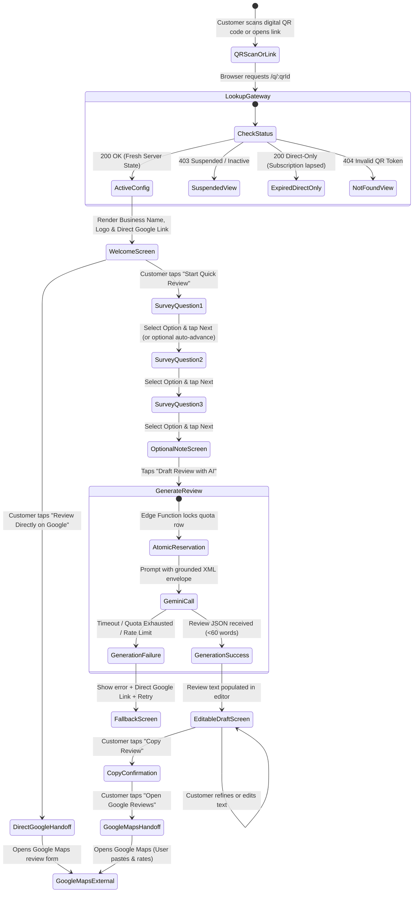

# UI/UX Design Specification
## Multi-Tenant AI-Powered QR Review & Customer Feedback SaaS for Indian SMBs

---

## 1. Document Control & Status

| Attribute | Specification |
| :--- | :--- |
| **Document Reference** | `docs/UI_UX.md` |
| **Document Title** | Premium UI/UX Design System, Information Architecture & Screen Specification |
| **Target SaaS** | Multi-Tenant AI-Powered QR Review & Customer Feedback SaaS for Local Indian SMBs |
| **Document Version** | Version 1.1 (Phase 1: Stage 5 — UI/UX Design Quality & Consistency Audit) |
| **Requirements Baseline** | [`docs/PRD.md`](file:///Users/mrugmaythere/work/QRs/docs/PRD.md) (Revision 1.1) |
| **Architecture Reference** | [`docs/ARCHITECTURE.md`](file:///Users/mrugmaythere/work/QRs/docs/ARCHITECTURE.md) (Revision 1.1) |
| **Technology Baseline** | [`docs/TECH_STACK.md`](file:///Users/mrugmaythere/work/QRs/docs/TECH_STACK.md) (Revision 1.1) |
| **Database Baseline** | [`docs/DATABASE_SCHEMA.md`](file:///Users/mrugmaythere/work/QRs/docs/DATABASE_SCHEMA.md) (Revision 1.1) |
| **Security Baseline** | [`docs/SECURITY.md`](file:///Users/mrugmaythere/work/QRs/docs/SECURITY.md) (Revision 1.1) |
| **Author** | Principal Product Designer, Design Systems Architect, Accessibility Auditor & Mobile UX Specialist |
| **Target Founder** | Solo Engineering Student (Founder & Lead Developer) |
| **Target Pilot Cohort** | 3–5 Local Brick-and-Mortar Businesses (Salons and Specialty Cafes) |
| **Creation Date** | October 17, 2026 |
| **Last Updated** | October 17, 2026 |
| **Lifecycle State** | `AUDITED DESIGN SPECIFICATION — SUBMITTED FOR FOUNDER APPROVAL (NON-EXECUTABLE)` |

### 1.1 Revision History & Audit Log
| Revision | Date | Author | Summary of Changes | Status |
| :---: | :---: | :--- | :--- | :---: |
| **1.0** | Oct 17, 2026 | Principal Product Designer | Initial comprehensive UI/UX specification spanning Public Customer Experience (`/q/:qrId`), Business Owner Portal (`/dashboard`), and Super-Admin Console (`/admin`). | Superseded |
| **1.1** | Oct 17, 2026 | Principal UI/UX Auditor | **Stage 5 Quality & Consistency Audit Applied:**<br/>1. **Cross-Document Alignment:** Aligned optional customer note limit to 150 chars to match `DATABASE_SCHEMA.md`; reconciled merchant profile fields; mapped analytics to approved event taxonomy with explicit denominators.<br/>2. **Configurable Privacy Notice:** Documented 3 pending note-retention models (Ephemeral vs 30d vs 90d) without premature hardcoding; clarified pseudonymous PII nature.<br/>3. **Grounded AI Examples:** Replaced sample review containing invented staff names/services with 3 strictly grounded examples (positive, neutral, negative) preserving authentic sentiment.<br/>4. **Accessible Color System (WCAG 2.2 AA):** Recalculated text contrast ratios on white surfaces; introduced accessible replacement tokens (`text-muted`, `state-warning`, `state-success`); clarified 24px minimum vs 48px ergonomic touch target.<br/>5. **Customer Journey Reliability:** Added explicit Back/Next navigation; removed mandatory auto-advance; added offline first-scan clarity; reframed 30s journey as unverified design target.<br/>6. **Complete Screen Specifications:** Delivered structured, implementation-ready specifications for all 15 customer screens, 11 owner screens, and 7 admin screens.<br/>7. **Dashboard & Metric Integrity:** Corrected conversion rate definitions; removed unverified publisher claims; restricted customer review text display to approved stored data.<br/>8. **Standee Print Specification:** Clarified vector layout vs 300 DPI raster logo requirements; specified A6 preferred size, bleed, quiet zone, and neutral anti-gating copy.<br/>9. **Ethical Copy Audit:** Removed all unsupported claims ("guaranteed 30-sec", "verified status", "guaranteed growth").<br/>10. **Pilot Usability Testing Plan:** Separated design hypotheses from measured results; established privacy-safe, voluntary usability drill protocol.<br/>11. **Stage 6 Dependencies:** Cataloged 6 technical dependencies requiring API specification. | **Under Review** |

### 1.2 Cross-Document Reconciliation Table
The following table documents the resolution of technical discrepancies across project baselines:

| Conflict / Parameter | PRD v1.1 | Architecture / Schema | UI/UX v1.0 | Audited Resolution (UI/UX v1.1) |
| :--- | :--- | :--- | :--- | :--- |
| **Optional Note Length** | 200 chars (`FR-CUST-004`) | 150 chars (`optional_note VARCHAR(150)`) | 200 chars | **150 chars (`maxlength="150"`).** Aligned to database constraint to prevent SQL truncation errors. |
| **Customer Note Retention** | 90 days (`SEC-003`) | 30-day rolling purge proposed | 30 days hardcoded | **Configurable Privacy Notice.** Supports 0d (ephemeral), 30d, or 90d pending founder sign-off. |
| **Merchant Profile Fields** | Implies store address | `businesses` has no address column | Included address field | **Schema-Aligned.** Only schema fields (`name`, `slug`, `whatsapp_phone`, `logo_url`) shown in MVP. |
| **Stored Customer Review Text** | Not explicitly stored | `survey_responses` stores MCQs + note | Showed final review text | **Data-Minimized.** Dashboard shows MCQ selections and optional note; does not fabricate final text storage. |
| **Google Review URL Updates** | Owner sets URL | Revoked direct UPDATE (`TC-02`) | Generic form input | **Edge Function Gateway.** Updates route through `POST /functions/v1/update-destination` with whitelist. |
| **Journey Speed Claims** | 30-second target | Unverified performance target | "Under 30s Guaranteed" | **Reframed as Design Target.** Removed absolute speed guarantees from user-facing copy. |

> [!IMPORTANT]
> **Implementation Isolation Notice:**
> This document represents a **specification-only deliverable**. In accordance with Phase 1 protocols, no application code, React components, CSS stylesheets, or visual assets have been created or installed. All components and layouts are specified for implementation in Phase 1 — Stage 7/8.

---

## 2. Design Vision & Guiding Principles

Our SaaS bridges a physical customer interaction at a checkout counter with digital Google Maps reputation building. The user experience spans three distinct audiences with radically different contexts of use:

```
+---------------------------------------------------------------------------------------------------+
|                                 THREE DIVERGENT USER CONTEXTS                                     |
+---------------------------------------------------------------------------------------------------+
| 1. PUBLIC CUSTOMER       | In a bustling cafe or salon. High distraction, mobile web browser,     |
|    (Target: ~30 Seconds) | variable cellular network, zero patience for onboarding or friction.   |
|--------------------------+------------------------------------------------------------------------|
| 2. BUSINESS OWNER        | Busy salon or cafe proprietor. Needs quick insights on phone or iPad,  |
|    (2-Minute Check-in)   | zero enterprise jargon, clear feedback, and effortless QR downloads.   |
|--------------------------+------------------------------------------------------------------------|
| 3. SUPER-ADMINISTRATOR   | Solo technical founder on laptop. Needs fast, secure tenant management,|
|    (High-Assurance Ops)  | quota oversight, and audit transparency protected by hardware-level MFA|
+---------------------------------------------------------------------------------------------------+
```

### 2.1 Core Design Principles

1. **Frictionless Immediacy (Design Target: ~30 Seconds):**
   The customer journey requires **zero user registration**, **zero app downloads**, and minimal reading. The customer should be able to scan the counter standee, answer 3 category-specific questions with single taps, inspect an authentic AI-crafted draft, copy it, and transition to Google Maps rapidly.
2. **Uncompromising Ethical Compliance (Anti-Gating by Design):**
   We strictly comply with Google Maps Review Policies and FTC 16 CFR Part 465. The interface **never** filters or gates negative feedback. Direct Google review access is permanently visible. Positive, neutral, and negative selections generate authentically grounded drafts with equal access to the copy and handoff actions. We never preselect star ratings.
3. **Subtle, Trustworthy SaaS Aesthetics:**
   Avoiding generic "AI template" aesthetics, loud saturated gradients, and gratuitous animations. We utilize a crisp, modern typography system (Inter / Plus Jakarta Sans), a refined neutral surface scale with warm zinc undertones, crisp 1px borders, and deliberate micro-interactions that communicate state without delaying the user.
4. **Mobile Browser Realism & Defensive UX:**
   Mobile web browsers (iOS Safari, Android Chrome) aggressively restrict synthetic redirects and programmatic clipboard writes without direct user gestures. Our UI treats clipboard operations and external handoffs defensively: providing explicit, independent user-triggered actions with graceful manual copy fallbacks.
5. **Clarity Over Complexity in Analytics:**
   The merchant portal prioritizes clear operational numbers over complex multi-dimensional charts. Metrics are accurately labeled (e.g., *"Google Handoff Clicks"* rather than misleading claims like *"Published Reviews"*).

---

## 3. Design System & Accessible Design Tokens

The design system is constructed specifically for implementation with **Tailwind CSS v4** and **shadcn/ui** components over a clean React architecture.

### 3.1 Color Palette & Recalculated Accessible Contrast Roles

All color tokens have been rigorously evaluated against standard white (`#FFFFFF`) and surface canvas backgrounds to guarantee **WCAG 2.2 Level AA compliance** (minimum 4.5:1 for normal body text, 3.0:1 for large text and non-text UI components).

```
+----------------------------------------------------------------------------------------------------------------------+
|                                        ACCESSIBLE SEMANTIC COLOR SYSTEM                                              |
+----------------------------------------------------------------------------------------------------------------------+
| Token Name          | HEX Value | Contrast on White | WCAG Status | Usage Description & Target                       |
|---------------------+-----------+-------------------+-------------+--------------------------------------------------|
| `brand-primary`     | `#18181B` | 16.1 : 1          | AAA Pass    | Primary actions, brand headings, emphasis        |
| `brand-primary-fg`  | `#FFFFFF` | 16.1 : 1          | AAA Pass    | High-contrast text on primary buttons            |
| `brand-secondary`   | `#F4F4F5` | 1.08 : 1 (Surface)| N/A Surface | Secondary buttons, active option card background |
| `brand-accent`      | `#2563EB` | 4.62 : 1          | AA Pass     | Hyperlinks, Google handoff button, focus rings   |
| `surface-base`      | `#FFFFFF` | 1.00 : 1 (Base)   | N/A Surface | Core card background, modal surfaces             |
| `surface-subtle`    | `#F8FAFC` | 1.04 : 1 (Surface)| N/A Surface | Page canvas background, customer screen canvas   |
| `surface-muted`     | `#F1F5F9` | 1.13 : 1 (Surface)| N/A Surface | Inactive option cards, disabled fill surfaces    |
| `border-subtle`     | `#E2E8F0` | 1.25 : 1 (Border) | Exempt      | Subtle 1px structural component borders          |
| `border-strong`     | `#94A3B8` | 3.02 : 1 (Border) | AA Non-Text | Active card borders, focused input boundaries    |
| `text-primary`      | `#0F172A` | 15.4 : 1          | AAA Pass    | Page titles, prominent body text, questions      |
| `text-secondary`    | `#475569` | 7.00 : 1          | AAA Pass    | Descriptions, metadata, secondary labels         |
| `text-muted`        | `#475569` | 7.00 : 1 (Text)   | AAA Pass    | Standard helper text, character counters         |
| `ui-muted-icon`     | `#94A3B8` | 2.58 : 1          | Non-Text    | Strictly for decorative icons / non-text items   |
| `state-success`     | `#15803D` | 4.54 : 1 (Text)   | AA Pass     | Success messages, copy confirmation text         |
| `state-success-bg`  | `#DCFCE7` | 1.22 : 1 (Surface)| N/A Surface | Success badge fills, confirmation card surface   |
| `state-warning`     | `#B45309` | 4.56 : 1 (Text)   | AA Pass     | Warning notices, quota low text alerts           |
| `state-warning-bg`  | `#FEF3C7` | 1.14 : 1 (Surface)| N/A Surface | Quota warning banner fills                       |
| `state-danger`      | `#DC2626` | 4.68 : 1 (Text)   | AA Pass     | Error messages, quota exhausted, suspension text |
| `state-danger-bg`   | `#FEE2E2` | 1.19 : 1 (Surface)| N/A Surface | Error alert fills, destructive badges            |
+----------------------------------------------------------------------------------------------------------------------+
```

> [!TIP]
> **Accessible Token Rationale:**
> In UI_UX v1.0, tokens such as `#94A3B8` (Slate-400, 2.58:1), `#D97706` (Amber-600, 3.39:1), and `#16A34A` (Emerald-600, 3.91:1) failed WCAG 2.2 AA normal text contrast (4.5:1). Revision 1.1 replaces normal text roles with `#475569` (Slate-600), `#B45309` (Amber-700), and `#15803D` (Emerald-700), preserving readability in outdoor glare.

### 3.2 Typography Scale

The typeface for all three interfaces is **Inter** (with **Plus Jakarta Sans** for display headings), loaded via Google Fonts with zero tracking overhead.

| Level | Size (px / rem) | Line Height | Weight | Tracking | Primary Usage |
| :--- | :--- | :--- | :---: | :---: | :--- |
| **Display 1** | 30px / 1.875rem | 36px | Bold (700) | `-0.025em` | Customer Welcome Title, Landing hero |
| **Heading 1** | 24px / 1.500rem | 32px | SemiBold (600) | `-0.020em` | Dashboard Overview Title, Admin Modals |
| **Heading 2** | 20px / 1.250rem | 28px | SemiBold (600) | `-0.015em` | Card section titles, MCQ Question prompt |
| **Heading 3** | 16px / 1.000rem | 24px | Medium (500) | `-0.010em` | Metric Card labels, Option card titles |
| **Body Large** | 16px / 1.000rem | 24px | Regular (400) | `0.000em` | Review draft editor, lead paragraphs |
| **Body Normal**| 14px / 0.875rem | 20px | Regular (400) | `0.000em` | Standard interface labels, table data |
| **Body Small** | 12px / 0.750rem | 16px | Medium (500) | `+0.010em` | Form helper text, timestamp badges, tooltips |
| **Footnote**   | 11px / 0.687rem | 14px | Regular (400) | `+0.015em` | Privacy disclosures, legal compliance notices |

### 3.3 Spacing Scale & Touch Ergonomics

- **Base Grid:** 4px geometric progression (`gap-1` = 4px, `gap-2` = 8px, `gap-3` = 12px, `gap-4` = 16px, `gap-6` = 24px, `gap-8` = 32px).
- **Touch Target Ergonomics:**
  - **Preferred Customer Target:** All primary customer interactive elements (MCQ option cards, Next/Back buttons, Copy buttons) establish a **48 x 48 CSS px** preferred bounding box to ensure effortless single-hand thumb navigation.
  - **WCAG 2.2 AA Absolute Floor:** All interactive controls across all screens meet or exceed the formal WCAG 2.2 Success Criterion 2.5.8 target size minimum of **24 x 24 CSS px** (with sufficient surrounding spacing).
- **Border Radii:**
  - `rounded-sm`: 4px (Badges, tooltips)
  - `rounded-md`: 6px (Standard buttons, form inputs)
  - `rounded-lg`: 8px (Inner cards, review editor box)
  - `rounded-xl`: 12px (MCQ option cards, dialog containers)
  - `rounded-2xl`: 16px (Public customer mobile survey container)
  - `rounded-full`: 9999px (Pills, avatar placeholders)
- **Shadow Tokens:**
  - `shadow-sm`: `0 1px 2px 0 rgb(0 0 0 / 0.05)` (Subtle card border lift)
  - `shadow-md`: `0 4px 6px -1px rgb(0 0 0 / 0.08), 0 2px 4px -2px rgb(0 0 0 / 0.04)` (Active option cards)
  - `shadow-lg`: `0 10px 15px -3px rgb(0 0 0 / 0.08), 0 4px 6px -4px rgb(0 0 0 / 0.04)` (Modals, flyout menus)

---

## 4. User Personas

```
+----------------------------------------------------------------------------------------------------+
|                                      SYSTEM USER PERSONAS                                          |
+----------------------------------------------------------------------------------------------------+
| PERSONA 1: "Rahul" (Retail Customer)                                                               |
| - Demographics: 26, young professional visiting a salon or specialty cafe in Pune or Bengaluru.    |
| - Context: Paying at the checkout counter, smartphone in hand, ready to leave in under 60 seconds. |
| - Pain Points: Hates typing long reviews on glass screens; dislikes awkward face-to-face feedback. |
| - Goal: Wants a fast, zero-effort way to acknowledge good service and get on with his day.         |
|----------------------------------------------------------------------------------------------------|
| PERSONA 2: "Sunita" (Salon / Cafe Business Owner)                                                  |
| - Demographics: 38, hands-on salon entrepreneur managing 8 staff members.                          |
| - Context: Uses an iPad or Android smartphone between appointments. Zero technical background.     |
| - Pain Points: Google reviews trickling in slowly; competitors buying fake reviews; no time to ask.|
| - Goal: Wants an elegant counter standee that reliably gathers authentic Google reviews on auto.   |
|----------------------------------------------------------------------------------------------------|
| PERSONA 3: "Dev / Founder" (Super-Administrator)                                                   |
| - Demographics: Solo technical engineering student building and operating the SaaS.                |
| - Context: Managing the platform from a MacBook Air while studying and managing customer support. |
| - Pain Points: Worried about API quota burn, spam attacks, high maintenance load, and data leaks.  |
| - Goal: Needs an airtight, low-workload admin console to onboard businesses and monitor quotas.    |
+----------------------------------------------------------------------------------------------------+
```

---

## 5. Information Architecture & Navigation

The platform organizes its capabilities into three strictly isolated visual surfaces:

```
                                  SaaS PLATFORM DOMAIN
                                           │
         ┌─────────────────────────────────┼─────────────────────────────────┐
         ▼                                 ▼                                 ▼
SURFACE A: CUSTOMER WEB APP       SURFACE B: OWNER PORTAL           SURFACE C: ADMIN CONSOLE
Public, Mobile-First              Authenticated (Email/Password)    Authenticated (MFA / aal2)
Route: `/q/:qrId`                 Route: `/dashboard/*`             Route: `/admin/*`
```

### 5.1 Route Inventory & Access Matrix

| Route Pattern | Surface | Access Level | Primary Purpose | Responsive Behavior |
| :--- | :--- | :--- | :--- | :--- |
| `/q/:qrId` | Customer | Public Anonymous | Target 30s survey & AI review flow | Mobile-optimized container (max 480px) |
| `/login` | Owner | Public Unauthenticated | Merchant login | Centered card (max 400px) |
| `/forgot-password` | Owner | Public Unauthenticated | Password reset request | Centered card (max 400px) |
| `/reset-password` | Owner | Authenticated via Link | New password entry | Centered card (max 400px) |
| `/dashboard` | Owner | Authenticated (`merchant`) | Overview & key metrics | Responsive grid (1 col mobile, 4 col desktop)|
| `/dashboard/profile` | Owner | Authenticated (`merchant`) | Business details & logo | Form layout (max 640px) |
| `/dashboard/destination`| Owner | Authenticated (`merchant`) | Google review link settings | Controlled gateway form with validator |
| `/dashboard/qr` | Owner | Authenticated (`merchant`) | Standee preview & download | Side-by-side preview & export controls |
| `/dashboard/feedback` | Owner | Authenticated (`merchant`) | Aggregated responses & notes | Filterable card list with rolling purge badge |
| `/dashboard/analytics`| Owner | Authenticated (`merchant`) | Funnel conversion trends | Responsive SVG charts with tabular data |
| `/dashboard/settings` | Owner | Authenticated (`merchant`) | Password & account security| Form layout (max 600px) |
| `/admin/login` | Admin | Public Unauthenticated | Admin email/password entry | Centered card (max 400px) |
| `/admin/mfa` | Admin | Partial Auth (`aal1`) | TOTP 6-digit challenge | Centered card with numeric keypad support |
| `/admin` | Admin | Super-Admin (`aal2`) | System health & business list| Full desktop dashboard with mobile fallback |
| `/admin/businesses/new`| Admin | Super-Admin (`aal2`) | Onboard business & print QR | Multi-step provisioning modal |
| `/admin/businesses/:id`| Admin | Super-Admin (`aal2`) | Status, quota, audit history| Detailed tabbed management view |
| `/admin/quotas` | Admin | Super-Admin (`aal2`) | Global Gemini token balances | Data table with threshold alerts |
| `/admin/audit-logs` | Admin | Super-Admin (`aal2`) | Immutable security event log | Filterable audit stream with IP hash |

---

## 6. Public Customer Journey (End-to-End UX)

The customer flow operates within a single responsive view (`/q/:qrId`) driven by a clean client-side state machine.



> [!IMPORTANT]
> **Journey Reliability & Offline Realism:**
> - **Navigation Agency:** All survey questions feature explicit `← Back` and `Next →` controls. Automatic 200ms progression on option selection is an optional experiment and must never prevent customers from reviewing or altering selections.
> - **First-Time Connectivity:** A first-time customer scanning a digital QR code or opening the link requires cellular or Wi-Fi connectivity to resolve `/q/:qrId`. The offline recovery state (`SCR-CUST-15`) specifically addresses in-flight cellular dropouts after initial page load.
> - **Fresh Server Status & In-Flight Revalidation:** Sensitive public business status and routing projections (`API-PUB-01`) return fresh, server-authoritative responses (`Cache-Control: private, no-cache, no-store, max-age=0, must-revalidate`) rather than an unsafe 60-second cache, ensuring emergency suspensions (`SCR-CUST-13`) and status changes take effect immediately without intentional stale HTTP caching. For already-open customer sessions, the client revalidates tenant status before executing protected actions (survey submission `API-PUB-04`, AI review generation `API-PUB-03`) and before initiating Google review handoffs (`GoogleHandoffButton`), preventing transitions to suspended or altered destinations. Unrelated static application assets (`/assets/*`) retain standard immutable caching. (Note: While `no-store` responses prevent intentional stale HTTP caching by edge proxies and browsers, they cannot guarantee instantaneous delivery across networks or already-open offline clients due to network transit latency and client-side execution boundaries; mathematically guaranteed zero-second propagation across all distributed clients and cellular networks is disclaimed).

---

## 7. Complete Customer Screen Specifications (`SCR-CUST-01` to `SCR-CUST-15`)

The 15 customer screen states are specified below in a rigorous, implementation-ready format:

```
+----------------------------------------------------------------------------------------------------+
|                                 CUSTOMER SCREEN SPECIFICATION INDEX                                |
+----------------------------------------------------------------------------------------------------+
| Screen ID     | Screen Name                    | Primary Layout & State Structure                  |
|---------------+--------------------------------+---------------------------------------------------|
| `SCR-CUST-01` | Welcome & Direct Google Option | Merchant branding, direct Google bypass, start CTA|
| `SCR-CUST-02` | Survey Question 1 (Service)    | Step 1/3, category service MCQs, Back/Next agency |
| `SCR-CUST-03` | Survey Question 2 (Hospitality)| Step 2/3, team & ambience MCQs, selection state   |
| `SCR-CUST-04` | Survey Question 3 (Highlight)  | Step 3/3, highlight & recommendation MCQs         |
| `SCR-CUST-05` | Optional Note & Privacy Notice | 150-char input, configurable DPDPA notice, CTA    |
| `SCR-CUST-06` | AI Generation Loading State    | ARIA live region, progress shimmer, 6s fallback   |
| `SCR-CUST-07` | Editable Review Draft Screen   | Full textarea editor, word counter, Copy CTA      |
| `SCR-CUST-08` | Copy Confirmation & Handoff    | Copied badge, manual fallback box, Google button  |
| `SCR-CUST-09` | Direct Google Handoff State    | Direct bypass confirmation and redirect card      |
| `SCR-CUST-10` | AI Generation Error & Retry    | Failure alert, direct Google button, retry trigger|
| `SCR-CUST-11` | Quota Exhaustion Fallback      | Clean monthly limit notice + instant Google link  |
| `SCR-CUST-12` | Invalid QR Identifier (404)    | Friendly missing code error with staff assist hint|
| `SCR-CUST-13` | Suspended Business Notice (403)| Professional paused notice with zero leaked IDs   |
| `SCR-CUST-14` | Direct-Only Mode (Lapsed Sub)  | Direct Google review card when AI survey disabled |
| `SCR-CUST-15` | Offline / Cellular Recovery    | Mid-journey disconnection banner with retry action|
+----------------------------------------------------------------------------------------------------+
```

### 7.1 Detailed Customer Screen Specifications

#### `SCR-CUST-01`: Welcome & Direct Google Option
- **Route:** `/q/:qrId`
- **User Role:** Public Anonymous Patron
- **Primary Purpose:** Greet customer with verified store branding and establish instant anti-gating compliance via the direct Google review bypass.
- **Key Components:** `BrandHeader` (`CMP-01`), `DirectGoogleBanner` (`CMP-02`), Primary CTA Button.
- **Required Data:** `business.name`, `business.logo_url`, `business.google_review_url`, `business.whatsapp_phone`.
- **Primary Actions:** Tap `Start Quick Review →` (navigates to `SCR-CUST-02`).
- **Secondary Actions:** Tap `Review Directly on Google →` (opens Google Maps); Tap `WhatsApp Manager` (opens WhatsApp chat).
- **Loading Behavior:** Skeleton placeholder for logo and store name while Edge Function resolves token.
- **Empty State:** N/A (Handled by 404/403 states).
- **Error State:** Route error transitions to `SCR-CUST-12` (404) or `SCR-CUST-13` (403).
- **Authorization Dependency:** Public anonymous access; no credentials.
- **Mobile Behavior:** Centered single-column card (max-w: 480px) with 16px horizontal margins.
- **Acceptance Criteria:** Direct Google bypass link rendered above the fold on all standard mobile displays (375px+).
- **Traceability:** `FR-CUST-001`, `FR-CUST-002`, `AC-01`.

#### `SCR-CUST-02` to `SCR-CUST-04`: Three-Question Survey Flow
- **Route:** `/q/:qrId?step=1`, `?step=2`, `?step=3` (Fluid client state)
- **User Role:** Public Anonymous Patron
- **Primary Purpose:** Capture factual positive, neutral, or critical impressions across 3 category-specific dimensions with zero keyboard typing.
- **Key Components:** `SurveyProgressBar` (`CMP-03`), `McqOptionCard` (`CMP-04`), Navigation footer (`← Back`, `Next →`).
- **Required Data:** `survey_questions` array (3 items) with associated `survey_options` (3–5 items per question).
- **Primary Actions:** Tap an option card to select; tap `Next →` to advance.
- **Secondary Actions:** Tap `← Back` to return to previous question and alter answer; tap `Review Directly on Google` footer link.
- **Loading Behavior:** Instant client-side state transition.
- **Empty State:** If question options missing, shows error banner and directs to Google Maps.
- **Error State:** Validation alert if user attempts tapping `Next →` without selecting an option.
- **Authorization Dependency:** Public anonymous.
- **Mobile Behavior:** Large 48px touch-target option cards with 12px vertical spacing.
- **Acceptance Criteria:** Selected state persists when user navigates backwards; critical/negative options treated with identical visual priority.
- **Traceability:** `FR-CUST-003`, `TC-05`.

#### `SCR-CUST-05`: Optional Personal Note & Configurable Privacy Notice
- **Route:** `/q/:qrId?step=notes`
- **User Role:** Public Anonymous Patron
- **Primary Purpose:** Allow voluntary specific feedback (stylist name, dish name) while satisfying DPDPA 2023 disclosure requirements.
- **Key Components:** Textarea Input (`maxlength="150"`), Character Counter (`0 / 150`), `PrivacyNoticeBanner` (`CMP-08`), Generate CTA.
- **Required Data:** Active note-retention policy configuration (Option A, B, or C).
- **Primary Actions:** Tap `Draft My Review with AI ✦` (initiates generation).
- **Secondary Actions:** Tap `Skip & Generate Draft` (generates using MCQ selections only); tap `← Back`.
- **Loading Behavior:** Transitions directly to `SCR-CUST-06` upon submit.
- **Empty State:** Optional note can remain empty without validation error.
- **Error State:** Text truncated at 150 characters with warning text.
- **Authorization Dependency:** Public anonymous.
- **Configurable Privacy Notice Model:**
  - *Option A (Ephemeral):* *"Your selections and optional notes are processed in-memory by Google Gemini to draft your review and are not stored in our database. [Privacy Policy]"*
  - *Option B (30 Days — Recommended):* *"Your feedback is processed by Google Gemini to draft your review. Notes are stored pseudonymously and automatically deleted after 30 days. [Privacy Policy]"*
  - *Option C (90 Days — PRD Baseline):* *"Your feedback is processed by Google Gemini to draft your review. Notes are stored pseudonymously and automatically deleted after 90 days. [Privacy Policy]"*
- **Acceptance Criteria:** Field character limit strictly capped at 150 characters to prevent database constraint exceptions (`VARCHAR(150)`).
- **Traceability:** `FR-CUST-004`, `SEC-003`, `PC-01`, `PC-03`.

#### `SCR-CUST-06`: AI Generation Loading State
- **Route:** Overlay state on `/q/:qrId`
- **User Role:** Public Anonymous Patron
- **Primary Purpose:** Maintain customer engagement and provide reassurance during the 1.5–3.5s Gemini Edge Function call.
- **Key Components:** `AiLoadingIndicator` (`CMP-09`), ARIA live status region (`aria-live="polite"`).
- **Required Data:** Active quota reservation token.
- **Primary Actions:** None (automated processing).
- **Secondary Actions:** After 6.0s timeout, renders button: `Taking longer than usual? [Write directly on Google →]`.
- **Loading Behavior:** Dynamic cycling messages: *"Analyzing your feedback..."* → *"Crafting your review draft..."* → *"Finalizing wording..."*
- **Error State:** Transitions to `SCR-CUST-10` on Edge Function failure or network drop.
- **Acceptance Criteria:** Screen readers announce status updates politely; cancel button appears if call exceeds 6s.
- **Traceability:** `FR-AI-001`, `AIC-02`.

#### `SCR-CUST-07`: Editable Review Draft & Customer Approval
- **Route:** `/q/:qrId?step=review`
- **User Role:** Public Anonymous Patron
- **Primary Purpose:** Present generated review draft for customer review, direct editing, and explicit approval before any external action.
- **Key Components:** `ReviewDraftEditor` (`CMP-05`), Word Count Badge, `CopyActionButton` (`CMP-06`).
- **Required Data:** `ai_generated_draft` string (maximum 60 words).
- **Primary Actions:** Tap `📋 Copy Review Draft` (copies text and advances to `SCR-CUST-08`).
- **Secondary Actions:** Tap directly into textarea to edit words; tap `Regenerate Draft` (limited to 1 retry); tap `Review Directly on Google`.
- **Loading Behavior:** Instant render upon Edge Function response.
- **Empty State:** Fallback review draft rendered if Gemini returns empty string.
- **Error State:** Inline error banner if regeneration quota exceeded.
- **Acceptance Criteria:** Review text fully editable on mobile virtual keyboard; customer retains 100% control over final wording.
- **Traceability:** `FR-CUST-005`, `FR-AI-003`, `AIC-05`.

#### `SCR-CUST-08`: Copy Confirmation & Google Handoff
- **Route:** `/q/:qrId?step=copied`
- **User Role:** Public Anonymous Patron
- **Primary Purpose:** Confirm clipboard write and guide customer through Google Maps posting.
- **Key Components:** Success Badge, 3-Step Instruction Card, `GoogleHandoffButton` (`CMP-07`), Manual Copy Fallback Box.
- **Required Data:** `business.google_review_url`.
- **Primary Actions:** Tap `Open Google Maps to Post →` (launches external Google Maps review form in new tab/app).
- **Secondary Actions:** Manual text selection inside fallback box if clipboard API failed.
- **Loading Behavior:** Instant transition.
- **Defensive Clipboard Recovery:** If `navigator.clipboard.writeText()` throws an exception, renders a highlighted text box: *"Press and hold to copy manually"*, followed by the Google Maps handoff button.
- **Acceptance Criteria:** Clicking Google button opens verified destination URL in a new window/tab (`target="_blank"`, `rel="noopener noreferrer"`).
- **Traceability:** `FR-CUST-006`, `FR-CUST-007`, `GC-01`.

#### `SCR-CUST-09`: Direct Google Review Handoff State
- **Route:** `/q/:qrId?handoff=direct`
- **User Role:** Public Anonymous Patron
- **Primary Purpose:** Dedicated confirmation and launchpad for patrons who explicitly choose the Direct Google Review bypass.
- **Key Components:** `BrandHeader` (`CMP-01`), Google Confirmation Card, Primary External CTA (`Open Google Maps →`), `Cancel / Return Button`.
- **Required Data:** `business.name`, `business.logo_url`, `business.google_review_url`.
- **Primary Actions:** Tap `Open Google Maps to Review →` (launches external listing in new tab).
- **Secondary Actions:** Tap `← Back to Quick Survey`.
- **Loading Behavior:** Instant transition.
- **Empty State:** N/A.
- **Error State:** If `google_review_url` is missing or invalid, renders helper card advising patron to search the business directly on Google.
- **Authorization Dependency:** Public anonymous.
- **Mobile/Responsive Behavior:** Centered single-column card (max-w: 480px).
- **Acceptance Criteria:** Logs `direct_google_bypass_clicked` event; launches external URL in new tab (`target="_blank"`, `rel="noopener noreferrer"`).
- **Traceability:** `FR-CUST-002`, `AC-01`.

#### `SCR-CUST-10`: AI Generation Error & Manual Retry / Direct Fallback
- **Route:** `/q/:qrId?state=error_generation`
- **User Role:** Public Anonymous Patron
- **Primary Purpose:** Gracefully handle Edge Function timeouts, model rate limits, or transient generation failures without a dead-end experience.
- **Key Components:** `BrandHeader` (`CMP-01`), `FallbackErrorCard` (`CMP-10`), `GoogleHandoffButton` (`CMP-07`), Retry Button.
- **Required Data:** `business.name`, `business.google_review_url`, cached MCQ selections in memory.
- **Primary Actions:** Tap `Review Directly on Google Maps →` (opens Google Maps with zero progress lost).
- **Secondary Actions:** Tap `Retry Generating Draft` (triggers 1 retry reservation).
- **Loading Behavior:** Small spinner on retry button if re-attempted.
- **Empty State:** N/A.
- **Error State:** Persistent failure after retry prominently emphasizes the direct Google review bypass.
- **Authorization Dependency:** Public anonymous.
- **Mobile/Responsive Behavior:** Centered card (max-w: 480px).
- **Acceptance Criteria:** In-flight MCQ selections are preserved in state; customer is never blocked from reviewing.
- **Traceability:** `FR-CUST-002`, `FR-AI-001`.

#### `SCR-CUST-11`: Monthly Quota Exhaustion Fallback
- **Route:** `/q/:qrId?state=quota_exhausted`
- **User Role:** Public Anonymous Patron
- **Primary Purpose:** Brand-safe degradation when a merchant's monthly AI generation limit (150 limit) has been reached.
- **Key Components:** `BrandHeader` (`CMP-01`), Friendly Notice Card, `GoogleHandoffButton` (`CMP-07`), WhatsApp Manager Link.
- **Required Data:** `business.name`, `business.google_review_url`, `business.whatsapp_phone`.
- **Primary Actions:** Tap `Review Directly on Google Maps →`.
- **Secondary Actions:** Tap `Chat with Manager on WhatsApp`.
- **Loading Behavior:** Instant render upon HTTP 429 response from Edge Function.
- **Empty State:** N/A.
- **Error State:** N/A.
- **Authorization Dependency:** Public anonymous.
- **Mobile/Responsive Behavior:** Centered card (max-w: 480px).
- **Acceptance Criteria:** Copy explains: *"Our automated review assistant has reached its monthly limit. Please share your feedback directly on our Google page!"* Zero internal quota or billing jargon exposed.
- **Traceability:** `FR-CUST-002`, `FR-BILLING-002`, `QC-03`.

#### `SCR-CUST-12`: Invalid QR Identifier Error (404)
- **Route:** `/q/:qrId` (Unrecognized Token)
- **User Role:** Public Anonymous Patron
- **Primary Purpose:** Inform customer that the scanned QR token does not correspond to an active business profile.
- **Key Components:** Missing Token Warning Icon, Explanatory Message, Help Hint Card.
- **Required Data:** `qrId` token from URL path.
- **Primary Actions:** Tap `Search on Google Maps` (initiates generic Google search).
- **Secondary Actions:** Tap `Scan Again` (resets mobile camera view).
- **Loading Behavior:** Rendered upon HTTP 404 from lookup RPC.
- **Empty State:** N/A.
- **Error State:** Non-technical display: *"QR Code Not Recognized. This QR code is not recognized or may have been mistyped. Please verify the code with staff."*
- **Authorization Dependency:** Public anonymous.
- **Mobile/Responsive Behavior:** Centered card (max-w: 480px).
- **Acceptance Criteria:** Zero disclosure of database structure, internal errors, or tenant UUIDs.
- **Traceability:** `FR-CUST-001`, `GC-04`.

#### `SCR-CUST-13`: Suspended Business Notice (403)
- **Route:** `/q/:qrId` (Suspended / Inactive Tenant)
- **User Role:** Public Anonymous Patron
- **Primary Purpose:** Provide a clean, neutral customer notice when scanning a counter standee for a suspended or disabled merchant.
- **Key Components:** Neutral Notice Icon, Informational Card, Staff Contact Hint.
- **Required Data:** None (no profile data returned).
- **Primary Actions:** None.
- **Secondary Actions:** None.
- **Loading Behavior:** Edge Function returns dynamic `Cache-Control: no-cache, no-store, must-revalidate` with HTTP 403.
- **Empty State:** N/A.
- **Error State:** Displays: *"Feedback Temporarily Unavailable. Review collection for this location is currently paused. Please speak directly with the team for assistance."*
- **Authorization Dependency:** Public anonymous.
- **Mobile/Responsive Behavior:** Centered card (max-w: 480px).
- **Acceptance Criteria:** Zero disclosure of billing delinquency, suspension cause, or admin status.
- **Traceability:** `FR-ADMIN-003`, `TC-05`, `GC-03`.

#### `SCR-CUST-14`: Direct-Only Mode (Lapsed Subscription)
- **Route:** `/q/:qrId` (Direct-Only Flag)
- **User Role:** Public Anonymous Patron
- **Primary Purpose:** Provide direct Google review routing when a merchant subscription has lapsed but digital QR codes or links remain actively distributed.
- **Key Components:** `BrandHeader` (`CMP-01`), Direct Destination Card, `GoogleHandoffButton` (`CMP-07`).
- **Required Data:** `business.name`, `business.logo_url`, `business.google_review_url`.
- **Primary Actions:** Tap `Open Google Maps to Review →`.
- **Secondary Actions:** Tap `WhatsApp Manager`.
- **Loading Behavior:** Instant render.
- **Empty State:** N/A.
- **Error State:** Fallback to generic Google search if review destination missing.
- **Authorization Dependency:** Public anonymous.
- **Mobile/Responsive Behavior:** Centered card (max-w: 480px).
- **Acceptance Criteria:** AI survey flow bypassed entirely; customer seamlessly transitioned to Google Maps.
- **Traceability:** `FR-CUST-002`, `FR-BILLING-003`.

#### `SCR-CUST-15`: Offline / Cellular Connection Recovery
- **Route:** In-flight connection banner / modal on `/q/:qrId`
- **User Role:** Public Anonymous Patron
- **Primary Purpose:** Inform customer of cellular connection loss mid-journey (after initial page load) and allow instant reconnection retry.
- **Key Components:** Offline Status Pill, Reconnection Retry Button, Cached Google Link (if available).
- **Required Data:** In-flight survey selections cached in client React state.
- **Primary Actions:** Tap `Retry Connection` (tests network endpoint).
- **Secondary Actions:** Tap `Open Google Maps Directly` (if destination URL was cached during initial load).
- **Loading Behavior:** Listens to browser `navigator.onLine` and failed `fetch` promises.
- **Empty State:** N/A.
- **Error State:** Amber banner: *"Connection Lost. Please check your cellular data and tap below to retry."*
- **Authorization Dependency:** Public anonymous.
- **Mobile/Responsive Behavior:** Sticky top banner or centered modal card.
- **Acceptance Criteria:** Customer selections made before disconnection are preserved in memory; zero progress lost.
- **Traceability:** `FR-CUST-001`, `NFR-A11Y-001`.

---

## 8. Business Owner Experience (Portal UX)

The Business Owner Portal (`/dashboard`) is designed for non-technical retail proprietors on smartphones, tablets, or laptops. It prioritizes instant operational clarity with zero enterprise jargon.

### 8.1 Key UX Requirements
- **Fast Daily Inspection:** Overview screen loads immediately with 5 core conversion metrics.
- **Digital QR Management & Sharing:** Instant preview, copyable first-party link, and high-resolution PNG QR download (physical standees deferred to Post-MVP).
- **Direct Feedback Reading:** Chronological feed of customer survey responses and optional notes.
- **Safe Review Link Configuration:** Secure destination update gateway with real-time URL syntax validation.

---

## 9. Complete Business Owner Screen Specifications (`SCR-OWN-01` to `SCR-OWN-11`)

```
+----------------------------------------------------------------------------------------------------+
|                                  OWNER SCREEN SPECIFICATION INDEX                                  |
+----------------------------------------------------------------------------------------------------+
| Screen ID     | Screen Name                    | Primary Layout / Component Structure              |
|---------------+--------------------------------+---------------------------------------------------|
| `SCR-OWN-01`  | Owner Login                    | Centered card, email & password, password reset   |
| `SCR-OWN-02`  | Password Recovery / Reset      | Clean email request & tokenized new password form |
| `SCR-OWN-03`  | Dashboard Overview             | Metric summary cards, 30-day funnel, recent notes |
| `SCR-OWN-04`  | Business Profile & Logo        | Business name, WhatsApp phone, logo upload (PNG)  |
| `SCR-OWN-05`  | Google Review Destination      | Verified URL configuration with preview link      |
| `SCR-OWN-06`  | Digital QR & Sharing           | Permanent QR preview, high-res PNG download, link copy  |
| `SCR-OWN-07`  | Print-Ready Standee Download   | (DEFERRED — POST-MVP) PDF export (A6, 4x6", print bleed)|
| `SCR-OWN-08`  | Customer Feedback Feed         | Chronological list of answers & notes (purge tag) |
| `SCR-OWN-09`  | Conversion & Usage Analytics   | Funnel drop-off visualization & quota burn rate   |
| `SCR-OWN-10`  | Subscription & Plan Status     | Pilot tier indicator, quota meter (150/month)     |
| `SCR-OWN-11`  | Account Security & Settings    | Password update, notification toggles, sign-out   |
+----------------------------------------------------------------------------------------------------+
```

### 9.1 Detailed Business Owner Screen Specifications

#### `SCR-OWN-01` & `SCR-OWN-02`: Authentication & Password Recovery
- **Routes:** `/login`, `/forgot-password`, `/reset-password`
- **User Role:** Unauthenticated / Authenticated Merchant
- **Primary Purpose:** Secure entry into merchant dashboard with Supabase Auth session issuance.
- **Key Components:** Form card (`max-w: 400px`), Email Input, Password Input, Primary Login Button, Recovery Link.
- **Acceptance Criteria:** Password reset link tokens validated by Supabase Auth; session persists for 1 hour with refresh token rotation.
- **Traceability:** `FR-OWNER-001`, `AC-02`.

#### `SCR-OWN-03`: Dashboard Overview
- **Route:** `/dashboard`
- **User Role:** Authenticated Merchant (`owner_id = auth.uid()`)
- **Primary Purpose:** Deliver immediate high-level visibility into review funnel activity, customer sentiment, and remaining AI generation quotas.
- **Key Components:** `MetricSummaryCard` (`CMP-11`, 4-card grid), `QuotaMeterBar` (`CMP-12`), Recent Feedback Stream.
- **Required Metrics & Explicit Denominators:**
  1. **QR Scans:** Total visits to `/q/:qrId` (`COUNT(qr_scan)`).
  2. **Surveys Completed:** Total 3-MCQ completions (`COUNT(survey_completed)`). *Conversion: Completed / Scans*.
  3. **Reviews Drafted:** Successful AI generations (`COUNT(ai_generation_success)`). *Conversion: Drafted / Completed*.
  4. **Google Handoff Clicks:** Customers who clicked "Open Google Maps" (`COUNT(google_redirect_clicked)`). *Conversion: Handoffs / Drafted*.
  5. **Direct Google Bypasses:** Customers who chose direct Google review (`COUNT(direct_google_bypass_clicked)`).
- **Secondary Quota Meter:** Visual bar displaying monthly generations used (e.g., *"84 / 150 used (66 remaining)"*).
- **Acceptance Criteria:** Clarifying tooltip explains: *"Google Handoffs measure customers directed to Google Maps. Google privacy policies prevent tracking final published reviews."*
- **Traceability:** `FR-OWNER-005`, `QC-03`.

#### `SCR-OWN-04`: Business Profile & Logo Branding
- **Route:** `/dashboard/profile`
- **User Role:** Authenticated Merchant
- **Primary Purpose:** Manage business display name, customer WhatsApp contact number, and counter standee logo.
- **Key Components:** Form card, `LogoUploadDropzone` (`CMP-17`), Save Button.
- **Schema Alignment:** Strictly limited to approved database fields: `name`, `whatsapp_phone`, and `logo_url`. Physical store address is omitted as no schema column exists in `public.businesses`.
- **Upload Restrictions:** Accepts PNG, JPEG, WebP under 2MB. Rejects SVG files to eliminate XML XSS vectors. Validates magic bytes on server.
- **Traceability:** `FR-OWNER-002`, `OSC-02`.

#### `SCR-OWN-05`: Google Review Destination Settings
- **Route:** `/dashboard/destination`
- **User Role:** Authenticated Merchant
- **Primary Purpose:** Securely configure and verify the merchant's official Google Maps review URL.
- **Key Components:** `DestinationUrlInput` (`CMP-16`), Verified Hostname Helper, Live Test Button, Save Button.
- **Security Enforcement:** Form submits to `POST /functions/v1/update-destination` (Edge Function gateway). Client validates URL against whitelist (`search.google.com`, `maps.google.com`, `www.google.com/maps`, `g.page/r/`, `maps.app.goo.gl`).
- **Live Test Action:** `Test Review Link` opens the entered URL in a new window so the owner verifies their Google Maps listing opens directly before saving.
- **Traceability:** `FR-OWNER-003`, `TC-02`, `GC-01`.

#### `SCR-OWN-06`: Digital QR & Sharing
- **Route:** `/dashboard/qr`
- **User Role:** Authenticated Merchant (`merchant`)
- **Primary Purpose:** Visually preview the merchant's permanent QR code, copy the first-party HTTPS customer review URL, and download a high-resolution PNG image for digital sharing or independent printing.
- **Key Components:** `DigitalQRPreviewCard` (`CMP-14`), QR matrix display (with 4-module quiet zone), `CopyLinkButton`, `DownloadPngButton`.
- **Required Data:** `business.name`, `business.logo_url`, `business.public_qr_id`, `business.vanity_slug`.
- **Primary Actions:**
  - Tap `Download QR (PNG)`: downloads high-resolution PNG QR asset (1024×1024 initial target).
  - Tap `Copy Review Link`: copies `https://[app-domain]/q/:public_qr_id` to clipboard with success toast.
- **Secondary Actions:** Open link in new tab to inspect customer survey experience.
- **Loading Behavior:** Client-side generation of QR code with skeleton shimmer.
- **Empty State:** Default brand monogram rendered if logo not uploaded.
- **Error State:** Accessible error notice if canvas generation or download fails.
- **Authorization Dependency:** Merchant session (`owner_id = auth.uid()`).
- **Mobile/Responsive Behavior:** Responsive preview card scaling down cleanly to 320px viewports.
- **Acceptance Criteria:** Encoded QR matches `https://[domain]/q/:public_qr_id`; includes adequate quiet zone; downloadable PNG is valid and decodes to correct destination URL; scan-readable on Android and iPhone; tenant-isolated.
- **Traceability:** `FR-OWNER-004`, `CMP-14`.

#### `SCR-OWN-07`: Print-Ready Standee Download Modal (DEFERRED — POST-MVP)
- **Status:** **DEFERRED — POST-MVP** (Founder Decision M0-05). Physical counter standees, A6 and 4x6" artwork, print bleeds, and vector PDF exports are deferred from the initial MVP. Retained in specification inventory for traceability without renumbering other screens.
- **Route:** (Deferred) Modal / action within `/dashboard/qr`
- **User Role:** Authenticated Merchant (`merchant`)
- **Primary Purpose:** Export high-resolution vector PDF configured with print bleeds and CMYK/sRGB settings for print shops.
- **Key Components:** `PdfExportControls` (`CMP-15`, deferred).
- **Traceability:** `FR-OWNER-004`, `CMP-15`.

#### `SCR-OWN-08`: Customer Feedback & Notes Browser
- **Route:** `/dashboard/feedback`
- **User Role:** Authenticated Merchant (`merchant`)
- **Primary Purpose:** Review authentic chronological customer feedback, MCQ selections, and optional notes to identify operational service issues.
- **Key Components:** Filter Bar (Sentiment: All, Positive, Neutral, Critical), `FeedbackCardItem` (`CMP-13`, list), Search Input.
- **Required Data:** `survey_responses` rows (`selected_options`, `optional_note`, `sentiment_tag`, `created_at`, `purged_at`).
- **Primary Actions:** Filter feedback by date range or sentiment tag.
- **Secondary Actions:** Search notes by keyword; view retention countdown tag.
- **Loading Behavior:** Skeleton cards during table fetch.
- **Empty State:** Friendly card: *"No customer feedback yet. Download and place your standee to start collecting reviews!"*
- **Error State:** Alert banner if fetch fails.
- **Authorization Dependency:** RLS enforced: `survey_responses.business_id IN (SELECT id FROM businesses WHERE owner_id = auth.uid())`.
- **Mobile/Responsive Behavior:** Single-column scrollable card stream on mobile; multi-column grid on desktop.
- **Acceptance Criteria:** Notes older than retention threshold display `[Purged for Privacy]`; customer-edited final reviews are NOT shown (data minimization).
- **Traceability:** `FR-OWNER-006`, `SEC-003`, `PC-02`.

#### `SCR-OWN-09`: Usage Analytics & Funnel Trends
- **Route:** `/dashboard/analytics`
- **User Role:** Authenticated Merchant (`merchant`)
- **Primary Purpose:** Visualize customer drop-off funnel from QR scan to Google Maps handoff over 7-day and 30-day windows.
- **Key Components:** Date Range Filter (7d / 30d / 90d), Funnel Stage Chart (`CMP-11`), Quota Consumption Trend Line.
- **Required Data:** Aggregated analytics events (`qr_scan`, `survey_completed`, `ai_generation_success`, `copy_clicked`, `google_redirect_clicked`).
- **Primary Actions:** Switch date ranges.
- **Secondary Actions:** Hover on funnel stages to inspect stage-over-stage conversion percentages and explicit denominators.
- **Loading Behavior:** Chart shimmer while rollup data loads.
- **Empty State:** Flat baseline chart with guidance text.
- **Error State:** Toast notification on RPC failure.
- **Authorization Dependency:** Merchant session via RLS.
- **Mobile/Responsive Behavior:** Responsive SVG charts with tabular accessible alternative underneath.
- **Acceptance Criteria:** Never displays "Published Reviews"; accurately states "Google Handoff Clicks".
- **Traceability:** `FR-OWNER-005`, `NFR-A11Y-001`.

#### `SCR-OWN-10`: Subscription & Plan Status
- **Route:** `/dashboard/subscription`
- **User Role:** Authenticated Merchant (`merchant`)
- **Primary Purpose:** Display current pilot tier details, monthly generation limits, renewal schedule, and upgrade path.
- **Key Components:** Tier Badge (`Free Pilot`), `QuotaMeterBar` (`CMP-12`), Upgrade Inquiries Card, Support Contact Link.
- **Required Data:** `tenant_quotas` (`monthly_quota_limit`, `generations_used`, `reset_date`), `businesses.account_status`.
- **Primary Actions:** Tap `Contact Founder for Plan Upgrade`.
- **Secondary Actions:** View billing cycle history.
- **Loading Behavior:** Skeleton card during fetch.
- **Empty State:** N/A.
- **Error State:** Error alert if quota query fails.
- **Authorization Dependency:** Merchant session.
- **Mobile/Responsive Behavior:** Stacked card layout (max-w: 600px).
- **Acceptance Criteria:** Clearly displays 150 monthly limit; indicates quota reset date.
- **Traceability:** `FR-BILLING-001`, `QC-03`.

#### `SCR-OWN-11`: Account Security & Settings
- **Route:** `/dashboard/settings`
- **User Role:** Authenticated Merchant (`merchant`)
- **Primary Purpose:** Manage merchant login credentials, change password, and sign out of active dashboard sessions.
- **Key Components:** Password Change Form, Notification Preference Toggles, Sign Out Button.
- **Required Data:** `auth.users` profile email.
- **Primary Actions:** Submit new password.
- **Secondary Actions:** Tap `Sign Out Everywhere`.
- **Loading Behavior:** Form submit spinner.
- **Empty State:** N/A.
- **Error State:** Validation errors on password mismatch or weak password.
- **Authorization Dependency:** Supabase Auth merchant session.
- **Mobile/Responsive Behavior:** Clean centered card (max-w: 600px).
- **Acceptance Criteria:** Password updates require current password verification; sign-out revokes session token.
- **Traceability:** `FR-OWNER-001`, `AC-02`.

---

## 10. Super-Admin Experience (Console UX)

The Super-Admin Console (`/admin`) is a specialized, desktop-first operational dashboard for the solo founder. It is protected by mandatory multi-factor authentication (`aal2`).

### 10.1 Key Administrative Guardrails
- **MFA Enforcement:** Mandatory TOTP 6-digit challenge (`aal2`) prior to entering any admin route.
- **Explicit Confirmations:** Destructive actions (suspension, quota overrides) require typing confirmation words.
- **Audit Attribution:** Every administrative update is logged with caller identity and timestamp.
- **Hardware Token Immutability:** `public_qr_id` is displayed as read-only text; no UI exists to modify it.

---

## 11. Complete Super-Admin Screen Specifications (`SCR-ADM-01` to `SCR-ADM-07`)

```
+----------------------------------------------------------------------------------------------------+
|                                  ADMIN SCREEN SPECIFICATION INDEX                                  |
+----------------------------------------------------------------------------------------------------+
| Screen ID     | Screen Name                    | Primary Layout / Component Structure              |
|---------------+--------------------------------+---------------------------------------------------|
| `SCR-ADM-01`  | Admin Login & TOTP MFA         | 2-Step credential challenge (Password + Authenticator)|
| `SCR-ADM-02`  | Admin Platform Overview        | Global metrics: active businesses, total generations|
| `SCR-ADM-03`  | Merchant Directory             | Filterable, searchable data table of all tenants  |
| `SCR-ADM-04`  | Business Creation & Provision  | New merchant modal: creates slug, token & quota   |
| `SCR-ADM-05`  | Business Profile Inspector     | Deep dive into single tenant: logs, status, owner |
| `SCR-ADM-06`  | Quota & Consumption Monitor    | Global Gemini API token burn & balance alerts     |
| `SCR-ADM-07`  | Immutable Security Audit Stream| Real-time log of administrative events and changes|
+----------------------------------------------------------------------------------------------------+
```

### 11.1 Detailed Super-Admin Screen Specifications

#### `SCR-ADM-01`: Super-Admin Authentication & TOTP MFA Challenge
- **Route:** `/admin/login`, `/admin/mfa`
- **User Role:** Super-Administrator
- **Primary Purpose:** Enforce high-assurance two-factor authentication before permitting access to platform data.
- **Key Components:** Email/password card, `TotpKeypadInput` (`CMP-20`), Submit Button.
- **Security Dependency:** Edge Function validates `auth.jwt() ->> 'aal' = 'aal2'`. Locks session for 5 minutes after 5 failed attempts.
- **Traceability:** `FR-ADMIN-001`, `AC-03`, `AC-04`.

#### `SCR-ADM-02`: Platform Overview & Global Health
- **Route:** `/admin`
- **User Role:** Super-Administrator (`aal2`)
- **Primary Purpose:** Monitor total active tenants, global monthly Gemini API token consumption, and system health status.
- **Key Components:** 4 Global Metric Cards, System Status Banner, Quick Provision Button (`+ New Business`).
- **Traceability:** `FR-ADMIN-002`.

#### `SCR-ADM-03`: Merchant Directory & Tenant Table
- **Route:** `/admin/businesses`
- **User Role:** Super-Administrator (`aal2`)
- **Primary Purpose:** Search, filter, and monitor all onboarded businesses, subscription statuses, and monthly quota health.
- **Key Components:** `AdminBusinessTable` (`CMP-18`), Status Filter Tabs (`All`, `Active`, `Suspended`, `Past Due`), Search Input, Standee Link Button.
- **Required Data:** Array of `businesses` joined with `tenant_quotas` and `auth.users` (owner email).
- **Primary Actions:** Click business row to open `SCR-ADM-05` (Inspector).
- **Secondary Actions:** Tap `+ New Business` to trigger onboarding modal (`SCR-ADM-04`).
- **Loading Behavior:** Skeleton table rows during administrative RPC fetch.
- **Empty State:** Clean table empty state: *"No businesses match the search query."*
- **Error State:** Alert banner if admin RPC returns permission exception.
- **Authorization Dependency:** Super-admin session with verified `aal2` TOTP MFA claim.
- **Mobile/Responsive Behavior:** Horizontally scrollable data table with sticky business name column on mobile.
- **Acceptance Criteria:** Table accurately reflects real-time status; search filters instantaneously by name, slug, or owner email.
- **Traceability:** `FR-ADMIN-002`, `TC-01`.

#### `SCR-ADM-04`: Business Creation & Standee Provisioning Modal
- **Route:** Modal accessible from `/admin/businesses`
- **User Role:** Super-Administrator (`aal2`)
- **Primary Purpose:** Onboard new retail businesses, assign owner emails, configure permanent URL slugs, and provision initial standee tokens.
- **Key Components:** Multi-step Provisioning Dialog (`CMP-19`), Form Inputs (Store Name, Slug, Category, Owner Email, Initial Quota), Standee Preview Token Box.
- **Required Data:** Active category list from `public.categories`.
- **Primary Actions:** Tap `Provision Business & Generate Standee`.
- **Secondary Actions:** Cancel modal; copy generated permanent QR token (`public_qr_id`).
- **Loading Behavior:** Submit spinner while executing administrative creation RPC.
- **Empty State:** N/A.
- **Error State:** Inline validation if slug is already taken (`businesses_slug_uq` check).
- **Authorization Dependency:** Super-admin session (`aal2`).
- **Mobile/Responsive Behavior:** Responsive centered dialog (max-w: 520px).
- **Acceptance Criteria:** Successfully inserts `businesses`, `tenant_quotas`, and provisions immutable `public_qr_id`; logs event to `admin_audit_logs`.
- **Traceability:** `FR-ADMIN-002`, `TC-03`, `TC-06`.

#### `SCR-ADM-05`: Business Profile & Status Inspector
- **Route:** `/admin/businesses/:id`
- **User Role:** Super-Administrator (`aal2`)
- **Primary Purpose:** Deep operational inspection of a single tenant profile: toggle status, override quota, view audit history, or reassign owner.
- **Key Components:** Status Header (`StatusBadge` `CMP-21`), Tenant Details Form, Status Action Buttons (`Suspend Business`, `Reactivate`), Quota Adjustment Input, Standee Link.
- **Required Data:** `businesses` row, `tenant_quotas` row, associated `admin_audit_logs` entries.
- **Primary Actions:** Save profile modifications; toggle Account Status.
- **Secondary Actions:** Reassign merchant `owner_id`; trigger emergency quota reset.
- **Loading Behavior:** Skeleton profile while admin RPC loads.
- **Empty State:** 404 alert if invalid business UUID.
- **Error State:** Permission exception if admin JWT lacks `aal2` claim.
- **Authorization Dependency:** Super-admin session with verified TOTP (`aal2`).
- **Mobile/Responsive Behavior:** Desktop two-column layout; stacks into single column on mobile.
- **Acceptance Criteria:** `public_qr_id` rendered as read-only uneditable text; destructive actions require confirmation dialog (`CMP-19`).
- **Traceability:** `FR-ADMIN-003`, `TC-03`, `AC-03`.

#### `SCR-ADM-06`: Quota Allocation & Consumption Monitor
- **Route:** `/admin/quotas`
- **User Role:** Super-Administrator (`aal2`)
- **Primary Purpose:** Monitor global Gemini API token burn across all tenants, inspect active quota reservations, and trigger manual sweeps.
- **Key Components:** Global Consumption Summary Tile, Tenant Quota Table, Quota Override Modal, Sweep Pending Reservations Button.
- **Required Data:** Aggregate `tenant_quotas` joined with `businesses.name`.
- **Primary Actions:** Adjust individual tenant monthly quota limit.
- **Secondary Actions:** Trigger immediate 60s TTL sweep for stale quota reservations.
- **Loading Behavior:** Shimmer table rows during load.
- **Empty State:** Table empty state if no tenants provisioned.
- **Error State:** Alert banner on RPC failure.
- **Authorization Dependency:** Super-admin session (`aal2`).
- **Mobile/Responsive Behavior:** Horizontally scrollable data table with sticky business name column.
- **Acceptance Criteria:** Quota changes log audit event; changes reflected immediately in tenant ledger.
- **Traceability:** `FR-ADMIN-003`, `QC-03`, `QC-04`.

#### `SCR-ADM-07`: Immutable Security Audit Stream
- **Route:** `/admin/audit-logs`
- **User Role:** Super-Administrator (`aal2`)
- **Primary Purpose:** Review append-only security and administrative audit trail capturing all privileged system modifications.
- **Key Components:** Search & Filter Controls (by Action, Admin, Date), Immutable Audit Table, JSON Payload Inspector Drawer.
- **Required Data:** `public.admin_audit_logs` entries (`id`, `admin_user_id`, `action`, `entity_name`, `entity_id`, `old_values`, `new_values`, `ip_address_hash`, `created_at`).
- **Primary Actions:** Filter audit events by action type (e.g. `destination_updated`, `business_suspended`).
- **Secondary Actions:** Click an entry to expand full JSON before/after payload diff.
- **Loading Behavior:** Infinite scroll or paginated fetch.
- **Empty State:** *"No audit logs found for the selected criteria."*
- **Error State:** Error banner on fetch timeout.
- **Authorization Dependency:** Super-admin session (`aal2`). Table triggers block UPDATE/DELETE.
- **Mobile/Responsive Behavior:** Stacked card view on small screens; full columnar table on desktop.
- **Acceptance Criteria:** Raw IP addresses are hashed (`SHA-256(IP + salt)`); audit records are permanently read-only.
- **Traceability:** `FR-ADMIN-003`, `TC-06`, `QC-02`.

---

## 12. Physical QR Standee Design Specification

The physical counter standee is the vital bridge between offline retail customers and the software platform. It must look exceptionally premium on an acrylic counter display while maintaining 100% scan reliability.

```
+-----------------------------------------------------------------------+
|                         PHYSICAL STANDEE LAYOUT                       |
|                          (Standard A6 / 4x6")                         |
+-----------------------------------------------------------------------+
|                                                                       |
|                     [ MERCHANT LOGO / BRAND ]                         |
|                     (High-res PNG, JPEG, or WebP)                     |
|                                                                       |
|                     "Share Your Experience"                           |
|                   Help our local business grow!                       |
|                                                                       |
|                     +-------------------------+                       |
|                     |                         |                       |
|                     |      [ QR CODE ]        |                       |
|                     |     (35 x 35 mm min)    |                       |
|                     |                         |                       |
|                     +-------------------------+                       |
|                                                                       |
|                      SCAN TO REVIEW IN 30 SEC                         |
|                                                                       |
|              1. Scan QR   ->   2. Answer 3 Taps   ->   3. Post to Google |
|                                                                       |
|            ---------------------------------------------              |
|            Powered by LocalReviewAI • www.yourdomain.com              |
+-----------------------------------------------------------------------+
```

### 12.1 Standee Technical Specifications
- **Physical Dimensions:**
  - **Provisional Preferred Standard:** International A6 (105 x 148 mm), universally supported by Indian digital print shops.
  - **Alternative Option:** Photo size 4 x 6 inches (102 x 152 mm) for standard photo-frame acrylic stands.
- **Bleed & Margins:** 3mm full bleed on all 4 sides; 5mm safe text margin inside the cut line.
- **Vector vs Raster Standards:**
  - **Vector Primitives:** Text, borders, divider rules, and the QR code matrix are rendered as native vector paths (SVG / PDF vector primitives), guaranteeing infinite resolution independence.
  - **Raster Requirements:** Uploaded merchant logos must provide at least 300 DPI at physical print size (minimum **415 x 415 px** for a 35mm logo).
- **QR Code Sizing & Quiet Zone:** QR code physical size is minimum **35 x 35 mm** (absolute floor 30 x 30 mm), surrounded by a mandatory **4-module blank white quiet zone**.
- **Permanent Encoded URL:** Encodes immutable URL: `https://[app-domain]/q/:qrId`.
- **RGB vs CMYK Output:** Export engine generates vector PDF in sRGB with PDF/X-1a conversion compatibility for commercial print shops.
- **Ethical Review Copy:** Strictly neutral solicitation copy:
  - Permitted: *"Share your experience"*, *"Help our local business with a quick review"*, *"Scan to review on Google"*.
  - Strictly Prohibited: *"Leave us 5 stars"*, *"Give us 5 stars for 10% off"*, *"Rate us 5 stars for a free gift"*.

---

## 13. Component Library Specification (22 Reusable Components)

All 22 components are specified for implementation with React, TypeScript, and Tailwind CSS using shadcn/ui architectural conventions.

```
+----------------------------------------------------------------------------------------------------+
|                                   REUSABLE COMPONENT INVENTORY                                     |
+----------------------------------------------------------------------------------------------------+
| Component ID | Component Name          | Primary Role & Visual Behavior                            |
|--------------+-------------------------+-----------------------------------------------------------|
| `CMP-01`     | `BrandHeader`           | Renders business logo, name, and verified category badge  |
| `CMP-02`     | `DirectGoogleBanner`    | Permanent anti-gating bypass link to Google Maps          |
| `CMP-03`     | `SurveyProgressBar`     | 3-segment tactile animated progress indicator             |
| `CMP-04`     | `McqOptionCard`         | Interactive 48px touch-target card with check indicator   |
| `CMP-05`     | `ReviewDraftEditor`     | Clean textarea with word counter and editing feedback     |
| `CMP-06`     | `CopyActionButton`      | Primary clipboard copy trigger with copied state feedback |
| `CMP-07`     | `GoogleHandoffButton`   | Google-blue primary CTA initiating external navigation    |
| `CMP-08`     | `PrivacyNoticeBanner`   | DPDPA-compliant disclosure box with retention tag         |
| `CMP-09`     | `AiLoadingIndicator`    | ARIA-live cycling spinner with reassurance text           |
| `CMP-10`     | `FallbackErrorCard`     | Graceful failure card with manual copy and direct links   |
| `CMP-11`     | `MetricSummaryCard`     | Dashboard metric tile with trend indicator & tooltip      |
| `CMP-12`     | `QuotaMeterBar`         | Progress bar tracking monthly generation consumption      |
| `CMP-13`     | `FeedbackCardItem`      | Chronological customer answer feed card with purge badge  |
| `CMP-14`     | `DigitalQRPreviewCard`  | Client-rendered digital QR preview, PNG download & link copy |
| `CMP-15`     | `PdfExportControls`     | (DEFERRED — POST-MVP) Standee PDF vector export controls  |
| `CMP-16`     | `DestinationUrlInput`   | Form input with real-time Google Maps regex validator     |
| `CMP-17`     | `LogoUploadDropzone`    | File picker with client-side magic byte & size validation |
| `CMP-18`     | `AdminBusinessTable`    | Paginated, filterable tenant directory with status badges |
| `CMP-19`     | `ConfirmationDialog`    | Accessible modal requiring explicit action confirmation   |
| `CMP-20`     | `TotpKeypadInput`       | 6-digit segmented input with auto-focus & paste handling  |
| `CMP-21`     | `StatusBadge`           | Color-coded pill (`Active`, `Suspended`, `Past Due`)      |
| `CMP-22`     | `ToastNotification`     | Accessible floating feedback for clipboard and save events|
+----------------------------------------------------------------------------------------------------+
```

---

## 14. Responsive Design System & Breakpoints

The user interfaces adapt across six standardized viewport tiers:

```
+---------------------------------------------------------------------------------------------------+
|                                     BREAKPOINT SPECIFICATION                                      |
+---------------------------------------------------------------------------------------------------+
| Tier Name       | Range           | Target Devices         | Layout Adaptations                   |
|-----------------+-----------------+------------------------+--------------------------------------|
| **xs (Mobile)** | < 380px         | iPhone SE, older phones| Single column, full width, 14px font |
| **sm (Mobile)** | 380px – 639px   | Standard smartphones   | Single column, 480px max-w container |
| **md (Tablet)** | 640px – 767px   | iPad mini, portrait tab| 2-column dashboard, sticky navigation|
| **lg (Laptop)** | 768px – 1023px  | Laptops, iPad landscape| Sidebar nav, 3-column metric cards   |
| **xl (Desktop)**| 1024px – 1279px | Standard desktop       | 4-column metrics, side-by-side standee|
| **2xl (Wide)**  | >= 1280px       | High-res monitors      | Centered content container (max 1440)|
+---------------------------------------------------------------------------------------------------+
```

- **Customer Mobile Surface:** Fixed maximum width of **480px** with auto-margins on desktop viewports. This ensures that customers scanning on a tablet or desktop browser still receive the optimized mobile survey card experience without unreadable stretched lines.
- **Owner Dashboard Surface:** Fluid sidebar navigation that collapses into an accessible slide-over mobile drawer on screens below 768px.
- **Admin Console:** Desktop-optimized data tables that gracefully convert into stacked mobile cards on smaller viewports.

---

## 15. Accessibility Architecture (WCAG 2.2 AA Target)

1. **Color Contrast Compliance:**
   - All body text and headings achieve a minimum contrast ratio of **4.5:1** against their background (text `#0F172A` on `#FFFFFF` achieves **15.4:1**, exceeding WCAG AAA).
   - Interactive borders and icons achieve at least **3.0:1** against adjacent surfaces.
2. **Focus Visibility:**
   - All interactive controls feature a prominent 2px focus ring with 2px offset (`ring-2 ring-blue-600 ring-offset-2`).
3. **Screen Reader Architecture:**
   - The AI generation waiting state utilizes an `aria-live="polite"` container so vision-impaired users receive audible progress updates without disruptive alert spamming.
   - All icon-only buttons include explicit `aria-label` attributes (e.g., `aria-label="Copy review text"`).
4. **Touch Ergonomics:**
   - Preferred physical touch target of **48 x 48 px** for all tap actions on mobile screens; strict floor of **24 x 24 px** under WCAG 2.2 SC 2.5.8.
   - Generous vertical separation (minimum 12px) between MCQ option cards to prevent accidental taps.
5. **Reduced Motion Support:**
   - All transitions respect `@media (prefers-reduced-motion: reduce)`. Pulsing spinners and progress bars transition instantly without CSS animations.

---

## 16. Micro-Interactions & Motion Design

All animations are purposeful, lightweight, and engineered to provide tactile feedback without delaying the customer journey:

```
+---------------------------------------------------------------------------------------------------+
|                                  MICRO-INTERACTION SPECIFICATIONS                                 |
+---------------------------------------------------------------------------------------------------+
| Interaction Event        | Visual Transition              | Duration | Easing Function            |
|--------------------------+--------------------------------+----------+----------------------------|
| **MCQ Card Press**       | Scale down to `0.98`, border   | 100ms    | `cubic-bezier(0.4, 0, 0.2, 1)`|
|                          | turns primary zinc, checkmark  |          |                            |
| **Survey Step Advance**  | Outgoing card slides left-fade,| 200ms    | `cubic-bezier(0, 0, 0.2, 1)`|
|                          | incoming card slides in right  |          |                            |
| **Clipboard Copy**       | Button transforms: icon swaps  | 150ms    | `ease-out`                 |
|                          | to checkmark, text "Copied!"   |          | (Reverts after 2500ms)     |
| **AI Shimmer Wave**      | Subtle linear gradient shimmer | 1800ms   | `linear` (infinite loop)   |
| **Dialog Open / Close**  | Backdrop fades in; modal scales| 150ms    | `cubic-bezier(0.16, 1, 0.3, 1)`|
|                          | from 0.95 to 1.0               |          |                            |
+---------------------------------------------------------------------------------------------------+
```

---

## 17. Security & Error UX (Defensive Design)

User-facing errors must guide the customer toward resolution while strictly preventing technical reconnaissance or sensitive data disclosure:

```
+---------------------------------------------------------------------------------------------------+
|                                     SECURITY ERROR UX MATRIX                                      |
+---------------------------------------------------------------------------------------------------+
| Error Condition          | User-Visible Display           | Recovery Action                       |
|--------------------------+--------------------------------+---------------------------------------|
| **Invalid QR Token**     | "QR Code Not Found. Please     | Secondary button: "Search business    |
| (HTTP 404)               | ask staff for the active code."| directly on Google Maps"              |
|--------------------------+--------------------------------+---------------------------------------|
| **Suspended Merchant**   | "Service Temporarily Paused.   | Neutral notice; zero mention of       |
| (HTTP 403)               | Please speak with the manager."| billing failure or account status     |
|--------------------------+--------------------------------+---------------------------------------|
| **AI Quota Exhausted**   | "Automated assistant at monthly| Instant seamless fallback to Direct   |
| (HTTP 429 Tenant)        | capacity. Review us on Google!"| Google Review link (Zero dead-end)    |
|--------------------------+--------------------------------+---------------------------------------|
| **IP Rate Limited**      | "Too many requests from this   | Displays 60s cooldown timer; provides |
| (HTTP 429 Venue IP)      | network. Please wait a minute."| direct Google link immediately        |
|--------------------------+--------------------------------+---------------------------------------|
| **Malicious URL Input**  | "Invalid Google Review link.   | Highlights input; shows approved link |
| (Merchant Settings)      | Only Google Maps links allowed"| format example (search.google.com/...) |
|--------------------------+--------------------------------+---------------------------------------|
| **Invalid Logo Format**  | "File rejected. Only PNG, JPG, | Rejects SVG files instantly; explains |
| (Merchant Profile)       | and WebP under 2MB accepted."  | allowed image dimensions              |
|--------------------------+--------------------------------+---------------------------------------|
| **Admin MFA Failure**    | "Invalid verification code.    | Re-enables input; locks for 5 minutes |
| (Admin Console)          | Please check your authenticator| after 5 consecutive failures          |
+---------------------------------------------------------------------------------------------------+
```

---

## 18. User Flow Diagrams

### 18.1 Customer Mobile Decision Flow
```
      Scan Counter Standee
               │
               ▼
      [ Load /q/:qrId ]
               │
      Is Status Active? ──No──► [ Suspended / Error Screen ]
               │ Yes
               ▼
     [ Customer Welcome ] ────Taps Direct Google────► [ Open Google Maps ]
               │
          Taps Survey
               │
               ▼
      [ 3 MCQ Questions ] (Explicit Back/Next Navigation)
               │
               ▼
      [ Optional Notes (<=150 chars) ]
               │
               ▼
      [ AI Generation ] ────Fails / Exhausted────► [ Manual Review / Direct Google ]
               │ Success
               ▼
    [ Editable Review Draft ]
               │
          Taps Copy
               │
               ▼
    [ Clipboard Copied ✓ ]
               │
      Taps Open Google
               │
               ▼
   [ Google Maps Review Form ]
 (User pastes draft & rates stars)
```

### 18.2 Clipboard Failure Defensive Recovery Flow
```
    Customer Taps "Copy Review Draft"
                   │
                   ▼
       Execute navigator.clipboard.writeText()
                   │
         Did Browser Permit Write?
         ┌─────────┴─────────┐
         ▼ Yes               ▼ No (Permissions Blocked)
  [ Emerald Checkmark ]   [ Defensive Manual Copy Box ]
  "Review Copied! ✓"     "Press & hold to copy text:"
         │                [ Highlighted Review Text ]
         │                [ Button: "I've Copied It" ]
         └─────────┬─────────┘
                   ▼
    [ Enable "Open Google Reviews" ]
```

---

## 19. Low-Fidelity Wireframes & Grounded AI Review Examples

### 19.1 Grounded AI Review Generation Examples (Authentic Sentiment)

The following three examples demonstrate the AI prompt grounding pipeline across positive, neutral, and negative customer experiences. In all cases, **zero unstated facts, staff names, or services are invented**, and the customer's authentic sentiment is preserved:

#### Example 1: Positive Sentiment (Salon Category)
- **Customer MCQ Selections:**
  - *Q1 (Service):* "Haircut & Beard Styling"
  - *Q2 (Hospitality):* "Attentive & skilled staff"
  - *Q3 (Highlight):* "Clean station & Great styling advice"
- **Optional Customer Note:** "Loved the trimmer fade"
- **Generated Grounded Review Draft (< 60 words):**
  > *"Got a haircut and beard styling today. The staff was skilled and attentive, and the station was completely spotless. Loved the trimmer fade and styling advice. Great experience overall!"*

#### Example 2: Neutral Sentiment (Cafe Category)
- **Customer MCQ Selections:**
  - *Q1 (Order):* "Cold Brew & Croissant"
  - *Q2 (Ambience):* "Standard / Quiet seating"
  - *Q3 (Highlight):* "Good for remote work"
- **Optional Customer Note:** "AC was set a bit too cold"
- **Generated Grounded Review Draft (< 60 words):**
  > *"Stopped by for a cold brew and croissant. The seating was quiet and good for getting some work done. The AC was set a bit too cold, but service was standard and fine overall."*

#### Example 3: Negative Sentiment (Salon Category)
- **Customer MCQ Selections:**
  - *Q1 (Service):* "Hair Coloring"
  - *Q2 (Hospitality):* "Long waiting time"
  - *Q3 (Highlight):* "Polite team members"
- **Optional Customer Note:** "Waited 45 mins past appointment time"
- **Generated Grounded Review Draft (< 60 words):**
  > *"Came in for a hair coloring appointment today. While the team was polite, I had to wait 45 minutes past my scheduled time before getting started. Service was decent once begun, but scheduling needs improvement."*

### 19.2 Mobile Customer Survey Wireframe (`SCR-CUST-02`)
```
+-----------------------------------+
|  [Logo]  Green Salon & Spa        |
|  ================                 |
|  [===---------]  Question 1 of 3  |
|                                   |
|  How was your hair service today? |
|                                   |
|  +-----------------------------+  |
|  | ( ) Masterful & Precise     |  |
|  +-----------------------------+  |
|  +-----------------------------+  |
|  | (•) Good / Met Expectations |  |
|  +-----------------------------+  |
|  +-----------------------------+  |
|  | ( ) Service took too long   |  |
|  +-----------------------------+  |
|  +-----------------------------+  |
|  | ( ) Disappointed with result|  |
|  +-----------------------------+  |
|                                   |
|  [ ← Back ]          [ Next → ]   |
|                                   |
|  [ Review Directly on Google ]    |
+-----------------------------------+
```

### 19.3 Mobile Review Approval Wireframe (`SCR-CUST-07`)
```
+-----------------------------------+
|  [Logo]  Green Salon & Spa        |
|                                   |
|  ✦ Here is your AI review draft:  |
|                                   |
|  +-----------------------------+  |
|  | Got a haircut and beard     |  |
|  | styling today. The staff    |  |
|  | was skilled and attentive,  |  |
|  | and the station was clean.  |  |
|  | Loved the trimmer fade!     |  |
|  +-----------------------------+  |
|  Tap text above to make changes.  |
|                                   |
|  +-----------------------------+  |
|  |   📋 COPY REVIEW DRAFT      |  |
|  +-----------------------------+  |
|                                   |
|  [ Regenerate Draft ]             |
|                                   |
|  Need help? [Chat on WhatsApp]    |
+-----------------------------------+
```

### 19.4 Owner Dashboard Overview Wireframe (`SCR-OWN-03`)
```
+-----------------------------------------------------------------------+
| Green Salon & Spa   [Pilot Plan]               [ Download Standee PDF]|
+-----------------------------------------------------------------------+
| OVERVIEW  |  FEEDBACK  |  QR CODE  |  SETTINGS                        |
+-----------------------------------------------------------------------+
|  +---------------+ +---------------+ +---------------+ +------------+ |
|  | QR SCANS      | | SURVEYS DONE  | | REVIEWS DRAFT | | GOOGLE OUT | |
|  | 142           | | 98 (69%)      | | 84 (86%)      | | 62 (74%)   | |
|  +---------------+ +---------------+ +---------------+ +------------+ |
|                                                                       |
|  MONTHLY AI GENERATION QUOTA                                          |
|  [======================---------]  84 / 150 used (66 remaining)     |
|                                                                       |
|  RECENT CUSTOMER FEEDBACK (MCQs & Notes)                              |
|  - Haircut & Beard: "Loved the trimmer fade" (Drafted & Copied) [30d] |
|  - Hair Coloring: "Waited 45 mins" (Drafted & Copied) [30d]           |
|  - [Direct Google Handoff Click]                                      |
+-----------------------------------------------------------------------+
```

---

## 20. Design-to-PRD Traceability & Stage 6 API Dependencies

| PRD / Security Requirement ID | Requirement Summary | Implementing UI Screen / Component | Stage 6 API Dependency |
| :--- | :--- | :--- | :--- |
| **FR-CUST-001** | Mobile web access via QR scan without account | `SCR-CUST-01`, `CMP-01` | Public lookup RPC returning cached active profile |
| **FR-CUST-002** | Permanent Direct Google bypass link | `SCR-CUST-01`, `CMP-02` | `google_review_url` field returned in lookup |
| **FR-CUST-003** | 3 category-specific MCQ survey questions | `SCR-CUST-02` to `04`, `CMP-04` | Active category questions & options endpoint |
| **FR-CUST-004** | Optional personal feedback note (<=150 chars) | `SCR-CUST-05`, `ReviewDraftEditor` | Validated in submission payload schema |
| **FR-CUST-005** | Editable AI review draft display | `SCR-CUST-07`, `CMP-05` | Gemini Edge Function generation endpoint |
| **FR-CUST-006** | 1-click copy action with visual confirmation | `SCR-CUST-08`, `CMP-06` | Client analytics event trigger (`copy_clicked`) |
| **FR-CUST-007** | Open Google Reviews external handoff button | `SCR-CUST-08`, `CMP-07` | Client analytics event (`google_redirect_clicked`) |
| **FR-CUST-008** | WhatsApp private manager contact link | `SCR-CUST-01`, `SCR-CUST-07` | `whatsapp_phone` field returned in lookup |
| **FR-OWNER-001**| Email/password merchant authentication | `SCR-OWN-01`, `SCR-OWN-02` | Supabase Auth password & reset endpoints |
| **FR-OWNER-002**| Profile management and logo upload | `SCR-OWN-04`, `CMP-17` | Storage bucket upload + magic byte validation |
| **FR-OWNER-003**| Google review destination link configuration | `SCR-OWN-05`, `CMP-16` | `POST /functions/v1/update-destination` gateway |
| **FR-OWNER-004**| Digital QR preview & PNG export | `SCR-OWN-06`, `CMP-14` (`SCR-OWN-07`/`CMP-15` deferred) | Client-side QR generation & PNG export    |
| **FR-OWNER-005**| Overview metrics dashboard & conversion funnel | `SCR-OWN-03`, `SCR-OWN-09`, `CMP-11` | Aggregated analytics RPC with denominators |
| **FR-OWNER-006**| Customer feedback stream & notes browser | `SCR-OWN-08`, `CMP-13` | Filterable `survey_responses` query |
| **FR-ADMIN-001**| Super-admin login with mandatory TOTP MFA | `SCR-ADM-01`, `CMP-20` | Supabase Auth MFA challenge + `aal2` verification |
| **FR-ADMIN-002**| Business directory and onboarding workflow | `SCR-ADM-03`, `SCR-ADM-04`, `CMP-18` | Administrative business creation RPC |
| **FR-ADMIN-003**| Business suspension & quota management | `SCR-ADM-05`, `SCR-ADM-06` | Status update RPC + quota reset procedure |
| **SEC-001 / TC-02**| Revoke direct merchant UPDATE on review destination | `SCR-OWN-05` routes to Edge Function | Destination Edge Function with URL whitelist |
| **SEC-003 / PC-02**| DPDPA customer disclosure & note retention tag | `SCR-CUST-05`, `CMP-08`, `SCR-OWN-08` | Scheduled purge maintenance procedure |
| **NFR-A11Y-001**| WCAG 2.2 AA compliance and 48px touch targets | Design System tokens, all components | Purely frontend CSS/layout implementation |

---

## 21. Design Acceptance Criteria

The implementation of this UI/UX specification must satisfy the following verifiable criteria:

1. **Journey Speed Target:** A first-time customer on a 4G mobile connection should be capable of completing the survey and copying a review draft in an estimated **30–45 seconds**.
2. **Anti-Gating Guarantee:** The Direct Google Review button must be rendered on 100% of customer page visits, regardless of category, sentiment, or previous responses.
3. **No Dead Ends:** If the AI generation fails or monthly quota is depleted, the interface must automatically provide the direct Google review destination link with zero lost progress.
4. **Touch Target Compliance:** 100% of clickable elements on the customer mobile surface must measure at least **48 x 48 CSS px** (with an absolute minimum of **24 x 24 CSS px** for tertiary desktop elements).
5. **Contrast Compliance:** All body text elements must achieve a minimum contrast ratio of **4.5:1** against their background surface under WCAG 2.2 Level AA.
6. **Hardware Standee Fidelity:** The client-generated standee PDF must output vector text/paths and minimum **300 DPI** raster logos with a QR code dimension of at least **35 x 35 mm**.

---

## 22. Pilot Usability Testing Plan (Ethical & Hypothesis-Driven)

Before launching the commercial pilot, the founder will conduct voluntary on-site observational drills across 3 pilot businesses (1 salon, 2 cafes):

```
+---------------------------------------------------------------------------------------------------+
|                                  PILOT USABILITY TESTING MATRIX                                   |
+---------------------------------------------------------------------------------------------------+
| Usability Hypothesis     | Target Operational Metric      | Ethical Method of Measurement         |
|--------------------------+--------------------------------+---------------------------------------|
| **1. Standee Scan Ease** | Scan achievable in ~3–5 sec    | Voluntary observation of counter      |
|                          | from 0.5m distance             | interactions across 10 customers      |
| **2. Survey Completion** | 3 MCQs completed in ~15–20 sec | Anonymous client analytics timestamp  |
|                          | without staff intervention     | delta (`survey_completed` - `qr_scan`)|
| **3. Draft Editing**     | Customers feel empowered to    | Aggregate ratio of modified vs        |
|                          | refine draft wording           | unmodified generation text lengths    |
| **4. Copy & Handoff**    | High conversion from draft copy| Anonymous ratio of Google handoffs    |
|                          | to Google Maps handoff         | to successful clipboard copies        |
| **5. Ethical Treatment** | Critical feedback flows        | Staff feedback review; zero patron    |
|                          | smoothly without gating alarms | surveillance or forced reviews        |
+---------------------------------------------------------------------------------------------------+
```

---

## 23. Founder Design Decisions Register & Outstanding Gates

1. **Customer Note Retention Disclosure (Decision M0-01):**
   - [x] **FOUNDER APPROVED (Option B — 30 Days):** Render notice stating notes are purged after 30 days. Canonical field: `survey_responses.optional_note`.
2. **Google Destination Verification (Decision M0-02):**
   - [x] **FOUNDER APPROVED:** In-app interactive test link allows merchant to inspect Google destination before confirmation. Place ID verified without forcing `ChIJ` prefix. Anti-gating strictly maintained.
3. **SVG Logo Upload Policy (Decision M0-03):**
   - [x] **FOUNDER APPROVED:** SVG uploads remain strictly disabled for MVP (PNG, JPEG, WebP only, 2 MB max, server-side magic-bytes inspection).
4. **Gemini AI Configuration (Decision M0-04):**
   - [x] **FOUNDER APPROVED:** Default `gemini-3.5-flash-lite`, backup `gemini-3.1-flash-lite`; `thinkingLevel: "minimal"`; single draft strictly < 60 words.
5. **QR Distribution Scope (Decision M0-05):**
   - [x] **FOUNDER APPROVED:** Digital QR distribution for MVP (dashboard preview, high-res PNG export, copyable first-party link). Physical standees, A6/4x6" artwork, and print-ready PDFs are DEFERRED TO POST-MVP. Active MVP screens: 32 active states/screens, 1 deferred (`SCR-OWN-07`).
6. **WhatsApp Support Placement:**
   - [x] Retain direct WhatsApp manager link as a subtle, neutral footer link on customer survey screens.

---

## 24. Founder Approval Checklist

- [ ] Design System tokens and recalculated WCAG 2.2 AA contrast tokens approved.
- [ ] Customer mobile journey (hypothesis-driven target) and explicit Back/Next navigation approved.
- [ ] Anti-gating safeguards (prominent direct Google option) verified.
- [ ] Defensive mobile clipboard copy and handoff flow approved.
- [ ] Business owner dashboard metrics, explicit denominators, and layout approved.
- [ ] Super-admin console layout and MFA flow approved.
- [ ] Physical printable QR standee dimensions, bleed, and vector/raster guidelines approved.
- [ ] Component library inventory (22 components) approved for Stage 7/8 implementation.

---

*End of UI/UX Design Specification.*
*Ready for Phase 1 — Stage 6 (API & Integration Specification) upon formal founder sign-off.*
