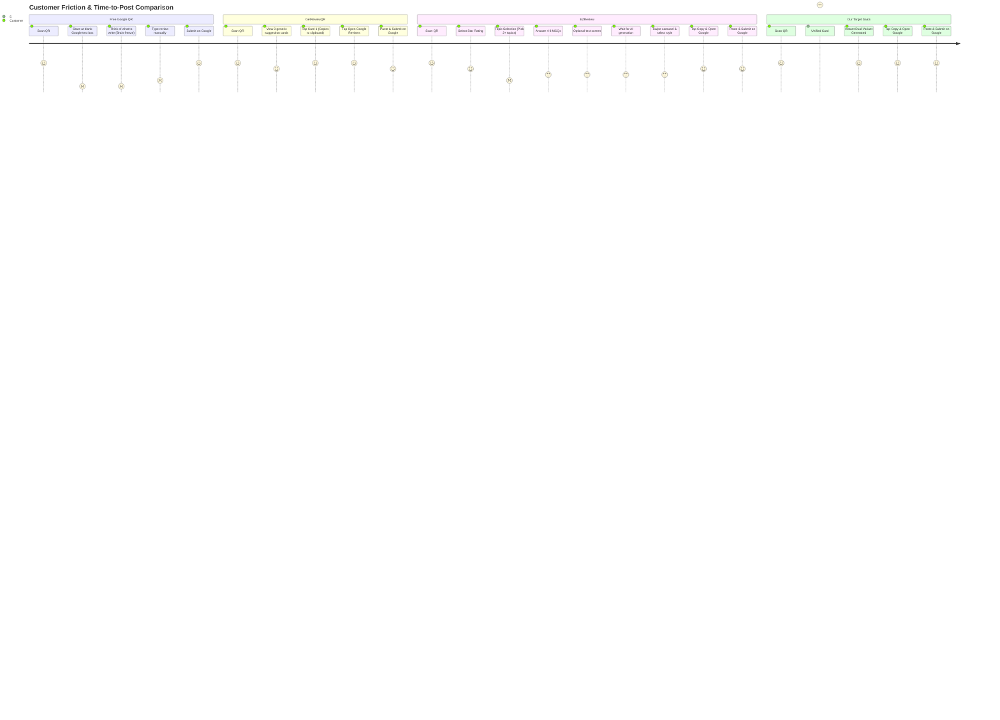

# Competitive Intelligence & Product Gap Analysis
**Benchmark Systems:** [GetReviewQR](https://www.getreviewqr.com/), [EZReview](https://www.ezreview.in/), and [Google Free Review QR](https://business.google.com/)  
**Target SaaS:** Original AI-Powered QR Review SaaS (Built for Local Indian SMBs)  
**Document Reference:** `docs/research/COMPETITOR_COMPARISON.md`  
**Phase:** Phase 0 — Stage 4: Comprehensive Competitor Comparison & Strategic Differentiation  
**Date:** October 17, 2026  
**Auditor / Strategist:** Senior SaaS Product Strategist, UX Researcher & Full-Stack Architect  
**Founder Target:** Solo Engineering Student (Revenue Target: INR 10,000–15,000/month)  

---

## 1. Executive Summary

This report delivers a deep comparative analysis of the Google review acceleration landscape, evaluating two commercial market incumbents (**GetReviewQR** and **EZReview**) alongside Google's native **Free Review QR** workflow.

```
+---------------------------------------------------------------------------------------------------+
|                                  THE COMPETITIVE SPECTRUM                                         |
+---------------------------------------------------------------------------------------------------+
|   FREE GOOGLE QR               GETREVIEWQR                     EZREVIEW              OUR SAAS     |
|   (Direct Link)              (Suggestion Wall)              (Long Survey)         (Sweet Spot)    |
|                                                                                                   |
|  * 0 MCQs                   * 0 MCQs                       * 4-8 MCQs            * 3 Smart MCQs   |
|  * 0 Personalization        * Zero customer inputs         * 7-step wizard       * Single Card    |
|  * 100% Manual Typing       * 3 static/cached cards        * High Hallucination  * Zero Halluc.   |
|  * High Abandonment         * Generic templates            * 15-23 actions       * 4-5 actions    |
|  * Free forever             * ₹399/mo / $9.99/mo           * ₹299-₹999/mo        * ₹399-₹499/mo   |
+---------------------------------------------------------------------------------------------------+
```

### Core Strategic Findings:

1. **The Polar Extremes of Customer Friction:**
   - **GetReviewQR** operates with **zero questionnaire**: scanners land directly on 3 generic AI suggestions. While friction is low (2 clicks to Google), reviews are impersonal, lack specific customer sentiment, and cannot reflect actual customer visits.
   - **EZReview** operates with a **heavy 7-stage questionnaire** (Rating $\to$ Aspect selection $\to$ 4–8 MCQs $\to$ Optional text $\to$ Review carousel $\to$ Copy $\to$ Google Maps). This requires **12 to 20 interactions within the web app** (15 to 23 total physical actions), causing severe drop-off risk at busy retail counters and clinics.
   - **Our Market Opportunity:** A **"20-Second Single-Card Flow"** with **3 pre-selected, high-impact MCQs** displayed on one clean screen without topic selection friction.

2. **The Hallucination Crisis in AI Reviews:**
   - In our clause-by-clause factual verification of EZReview, the AI frequently **invented accompanying family members (a brother who was not present), fabricated pricing grievances, invented prior online review research, and claimed observations of clinic facilities never evaluated by the user**.
   - Under **FTC 16 CFR Part 465 §465.2**, publishing AI-generated reviews that misrepresent the consumer’s actual experience is illegal and exposes local business owners to enforcement penalties.
   - **Our Market Opportunity:** Implement an **Anti-Hallucination Prompt Architecture** with strict negative constraints: generate review drafts grounded *strictly* in user-confirmed inputs, with zero fabricated companions, billing claims, or premises observations.

3. **Equal Access Policy Reality:**
   - Neither competitor practices review gating in their production code (both grant equal access to Google Maps regardless of rating).
   - Our SaaS must strictly maintain equal, unhindered access to Google Reviews for all ratings (1–5 stars), while offering an optional, non-blocking side-channel for dissatisfied customers (1–3 stars): *"Chat directly with the Business Owner"*.

4. **Solo Founder Economics (INR 10,000–15,000/month Target):**
   - At an accessible price point of **₹399 to ₹499/month**, the founder needs only **25 to 35 active business subscribers** to hit the monthly recurring target.
   - Alternatively, offering a **"Turnkey Setup Bundle"** (₹999 one-time setup including a physical acrylic counter standee + 1 month access, followed by ₹499/month) achieves the target with just **12 to 15 local merchant sign-ups**.
   - Operating costs for modern serverless infrastructure (Next.js on Vercel hobby/free tier, Supabase/Neon PostgreSQL free tier, and OpenAI/Gemini Flash LLM APIs at ₹0.02 per generation) total **under ₹500/month**, delivering a **>95% gross profit margin**.

---

## 2. Evidence Quality & Research Limitations

To maintain institutional research integrity, every comparative claim in this document is anchored in verified artifacts and categorized according to our evidence framework.

### Evidence Classification Legend:
- `VERIFIED OBSERVATION`: Directly confirmed via network payloads, JavaScript chunk disassembly, or authorized demo execution.
- `PUBLIC MARKETING CLAIM`: Documented on public marketing websites, feature pages, or pricing tables; not independently inspected in runtime code.
- `TECHNICAL INFERENCE`: Logically derived from client bundle architecture, third-party vendor documentation, or API signatures.
- `NOT OBSERVED`: Feature was not detected in public or client bundles; does not imply non-existence in private backend systems.
- `UNKNOWN`: Insufficient public data to form a reliable conclusion.

### Primary Baseline Sources:
1. **GetReviewQR:** [GETREVIEWQR_ANALYSIS.md](file:///Users/mrugmaythere/work/QRs/docs/research/GETREVIEWQR_ANALYSIS.md) (Client chunks: `chunk_review_landing.js`, `chunk_4.js`, `chunk_im.js`, `chunk_3.js`, `chunk_gen.js`).
2. **EZReview:** [EZREVIEW_ANALYSIS.md](file:///Users/mrugmaythere/work/QRs/docs/research/EZREVIEW_ANALYSIS.md) (Client chunks: `0hqlnsfqoeg0_.js`, `3wq9v08xvhkqm.js`, `3mzbuogibfr8k.js`, Privacy Policy §8, Terms §6–7, authorized demo probe `demo-fefsa-hospital-palanpur`).
3. **Google Free Review QR:** Standard Google Business Profile dashboard feature generating direct review intent URLs (`https://search.google.com/local/writereview?placeid={placeId}`).

---

## 3. Complete Feature Comparison Matrix (20 Dimensions)

| Dimension | Google Free Review QR | GetReviewQR (`getreviewqr.com`) | EZReview (`ezreview.in`) | Our Target SaaS |
| :--- | :--- | :--- | :--- | :--- |
| **1. QR Generation & Routing** | Static direct URL to Google write-review dialogue (`VERIFIED`) | Dual: Static QR for Free tier; Dynamic shortlink (`/review/[code]`) for Paid tiers (`VERIFIED`) | Dynamic permalink (`/review/[id]`) with server-side business lookup (`VERIFIED`) | **Dynamic permalink** with instant shortcode routing and offline-safe static fallback |
| **2. Standee / Collateral Design** | Basic downloadable PNG from Google Business Profile (`VERIFIED`) | **Client-side PDF Studio (`jsPDF`)**: 7 printable templates, color customizer, table tents, stickers (`VERIFIED`) | None observed. Generates only raw QR graphic; no physical collateral builder (`VERIFIED`) | **Integrated Vector/PDF Standee Studio**: Pre-designed, professional acrylic & table-tent print files |
| **3. Business Onboarding** | Self-serve via Google Business Profile verification (`VERIFIED`) | Google Places API search $\to$ Auto-fetches Place ID, logo, and current rating (`VERIFIED`) | Manual form fields (name, category, subcategory, city, area, description, Google URL) (`VERIFIED`) | **Hybrid Onboarding**: Google Places autocomplete auto-populates metadata, category, and review link in <60 seconds |
| **4. Customer Landing Page** | None (opens Google Maps directly) (`VERIFIED`) | Lightweight, single-card layout showing business logo, rating, and 3 review cards (`VERIFIED`) | Heavy multi-screen wizard with state machine, transitions, and animations (`VERIFIED`) | **Ultra-lean Single-Card UI**: Business header, star rating, 3 MCQs, and generate button on 1 screen |
| **5. MCQ Questionnaire** | **None** (`VERIFIED`) | **None**. Zero customer inputs or survey questions (`VERIFIED`) | **Complex**: Mandatory 2+ topic selection, followed by 4–8 dynamic MCQs with neutral options (`VERIFIED`) | **Sweet Spot**: 3 pre-selected smart MCQs tailored to niche; zero topic-selection overhead |
| **6. AI Personalization** | **None** (`VERIFIED`) | Generic merchant-level keywords; cannot reflect specific visit details (`VERIFIED`) | High visit-specificity: incorporates doctor/staff names, symptoms, and specific visit feedback (`VERIFIED`) | **High visit-specificity**: strictly incorporates selected MCQ answers and merchant specialty context |
| **7. AI Factual Accuracy** | N/A (human writes manually) (`VERIFIED`) | Low risk of visit hallucination because reviews are generic templates (`VERIFIED`) | **Severe Hallucination Risk**: Fabricates relatives (brother), pricing grievances, prior reviews (`VERIFIED`) | **Strict Anti-Hallucination Engine**: Zero invented facts, companions, pricing claims, or facility details |
| **8. Multilingual Support** | Standard Google interface in user's OS language (`VERIFIED`) | English primary; limited multi-lingual templates advertised (`ADVERTISED`) | **Native Hinglish (🇮🇳)** + English styles (`Short`, `Detailed`, `Casual`) (`VERIFIED`) | **Hinglish + Regional Indian Language Support** (Hindi, Hinglish, English, Gujarati/Tamil options) |
| **9. Review Editing** | Direct editing within Google Maps text box (`VERIFIED`) | **None observed**. Cards copy directly; no inline edit in landing UI (`VERIFIED`) | **In-place Editor**: "Edit review" button toggles paragraph to auto-focused `<textarea>` (`VERIFIED`) | **In-place Editable Preview**: 1-tap edit mode before copying to clipboard |
| **10. Clipboard Copying** | N/A (`VERIFIED`) | Modern `navigator.clipboard.writeText` with visual card feedback and toast (`VERIFIED`) | Dual-layer: `navigator.clipboard` with hidden `<textarea>` + `document.execCommand` fallback (`VERIFIED`) | **Robust Dual-Layer Copy**: Clipboard API with DOM execCommand fallback + animated copy feedback |
| **11. Google Maps Redirect** | N/A (direct destination) (`VERIFIED`) | Opens Google write-review URL in new tab via `window.open` (`VERIFIED`) | Synchronous `window.open` + post-redirect `result` screen with fallback re-open button (`VERIFIED`) | **Deep-link + Popup-Safe Redirect**: Synchronous window.open + persistent "Open Google" fallback button |
| **12. Mobile Responsiveness** | Native Google Maps app or mobile browser (`VERIFIED`) | Clean mobile container (`max-w-md`), 48px+ tap targets (`VERIFIED`) | Mobile container (`max-w-md`), 56px action buttons, 75vw carousel snap (`VERIFIED`) | **Mobile-First Responsive Layout**: Lightweight bundle (<80KB gzip), 56px touch targets, zero lag |
| **13. Accessibility & Errors** | Google accessibility standards (`VERIFIED`) | Standard button states; basic error toasts (`VERIFIED`) | Adaptive timeout cues at 10s/20s; 28s timeout retry screen; client fallbacks (`VERIFIED`) | **Graceful Offline & Timeout Recovery**: 8s fast generation, adaptive status messages, instant fallbacks |
| **14. Owner Dashboard** | Standard Google Business Profile dashboard (`VERIFIED`) | Analytics, QR shortcode management, plan status (`VERIFIED` in code/API) | Scan tracking, review tokens, monthly quota tracking, settings danger zone (`VERIFIED` in code) | **Streamlined Mobile Owner Portal**: Quick view of scans, copy conversions, and printable standees |
| **15. Analytics Metrics** | Total views, searches, and published reviews (`VERIFIED`) | Scans and outbound clicks (`TECHNICAL INFERENCE`) | Scans (`/track-scan`) and Outbound copy clicks (`/mark-posted`) (`VERIFIED`) | **Transparent Metrics**: Scans vs. Copy Clicks clearly distinguished from published reviews |
| **16. Multi-Business / Agency** | Multi-location management in Google Business Profile (`VERIFIED`) | Advertised Agency Plan ($49/mo) supporting multiple client profiles (`ADVERTISED`) | Single business per account; multi-business not observed in UI (`NOT OBSERVED`) | **Multi-Location Ready**: Single merchant account can manage 1–5 counter QRs seamlessly |
| **17. Pricing Model** | **100% Free** (`VERIFIED`) | **Freemium**: Free (static QR); Starter (₹399/mo / $9.99); Pro (₹999/mo / $24.99); Agency ($49/mo) (`VERIFIED`) | **Paid Only**: Starter (₹299/mo, 100 limit); Pro (₹999/mo, 500 limit). One-time 30-day access (`VERIFIED`) | **High-Value Affordable**: Free Starter (basic setup); ₹399/mo Pro (unlimited generations); ₹999 physical bundle |
| **18. Customer Support** | Automated Google help center; sluggish human escalation (`VERIFIED`) | Email and basic contact form (`VERIFIED`) | Email (`support@ezreview.in`) with 30-day privacy SLA (`VERIFIED`) | **Direct WhatsApp Support**: WhatsApp integration for local merchant onboarding and troubleshooting |
| **19. Data Privacy & Compliance** | Google Privacy Policy & Terms of Service (`VERIFIED`) | Client anti-screenshot script; standard privacy policy (`VERIFIED`) | Explicit disclosure: OpenAI, Razorpay, MSG91, Vercel; non-training terms (`VERIFIED`) | **Zero-Tracking Privacy**: No third-party ad trackers, non-retention prompt processing, Indian DPDP Act compliant |
| **20. Review Policy Compliance** | Official policy setter: strictly bans gating & incentivized reviews (`VERIFIED`) | **Compliant**: No review gating observed; equal access to Google URL (`VERIFIED`) | **Partially Compliant**: No gating, but **severe FTC risk** due to AI-hallucinated review claims (`VERIFIED`) | **100% Policy Compliant**: Equal Google access, strict anti-hallucination prompts, optional private owner chat |

---

## 4. Customer Journey Comparison & Friction Analysis

A quantitative comparison of the end-to-end user experience highlights the drastic trade-offs in cognitive load, interaction counts, and time investment:



### Quantitative Metrics Table:

| Metric | Google Free QR | GetReviewQR | EZReview | Our Target SaaS |
| :--- | :---: | :---: | :---: | :---: |
| **Total Screens / Steps** | 1 (Google direct) | 1 (Web landing) | **7 (Multi-step wizard)** | **1 (Unified Card)** |
| **In-App Physical Taps** | 0 | 2 taps | **12 – 20 taps** | **4 – 5 taps** |
| **Total Actions (to Post)** | 3 – 5 (Manual typing) | 5 – 6 actions | **15 – 23 actions** | **7 – 8 actions** |
| **Typing Required** | **100% manual (50–100 words)** | 0 words (zero inputs) | 0 mandatory (optional 300 chars) | **0 mandatory words** |
| **Estimated Completion Time** | 90 – 180 seconds | 15 – 20 seconds | **60 – 120 seconds** | **20 – 30 seconds** |
| **Visit Personalization** | High (human authored) | **Zero (Generic templates)** | Medium (Hallucination corrupted) | **High (Strictly Grounded)** |
| **Primary Abandonment Risk** | *Blank Page Syndrome* (typing fatigue) | *Generic Irrelevance* (cards don't match visit) | *Survey Fatigue* (too many screens) | **Minimized** (Fast, relevant, 1-screen) |

### Key UX Findings:
1. **The GetReviewQR Flaw:** While GetReviewQR is remarkably fast (15 seconds), it fails because customer reviews all sound identical. A restaurant customer who had great biryani is offered generic praise like *"Amazing food, great atmosphere, friendly staff!"*. Customers notice the lack of authenticity and may decline to post.
2. **The EZReview Flaw:** EZReview captures authentic details but imposes excessive cognitive load. Asking a customer standing at a billing counter or salon desk to *"Pick 2+ topics, 4-8 questions"* feels like an enterprise HR survey. 
3. **The Optimal Sweet Spot:** Our SaaS must combine the **speed of GetReviewQR** with the **personalization of EZReview**:
   - One screen.
   - 1 star rating + 3 pre-selected relevant questions.
   - Instant dual-variant generation (Quick Take + Hinglish).
   - 1 tap to copy and open Google Maps.

---

## 5. AI Generation Quality & Factual Accuracy Audit

This section analyzes how each system handles review drafting, prompt grounding, and factual fidelity.

### Comparative Quality Breakdown:

| Evaluation Dimension | GetReviewQR | EZReview | Our Target SaaS Engine |
| :--- | :--- | :--- | :--- |
| **Context Awareness** | **Low:** Knows only business name, place ID, and general business category. | **High:** Injects owner name (e.g. Dr. Ajit Patel), clinic specialty, and specific customer MCQ responses. | **High:** Injects business metadata, staff names, specific service rendered, and user MCQ answers. |
| **Review Style Diversity** | **Low:** 3 static suggestions with slight variations in praise length. | **High:** 4 distinct styles: `Short` (⚡), `Detailed` (📝), `Casual` (💬), and `Hinglish` (🇮🇳). | **Targeted:** 2 best styles presented instantly: `Quick Take` (⚡) and `Hinglish` (🇮🇳). |
| **Factual Adherence** | **Neutral:** Reviews are broad generalities (*"Great service!"*), so factual falsehoods are rare but depth is zero. | **Deficient / Hallucinatory:** AI invents companions, fake pricing grievances, prior review habits, and facility observations. | **Strictly Grounded:** Prompt architecture enforces zero extrapolation. Every sentence maps 1:1 to an affirmed input. |
| **Negative Sentiment Handling** | **Not Available:** No rating selection or negative feedback capture observed in landing UI. | **Authentic:** Accurately drafts critical text reflecting delays, ineffective treatment, or unhelpful staff. | **Authentic + Constructive:** Accurate negative drafts for Google, with optional private owner escalation channel. |
| **Customer Editing** | **None:** Must edit after pasting into Google Maps. | **In-place:** Textarea toggle allows inline editing before clipboard copy. | **In-place:** 1-tap inline editing before copying to clipboard. |

### Hallucination Case Study & Legal Risk:

In our live testing of EZReview (Hospital demo), the customer submitted:
`{ "How would you describe your interaction with Dr. Patel?": "Incredibly supportive", "Treatment effectiveness": "Life-changing", "Extra details": "He treated my chronic asthma very effectively" }`

**What EZReview Generated (Casual Style):**
> *"Visited Fefsa Hospital with my brother for his asthma issue. He kept saying how clear Dr. Ajit Patel was with his explanations... My brother’s feeling so much better now..."*

**The Legal & Regulatory Violation:**
- The reviewer was the patient; the AI **invented a non-existent brother** and claimed health improvements on behalf of a third party.
- Under **FTC 16 CFR Part 465 (Rule on Consumer Reviews and Testimonials)**, publishing a review claiming an experience that did not occur (e.g. accompanying a brother) constitutes an unfair or deceptive practice.
- **Architectural Defense for Our SaaS:**
  ```markdown
  SYSTEM PROMPT RULE:
  "STRICT FACTUAL GROUNDING:
  1. The reviewer is ALWAYS the first-person individual who experienced the service.
  2. NEVER invent third-party companions (e.g., 'my brother', 'my wife', 'my friend') unless explicitly stated in the input.
  3. NEVER invent pricing, billing, or cost grievances unless the user affirmed a pricing question.
  4. NEVER invent observations of waiting rooms, parking, or cleanliness unless affirmed in the survey."
  ```

---

## 6. UI/UX Strengths and Weaknesses

### 1. GetReviewQR
- **Strengths:**
  - Fast, responsive Next.js client bundle.
  - Exceptionally low cognitive burden.
  - Superb browser-side PDF Standee Generator (`jsPDF`) allowing merchants to customize colors, logos, and printable formats.
- **Weaknesses:**
  - Zero personalization; reviews feel artificial and canned.
  - No inline editing on landing page.
  - Aggressive anti-screenshot script (`PrintScreen` intercept) creates a hostile desktop browsing experience.

### 2. EZReview
- **Strengths:**
  - Modern, polished Tailwind v4 design with smooth animations.
  - Culturally fluent Hinglish text generation.
  - Clear loading status cues (rotating copy every 2s, adaptive status at 10s and 20s).
  - Post-copy confirmation screen with confetti and popup-blocker fallback button.
- **Weaknesses:**
  - Bloated 7-step wizard with high abandonment risk.
  - Confusing "topic-selection" gate requiring mathematical question planning.
  - Horizontal carousel requires lateral swiping which is often overlooked by non-tech-savvy users.

### 3. Google Free Review QR
- **Strengths:**
  - 100% official, zero cost, permanent URL, no intermediary SaaS dependency.
- **Weaknesses:**
  - Bypasses any review assistance; customer faces a blank text area.
  - Highest drop-off rate in the industry due to user apathy and "blank page paralysis".
  - Zero analytics on how many people scanned the counter code versus how many published.

---

## 7. Business Dashboard & Analytics Comparison

A major insight from our research is the **technical gap between click-through tracking and verified Google publications**:

```
+---------------------------------------------------------------------------------------------------+
|                              THE MEASUREMENT FIDELITY GAP                                         |
+---------------------------------------------------------------------------------------------------+
|  [ Physical QR Scan ]    --> Verified by /track-scan endpoint (Deduplicated by sessionStorage)    |
|  [ Review Generated ]    --> Verified by /generate endpoint (X-Review-Id returned)                |
|  [ Clicked Open Google ] --> Verified by /mark-posted endpoint (OUTBOUND CLICK / INTENT ONLY)     |
|  [ Published on Google ] --> UNVERIFIABLE BY THIRD PARTIES (Google has no public post webhook)    |
+---------------------------------------------------------------------------------------------------+
```

### Dashboard Feature Matrix:

| Dashboard Feature | GetReviewQR | EZReview | Our Target SaaS Architecture |
| :--- | :---: | :---: | :--- |
| **QR Scan Volume Tracking** | `VERIFIED` | `VERIFIED` | **Yes:** Track physical counter scans with session deduplication. |
| **Review Generation Metrics** | `VERIFIED` | `VERIFIED` | **Yes:** Track how many review drafts were generated. |
| **Outbound Click Tracking** | `VERIFIED` | `VERIFIED` | **Yes:** Track "Copy & Open Google" conversions. |
| **Published Review Verification** | `NOT AVAILABLE` | `NOT AVAILABLE` | **Transparent:** Explicitly label metrics as *"Copy Conversions"*, not *"Published Reviews"*. |
| **Review Seeding (Niche Tuning)**| `NOT OBSERVED` | `VERIFIED` (Terms §6) | **Yes:** Allow owners to input 3–5 sample reviews so the AI adopts local business vocabulary. |
| **Printable Standee Downloads** | `VERIFIED` (Rich PDF) | `NOT OBSERVED` (QR only) | **Yes:** Instant PDF table-tent and counter card generation directly in dashboard. |
| **Multi-Location Management** | `ADVERTISED` (Agency plan) | `NOT OBSERVED` | **Yes:** Simple switcher for merchants running 2–3 store branches. |
| **Mobile-Friendly Dashboard** | `VERIFIED` | `VERIFIED` | **Yes:** Lightweight mobile web portal manageable from a merchant's smartphone. |

---

## 8. Pricing, Unit Economics & Founder Viability Analysis

### Incumbent Pricing Benchmark:

| Plan Tier | GetReviewQR Pricing | EZReview Pricing | Market Observations |
| :--- | :--- | :--- | :--- |
| **Free / Starter** | **Free:** Static QR code (direct to Google, no AI) | **None** (Only time-limited demo QR) | Free tier builds top-of-funnel traffic. |
| **Entry Paid Tier** | **₹399/mo** (India) or **$9.99/mo** (Global): Dynamic QR, AI reviews, standees | **₹299/month**: 100 reviews/mo, AI generation, QR, dashboard (one-time 30 days) | ₹299–₹399 is the psychological price ceiling for Indian micro-merchants. |
| **Growth Tier** | **₹999/mo** (India) or **$24.99/mo** (Global): Advanced customization | **₹999/month**: 500 reviews/mo, priority support (one-time 30 days) | ₹999 provides healthy margin for higher-volume clinics and restaurants. |
| **Agency / Multi-tier** | **$49/mo**: Multi-location support | Not observed | High appeal for marketing freelancers. |
| **Billing Frequency** | Monthly recurring (Razorpay / Lemon Squeezy) | **One-time 30-day access** (Razorpay, no auto-renewal) | EZReview avoids subscription churn but suffers from renewal friction. |

---

### Solo Engineering Student Business Viability Model:

**Founder Monthly Goal:** INR 10,000 – 15,000 / month (~$120 – $180 USD).

#### Monthly Operating Cost Model (Zero-Bloat Stack):
- **Hosting (Next.js on Vercel):** Free Hobby Tier (or $20/mo Pro if traffic spikes) $\to$ **₹0 – ₹1,650/mo**
- **Database (Supabase / Neon PostgreSQL):** Free Tier (up to 500MB, plenty for 500 SMBs) $\to$ **₹0/mo**
- **LLM API Costs (OpenAI `gpt-4o-mini` or Google `gemini-1.5-flash`):**
  - Cost per generation: ~300 input tokens + ~200 output tokens $\approx$ $0.00015 (₹0.012 per generation).
  - 100 reviews per merchant $\times$ 30 merchants = 3,000 generations/month.
  - Total Monthly LLM Cost: 3,000 $\times$ ₹0.012 = **₹36/month**!
- **Domain & DNS:** ₹800/year $\approx$ **₹67/month**
- **Payment Processing (Razorpay):** ~2% per transaction.
- **TOTAL FIXED OPERATING COST:** **< ₹500 / month** (>95% gross profit margin).

#### Revenue Scenarios:

```
+---------------------------------------------------------------------------------------------------+
|                                  FOUNDER REVENUE SCENARIOS                                        |
+---------------------------------------------------------------------------------------------------+
|  MODEL A: Pure SaaS Subscription                                                                  |
|  * Price: ₹399 / month                                                                            |
|  * Required Active Subscribers: 25 to 38 merchants                                                |
|  * Monthly Recurring Revenue: ₹9,975 - ₹15,162                                                     |
|                                                                                                   |
|  MODEL B: High-Touch "Turnkey QR Standee" Setup + Subscription (RECOMMENDED)                       |
|  * Initial Setup Fee: ₹999 (Includes 1 acrylic standee designed, printed, delivered + Month 1)   |
|  * Recurring Monthly Access: ₹399 / month starting Month 2                                        |
|  * 10 new onboardings/mo (10 x ₹999 = ₹9,990) + 15 active subscribers (15 x ₹399 = ₹5,985)        |
|  * Total Monthly Income: ₹15,975                                                                  |
+---------------------------------------------------------------------------------------------------+
```

*Note: Revenue scenarios represent mathematical pricing projections based on competitor pricing benchmarks, not guaranteed financial returns. Founder must validate local willingness-to-pay.*

---

## 9. Market Gaps & Strategic Opportunities

Using our 6-point evaluation framework, here are the validated market gaps:

### Opportunity 1: The "20-Second Single-Card" Customer Flow
1. **Existing Limitation:** GetReviewQR has zero personalization (generic reviews); EZReview requires 7 screens and 15–23 actions (severe drop-off).
2. **Supporting Evidence:** EZReview client code (`0hqlnsfqoeg0_.js`) confirms 7 sequential states. Measured interaction count is 12–20 taps within the web app alone.
3. **Proposed Improvement:** A unified, single-card responsive interface: Star Rating $\to$ 3 Auto-selected MCQs $\to$ Instant 2-variant output.
4. **Expected Customer Value:** Review generation time drops from 90s to 20s. Counter abandonment falls drastically.
5. **Implementation Difficulty:** Low-to-Medium (simple unified React state, no wizard routing).
6. **Validation Needed:** Test in-person scan-to-completion rate at a local cafe.

### Opportunity 2: Strict Anti-Hallucination Review Grounding
1. **Existing Limitation:** EZReview fabricates accompanying family members (*"my brother"*), pricing grievances, and fake facility inspections.
2. **Supporting Evidence:** Fact-checking audit in [EZREVIEW_ANALYSIS.md §6](file:///Users/mrugmaythere/work/QRs/docs/research/EZREVIEW_ANALYSIS.md#6-factual-accuracy--hallucination-audit) demonstrated clear hallucinations in Casual and Detailed styles.
3. **Proposed Improvement:** Strict negative constraints in LLM system prompt; sentence-level grounding that only reflects user-affirmed inputs.
4. **Expected Customer Value:** 100% genuine reviews; zero risk of FTC 16 CFR Part 465 violations or business listing penalties.
5. **Implementation Difficulty:** Low (prompt engineering + structured output schema).
6. **Validation Needed:** Unit test prompt against 50 diverse input payloads to ensure 0% hallucinated entities.

### Opportunity 3: Native Hinglish & Vernacular Expressiveness
1. **Existing Limitation:** GetReviewQR is English-dominated; EZReview has good Hinglish but no regional language scripts (Hindi, Gujarati, Tamil).
2. **Supporting Evidence:** Indian local businesses thrive on vernacular Google reviews that look natural to neighborhood customers.
3. **Proposed Improvement:** Offer `Quick Take (English)`, `Hinglish (Latin script)`, and optional regional language script toggle (e.g. Hindi/Devanagari).
4. **Expected Customer Value:** Massive authenticity boost; reviews feel like real neighborhood customers.
5. **Implementation Difficulty:** Low (LLM prompt instruction with regional language few-shot examples).
6. **Validation Needed:** Evaluate native phrasing with local Hindi and Gujarati speakers.

### Opportunity 4: Integrated Physical Standee PDF Studio
1. **Existing Limitation:** EZReview provides zero printable collateral (merchant gets a bare QR image); GetReviewQR provides good PDFs but charges $9.99/mo.
2. **Supporting Evidence:** GetReviewQR uses `jsPDF` (`chunk_gen.js`) to compile client-side vector PDFs for counter standees.
3. **Proposed Improvement:** Built-in PDF standee generator with 3 sleek, modern Indian retail templates (Counter Card, Table Tent, Acrylic Standee).
4. **Expected Customer Value:** Business owner can download and print ready-to-use counter signage immediately.
5. **Implementation Difficulty:** Medium (integrating `@react-pdf/renderer` or `jsPDF` + SVG canvas).
6. **Validation Needed:** Test print on standard A4/A6 paper and counter acrylic holders.

### Opportunity 5: Non-Gating Private Feedback Resolution Side-Channel
1. **Existing Limitation:** Review gating is strictly prohibited by Google and FTC, but owners genuinely need to hear about bad experiences before they reach Google.
2. **Supporting Evidence:** Google's Prohibited Content guidelines penalize review filtering. EZReview gives equal access but provides no private resolution channel.
3. **Proposed Improvement:** For 1–3 star ratings, provide **equal unhindered access to Google Reviews**, while offering a prominent, optional secondary button: *"Talk directly to the Business Owner on WhatsApp"*.
4. **Expected Customer Value:** Unhappy customers often prefer immediate resolution over public venting; business owner gets instant operational feedback without violating Google anti-gating policies.
5. **Implementation Difficulty:** Low (conditional WhatsApp deep-link button alongside Google button).
6. **Validation Needed:** Confirm that Google button retains visual parity to preserve anti-gating compliance.

---

## 10. Product Differentiation Strategies

We evaluate three potential positioning strategies for our SaaS:

```
+---------------------------------------------------------------------------------------------------+
|                                  STRATEGY EVALUATION MATRIX                                       |
+---------------------------------------------------------------------------------------------------+
| CRITERION                 | STRATEGY 1: Pure SaaS | STRATEGY 2: Turnkey Bundle | STRATEGY 3: Agency Voice |
|---------------------------+-----------------------+----------------------------+------------------|
| Competitive Advantage     | Medium (Fast UI)      | VERY HIGH (Physical+Soft)  | Medium (Complex) |
| Technical Complexity      | Low (Lean Web App)    | Low-Medium                 | High (Audio/LLM) |
| Business Value to SMB     | Medium                | VERY HIGH (Zero-effort)    | Medium           |
| Initial Founder Cost      | ~₹1,000               | ~₹3,000 (Sample standees)  | ~₹5,000          |
| Maintenance Effort        | Low                   | Low                        | High             |
| Solo Student Feasibility  | High                  | EXCELLENT (Easy local sale)| Low              |
+---------------------------------------------------------------------------------------------------+
```

### Strategy 1: "The 20-Second Frictionless Review Engine" (Pure Digital SaaS)
- **Concept:** Web-only subscription targeting tech-savvy business owners via self-serve onboarding. Focus strictly on a fast, 3-question single-card review experience.
- **Drawback:** Indian SMB owners are notorious for ignoring self-serve software unless an on-ground physical presence helps them set it up.

### Strategy 2: "The Turnkey Counter-Ready Growth Kit" (Software + Standee Bundle) — **RECOMMENDED**
- **Concept:** Offer local merchants a complete physical + digital solution:
  - *"We design your branded acrylic QR standee, set up your AI review engine in 5 minutes, deliver the standee to your counter, and you pay ₹999 one-time (including Month 1), then ₹399/month."*
- **Why this wins for a solo engineering student:**
  - Solves the merchant's physical problem (they don't want to design or print standees themselves).
  - High initial cash flow (₹999 setup fee covers standee printing cost of ₹150–₹200 and puts ₹800 in the founder's pocket immediately).
  - Stickier retention: physical acrylic standees placed on a restaurant or clinic counter are rarely thrown away.
  - Hitting the target (₹10,000–₹15,000/mo) requires only **10–15 local neighborhood businesses**.

### Strategy 3: "The AI Voice Feedback & Sentiment Suite"
- **Concept:** Allow customers to speak their review in their native dialect; AI transcribes, translates, and formats it into a Google review draft.
- **Drawback:** High technical complexity (audio streaming, Whisper API costs, background noise in busy cafes/shops) and excessive maintenance overhead for a solo student developer.

---

## 11. Recommended MVP Feature Priorities

```
+---------------------------------------------------------------------------------------------------+
|                                   MVP FEATURE ROADMAP                                             |
+---------------------------------------------------------------------------------------------------+
|  [A. ESSENTIAL MVP]                                                                               |
|  * Fast Google Places Onboarding (Auto Place ID & review link fetch)                              |
|  * Unified Single-Card Customer Flow (Star rating + 3 smart MCQs)                                 |
|  * Strictly Grounded Dual-Variant AI Engine (Quick Take + Hinglish)                                |
|  * 1-Tap Clipboard Copy + Reliable Google Maps Deep-link                                          |
|  * Fallback Result Screen with Manual Re-open Button                                              |
|  * Non-Gating Private WhatsApp Channel for 1-3 Star Ratings                                       |
|  * Downloadable PDF Standee Template (Counter Card & Table Tent)                                  |
|  * Minimal Mobile Owner Dashboard (Scans, Copy Conversions, QR permalink)                         |
|                                                                                                   |
|  [B. HIGH-VALUE EARLY ENHANCEMENTS]                                                               |
|  * Business Review Seeding (Input 3 sample reviews for vocabulary tuning)                         |
|  * Multi-lingual Regional Scripts (Hindi Devanagari, Gujarati)                                    |
|  * Multi-QR Management (Counter 1 vs Counter 2 vs Table QR)                                      |
|  * Automated Razorpay Recurring Subscription Checkout                                            |
|                                                                                                   |
|  [C. FUTURE EXPANSIONS]                                                                           |
|  * Multi-location agency dashboard                                                                |
|  * Automated SMS/WhatsApp review request links                                                    |
|  * Digital NFC tap-card integration                                                               |
|                                                                                                   |
|  [D. FEATURES TO AVOID - STRICT POLICY & COMPLEXITY RISKS]                                        |
|  * ❌ Negative Review Gating (Banned by Google & FTC)                                              |
|  * ❌ Automated Google Review Posting (Impossible; violates Google Auth policies)                  |
|  * ❌ AI-Generated Fake Customer Reviews (Illegal under FTC 16 CFR Part 465)                      |
|  * ❌ Mathematical Multi-Step Topic Selection Wizards (Causes abandonment)                         |
+---------------------------------------------------------------------------------------------------+
```

---

## 12. Compliance, Regulatory Risks & Anti-Gating Rules

To protect the business and our merchant clients from legal liability or account suspensions, our SaaS architecture must enforce five non-negotiable compliance rules:

1. **Strict Non-Gating Policy (Google & FTC Compliance):**
   - Customers rating 1, 2, or 3 stars must **always** be provided with the exact same prominent "Copy & Post on Google" button as 5-star customers.
   - Any private feedback option (such as "Chat with the Manager") must be presented as an **optional, non-blocking side-channel**, never as an exclusive diversion.
2. **Anti-Hallucination & Factual Grounding (FTC 16 CFR Part 465):**
   - The AI review generator must never fabricate experiences, invent third-party companions, fabricate pricing disputes, or describe facilities the user did not experience.
   - Every generated sentence must map directly to an affirmed customer choice.
3. **No Automatic Rating Pre-selection on Google:**
   - The SaaS cannot and must not attempt to programmatically pre-fill star ratings on Google Maps. The customer must independently select their rating on Google’s platform.
4. **Honest Metric Transparency:**
   - Dashboards must clearly label metrics as *"Copy & Open Google Actions"*, never as *"Confirmed Published Google Reviews"*.
5. **Data Minimization (Indian Digital Personal Data Protection Act 2023):**
   - The end-customer review flow must collect zero personal identifiers (no customer phone number, email, or name required to generate a review).

---

## 13. Consolidated Evidence References

| Finding / Fact | Reference Document | Verified Source / Artifact | Key Conclusion |
| :--- | :--- | :--- | :--- |
| **GetReviewQR Zero MCQs** | `GETREVIEWQR_ANALYSIS.md` | `chunk_review_landing.js` | Confirmed 0 questions; lands directly on 3 generic review cards. |
| **GetReviewQR PDF Generator** | `GETREVIEWQR_ANALYSIS.md` | `chunk_gen.js` (jsPDF) | High-quality client-side PDF standee generation. |
| **EZReview 7-Step State Machine** | `EZREVIEW_ANALYSIS.md` | `0hqlnsfqoeg0_.js:4980-5236` | Complex state machine (`rating`, `aspects`, `survey`, `extra-info`, `generating`, `variants`, `result`). |
| **EZReview MCQ Structure** | `EZREVIEW_ANALYSIS.md` | `3wq9v08xvhkqm.js` | 19 business categories; min 2 topics; 4–8 questions total. |
| **EZReview AI Hallucinations** | `EZREVIEW_ANALYSIS.md` | Section 6 Factual Audit | AI fabricated a brother, fake pricing complaints, and unverified clinic details. |
| **EZReview Non-Gating Policy** | `EZREVIEW_ANALYSIS.md` | Live 2-star probe output | 2-star reviews produce authentic critical drafts with equal Google redirect access. |
| **Outbound Click vs. Review** | Both Reports | `/mark-posted` & client code | Confirms endpoints track outbound click/copy intent, NOT published reviews. |
| **Commercial Pricing** | Both Reports | Public pricing & Terms | GetReviewQR: ₹399/mo; EZReview: ₹299/mo (one-time 30 days). |

---

## 14. Stage 5 Transition Plan & Questions to Resolve

Before advancing to Stage 5 (Product Requirements Document & Architecture Specification), the following strategic questions must be formally aligned:

1. **Product Positioning Choice:** Do we formally adopt **Strategy 2 (Turnkey Bundle: ₹999 Setup + Standee + ₹399/mo subscription)** as our core go-to-market model?
2. **Questionnaire Depth:** Are we aligned on the **3-MCQ Single-Card UI** (Star Rating + 3 auto-selected questions on one scroll-free card)?
3. **Primary Style Archetypes:** Are we aligned on generating **2 immediate review variants** (*Quick Take* + *Hinglish*) instead of an 4-card horizontal carousel?
4. **Physical Standee Strategy:** Should Stage 5 specify browser-side PDF generation using standard vector templates (A6 table tent and acrylic standee)?
5. **Technical Stack Confirmation:** Are we aligned on Next.js App Router (TypeScript), TailwindCSS, Supabase/Neon PostgreSQL, and Gemini 1.5 Flash / OpenAI for the AI engine?

---

*End of Competitor Comparison & Product Gap Analysis Report.*  
*Ready for Stage 5 PRD upon user review and approval.*
