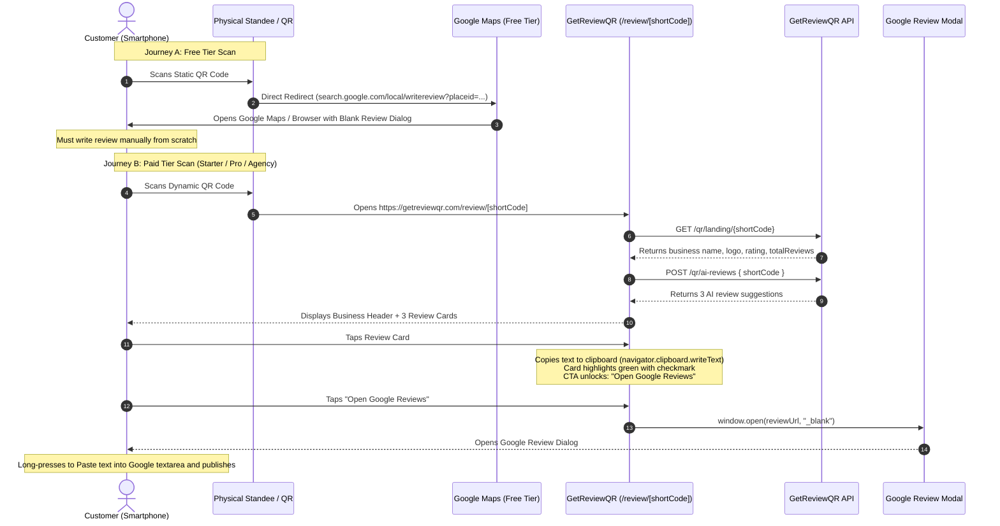
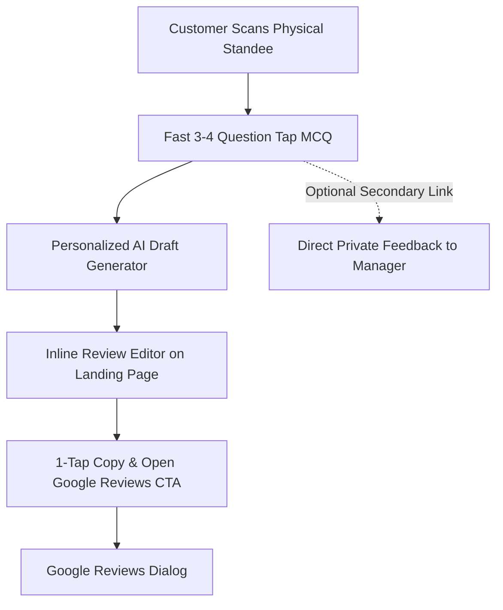

# Competitor Analysis: GetReviewQR (`getreviewqr.com`)

**Role:** Senior SaaS Product Analyst, UX Researcher & Software Architect  
**Investigation Date:** October 17, 2026  
**Document Version:** 2.0.0 (Research Validation & Policy Correction Update)  
**Target Product:** [GetReviewQR](https://www.getreviewqr.com/)  
**Primary App Routes Inspected:**  
- Marketing & Value Proposition: `https://www.getreviewqr.com/`
- How It Works Guide: `https://www.getreviewqr.com/how-it-works`
- Pricing & Plan Comparison: `https://www.getreviewqr.com/pricing`
- Standee Generator & Customizer: `https://www.getreviewqr.com/google-review-qr-code-generator`
- Customer Mobile Review Route: `https://www.getreviewqr.com/review/[shortCode]`
- Backend API Host: `https://api.getreviewqr.com/api`

---

## 1. Executive Summary

GetReviewQR (`getreviewqr.com`) is a Google Review acceleration SaaS developed by an India-based engineering studio (One9Tech, located in Rewa, Madhya Pradesh). The product aims to help local brick-and-mortar merchants (restaurants, cafes, medical clinics, salons, retail outlets, coaching centers) convert in-person customers into Google Reviews using physical QR standees, table tents, and stickers.

### Core Analytical Findings

1. **No MCQ Questionnaire Exists (Verified Observation):**
   Static disassembly of the production client-side routing chunks (`chunk_review_landing.js` and `chunk_4.js`) confirms that GetReviewQR contains **zero** customer questionnaires, **zero** MCQs, and **zero** customer rating inputs. Scanners land on a lightweight page displaying 3 pre-configured AI review suggestions.
2. **Dual QR Architecture (Verified Client Logic):**
   - **Free Plan:** Generates a static QR code directly embedding Google's official review dialogue (`https://search.google.com/local/writereview?placeid={placeId}`). The customer completely bypasses GetReviewQR's web app and is taken straight to Google Maps.
   - **Paid Plans (Starter / Pro / Agency):** Generates a dynamic QR code pointing to `https://www.getreviewqr.com/review/{shortCode}`. The customer lands on GetReviewQR's branded mobile page where they can copy one of 3 AI review cards before opening Google Reviews.
3. **Friction-Reduction vs. Personalization Trade-off:**
   GetReviewQR optimizes strictly for minimal friction (tap to copy $\to$ tap to open Google). However, because no customer feedback or experience data is gathered, the generated reviews lack authentic, individual context.
4. **Anti-Piracy Script in Generator (Verified Code Presence):**
   The public generator page includes client-side keyboard event listeners that intercept screenshot and print key combinations (`PrintScreen`, `Cmd+Shift+3/4/5`, `Cmd+P`), display an error toast, and attempt to clear the clipboard via `navigator.clipboard.writeText("")`.
5. **Regulatory & Policy Compliance Note:**
   GetReviewQR does not perform review gating; all users on the dynamic landing page are provided an "Open Google Reviews" button. Any competing SaaS must strictly preserve this practice to comply with Google’s Prohibited Content policies and FTC regulations.

---

## 2. Product Overview

| Dimension | Observed / Public Details | Evidence Classification |
| :--- | :--- | :--- |
| **Core Value Proposition** | "More Google reviews from your counter. Print a QR standee — customers scan, pick an AI-written review, and post on Google in seconds." | Public Marketing Claim |
| **Primary Target Market** | Local brick-and-mortar SMBs (India and international). Supports INR payments via Razorpay and USD via Lemon Squeezy. | Verified Client Code & Marketing |
| **Client Frontend Stack** | Next.js 14/15 (App Router, Turbopack, hosted on Vercel), React, Redux Toolkit Query (`rtk-query`), TailwindCSS, Lucide Icons, `react-hot-toast`. | Verified Observation |
| **QR & Standee Engine** | `qr-code-styling` (canvas/SVG rendering) and `jsPDF` (browser-side PDF document compilation). | Verified Observation |
| **Backend API Host** | `https://api.getreviewqr.com/api` (RESTful API serving places, QR CRUD, landing data, analytics, and billing). Underlying server language/framework is unobserved. | Verified Client Code / Technical Inference |
| **Review Destination** | Google Business Profile (Google Maps) exclusively. No support for third-party review platforms (Yelp, TripAdvisor, Facebook, Trustpilot). | Verified Observation |

---

## 3. Detailed Customer Journey

GetReviewQR operates two distinct customer journeys based on the merchant's subscription tier:



### Step-by-Step Experience Breakdown

1. **Scan (Physical Touchpoint):** Customer scans an acrylic standee, counter card, or sticker using their smartphone camera.
2. **Routing:**
   - *Free Plan:* Directly opens Google Review write URL (`search.google.com/local/writereview?placeid=...`).
   - *Paid Plans:* Opens mobile web landing page `https://www.getreviewqr.com/review/{shortCode}`.
3. **Data Loading:**
   - Landing page queries `GET /qr/landing/{shortCode}` to fetch merchant details (name, logo, rating, review count).
   - If `aiEnabled` is true, fires `POST /qr/ai-reviews` with `{ shortCode }`.
   - Displays 3 skeleton loader bars with pulsing animation during fetch.
4. **Card Presentation:**
   - Renders 3 suggestion cards. The client bundle does not provide any rating filters, thumbs up/down, or survey questions.
5. **Selection & Clipboard Action:**
   - Tapping a card triggers `navigator.clipboard.writeText(cardText)`.
   - Provides visual feedback (green border `#1A6B45`, light green fill `#F0FDF4`, checkmark icon, and toast `"Review copied to clipboard!"`).
6. **CTA Unlock & Redirect:**
   - The primary CTA button *"Open Google Reviews"* transitions from disabled (`cursor-not-allowed`) to active.
   - Clicking opens the merchant's Google Review URL in a new window/tab via `window.open(h.reviewUrl, "_blank")`.
   - If clicked before selecting a card, displays a warning toast: `"Please pick a review first!"`.
7. **Pasting on Google:**
   - The user is redirected to Google’s native review dialog.
   - Customer assigns a star rating, long-presses the comment box to paste the clipboard text, and taps "Post".

---

## 4. Screens and Interaction Observations

### Screen 1: Business Search & Discovery (`/google-review-qr-code-generator`)
- **UI Elements:** Prominent search bar with placeholder `"Search your business name and city..."` and 9 category filter pills (`All`, `Pharmacy`, `Dental Clinic`, `Sweet Shop`, `Beauty Parlour`, `Coaching Institute`, `Electronics`, `Fitness`, `Restaurant`).
- **Data Hook:** Bound to `placesApi.searchBusinesses` querying `GET https://api.getreviewqr.com/api/places/search?q={query}&category={category}`.
- **Search Result Card:** Shows business name, full street address, Google star rating, total reviews, and Google Place ID (`Place ID: ChIJ...`).
- **Live Preview:** Selecting a business immediately renders a live QR canvas preview without requiring upfront account creation.

### Screen 2: QR & Standee Customization Panel
- **Customization Controls:**
  - **Color Palette:** 8 preset accent swatches (`#1a56db`, `#7c3aed`, `#059669`, `#dc2626`, `#d97706`, `#0891b2`, `#db2777`, `#374151`) plus custom hex input.
  - **Dot Shapes:** Square (Free), Rounded, Dots, Classy, Extra-Rounded (Pro).
  - **Standee Themes:** 4 visual themes:
    1. *Minimal:* White background (`#ffffff`), emerald accent (`#1D9E75`).
    2. *Luxury:* Dark slate background (`#0d0d1a`), gold accent (`#d4af37`).
    3. *Bold:* Royal blue background (`#1e40af`), crisp white accent (`#ffffff`).
    4. *Festive:* Cream background (`#fffbf0`), orange accent (`#f97316`).
  - **Languages:** Standee header text localized into 5 languages: English, Hindi (हिन्दी), Marathi (मराठी), Tamil (தமிழ்), Telugu (తెలుగు).
  - **Watermark Banner:** Unpaid users see: *"This QR includes a ReviewQR watermark. Upgrade to remove it."*

### Screen 3: Generator Anti-Piracy Script
- **Observed Client Code:**
  ```javascript
  // chunk_gen.js (lines 1420-1435)
  ("PrintScreen" === t.key ||
    ((t.ctrlKey || t.metaKey) && "p" === t.key) ||
    (t.metaKey && t.shiftKey && ["s", "S", "3", "4", "5"].includes(t.key)) ||
    (t.ctrlKey && t.shiftKey && ["s", "S"].includes(t.key))) &&
    (t.preventDefault(),
    tg.default.error("Screenshots are not allowed on this page!", { duration: 3000, icon: "🛑" }),
    navigator.clipboard.writeText(""));
  ```
- **Context & Scope:** Located exclusively on `/google-review-qr-code-generator` (owner standee builder), NOT on the customer review page.
- **Reproducibility & Browser Limitations:**
  - Modern operating systems (macOS `Cmd+Shift+4`, Windows `Win+Shift+S`) often handle screenshot shortcuts at the window manager level before passing keydown events to the browser.
  - `navigator.clipboard.writeText("")` requires active user gesture permissions in modern Chromium and WebKit browsers; automated execution during keydown may be blocked or restricted depending on browser sandbox permissions.

### Screen 4: Customer Mobile Review Page (`/review/[shortCode]`)
- **Header:** Sticky brand avatar/logo, business name, star rating badge, and review count.
- **Suggestion Cards:** 3 stacked card components with copy icon indicators.
- **Two-Step Instructional Guide:**
  - Step 1: *"Tap a suggestion above to copy the review text."*
  - Step 2: *"Click the button below to open Google Reviews and paste your text. Tip: Long press on the review box to paste!"*
- **Primary Action Button:**
  - Disabled: `bg-gray-100 text-gray-400 cursor-not-allowed`.
  - Active: `bg-gradient-to-r from-[#1A6B45] to-[#2ECC71] text-white shadow-xl`.
- **Footer:** `"Verified Review Page"` with shield icon, and `"Powered by getreviewqr.com"`.

---

## 5. AI Review Functionality & Technical Audit

### Questionnaire Verification
- **Claim:** Does GetReviewQR feature an MCQ questionnaire or customer feedback survey?
- **Finding:** **NO.** Verified by examining the full component tree of `/review/[shortCode]`. The customer is presented with pre-generated text cards immediately upon page load. There are no survey inputs, satisfaction rating forms, or prompt customization options.

### Generation Mechanism: Dynamic vs. Cached
- **What is Verified (Frontend):**
  - The client triggers `POST /qr/ai-reviews` with payload `{ shortCode: e }`.
  - It does not send any customer inputs, sentiment ratings, or survey answers.
- **What is Unverified (Backend Implementation):**
  - Whether `api.getreviewqr.com` calls an LLM (e.g., OpenAI, Claude, Gemini) on each request, or returns cached pre-generated reviews per business/shortCode, is an **unverified backend implementation detail**.
  - Without access to server logs or live API responses across multiple sessions, it cannot be definitively proven whether suggestions are generated dynamically or reused from a cache.
- **Analytical Inference:** Because the client sends only `{ shortCode }`, any AI generation is based entirely on business profile metadata (business name, category, location) rather than individual customer session data.

---

## 6. Google Review Handoff Mechanism

### Technical Implementation

1. **Target URL Construction:**
   ```typescript
   const generateReviewURL = (placeId: string): string =>
     `https://search.google.com/local/writereview?placeid=${placeId}`;
   ```
   - Observed in `chunk_gen2.js` (module `48638`).
   - Derived from Google Place ID retrieved during Google Places search.
2. **Clipboard Copy Execution:**
   - Invokes `navigator.clipboard.writeText(selectedReviewText)` upon tapping a card.
   - Enforced by disabling the redirect CTA until a card is selected.
3. **External Navigation:**
   - Invokes `window.open(reviewUrl, "_blank")`.
   - On mobile devices with the Google Maps app installed, Android intents and iOS Universal Links automatically open the Google Maps app review modal.
   - On desktop or devices without the app, opens Google's web-based review dialogue.

---

## 7. QR Generation and Customization

### Client-Side Architecture

1. **Rendering Pipeline:**
   - QR codes are drawn in the browser DOM using `qr-code-styling`.
   - Supports canvas rasterization and inline SVG nodes.
2. **Print Document Compilation:**
   - Standees and table tents are generated client-side using `jsPDF`.
   - Generates 4×6 inch acrylic table tents, A5/A4 counter standees, and square window stickers.
3. **Format Gating:**
   - **PNG:** Available on Free (watermarked) and Paid (clean).
   - **SVG:** Gated behind Starter plan and above.
   - **PDF Standee:** Gated behind Starter plan and above.

---

## 8. Dashboard and Subscription Research

### Subscription Tiers (Public Marketing Claims)

| Tier | Monthly (INR) | Monthly (USD) | Active QRs | Standees | Custom Logo | Analytics |
| :--- | :---: | :---: | :---: | :---: | :---: | :---: |
| **Free** | ₹0 | $0 | 1 | PNG (Watermarked) | ❌ | ❌ |
| **Starter** | ₹199 | ~$4 | 3 | PNG, SVG, PDF (Minimal) | ❌ | Basic |
| **Pro** | ₹299 | ~$6 | 10 | All 4 Templates + Custom Color | ✅ | Full |
| **Agency** | ₹999 | ~$19 | Unlimited | White-label + Client Footer | ✅ | Client Dash |

### Backend API Surface (Observed in Frontend Bundles)

The client code (`chunk_4.js`) declares the following RTK Query API slices communicating with `https://api.getreviewqr.com/api`:

```typescript
// Verified RTK Query API Slices from chunk_4.js
placesApi:
  - GET /places/search?q={query}&category={category}
  - GET /places/details/{placeId}

qrApi:
  - POST /qr/generate
  - GET  /qr/user/check-plan
  - GET  /qr
  - GET  /qr/get/{id}
  - PUT  /qr/{id}
  - DELETE /qr/{id}
  - GET  /qr/{id}/download
  - GET  /qr/{id}/analytics

landingApi:
  - GET  /qr/landing/{shortCode}
  - POST /qr/ai-reviews

analyticsApi:
  - GET  /analytics/summary?range={range}
  - POST /analytics/sync

subscriptionApi:
  - GET  /subscription/pricing-region
  - POST /subscription/create-order          // Razorpay (INR)
  - POST /subscription/create-lemon-checkout // Lemon Squeezy (USD)
  - POST /subscription/verify-payment
  - POST /subscription/verify-lemon-payment
  - POST /subscription/payment-failed
```

*Note: The owner dashboard (`/dashboard`) requires active authentication. Live UI screens and visualization charts inside the dashboard remain unverified.*

---

## 9. Mobile UX and Accessibility Audit

| Area | Status | Findings |
| :--- | :---: | :--- |
| **Mobile Layout** | **Pass** | Single-column responsive layout optimized for 375px–430px smartphone viewports. |
| **Tap Targets** | **Pass** | Review cards and primary CTA buttons have touch target heights $\ge 48\text{ px}$. |
| **Typography & Contrast** | **Marginal** | Primary green (`#1A6B45`) on white meets WCAG AA (4.8:1). Small secondary text (`#94A3B8`) on step badges exhibits low contrast. |
| **Accessibility Tree** | **Marginal** | Interactive review cards use standard `<button>` tags, but lack explicit ARIA selected states (`aria-pressed` or `aria-selected`). |
| **Performance** | **Good** | Initial page bundle for `/review/[shortCode]` is approximately 11 KB, enabling fast loading on mobile cellular networks. |

---

## 10. Strengths and Limitations

### Strengths
1. **Low Cognitive Load:** Scanners are presented with immediate copyable options rather than facing a blank text box.
2. **Instant Self-Service Generator:** Merchants can search their Google listing and generate a QR code in under 60 seconds without creating an account.
3. **Client-Side Asset Generation:** PDF and SVG files are compiled directly in the browser via `jsPDF` and `qr-code-styling`, eliminating server rendering bottlenecks.
4. **Clean Policy Compliance on Landing Page:** The landing page does not attempt to gate reviews or prevent users from opening Google Reviews.

### Limitations
1. **No Personalization:** Because no customer input is collected, reviews cannot highlight specific menu items, staff members, or unique customer experiences.
2. **Potential Spam Pattern Risk:** If multiple customers at the same establishment repeatedly copy and paste identical or near-identical AI suggestions, Google’s automated review spam detection algorithms may flag or filter those reviews.
3. **No Review Draft Editing on Landing Page:** The customer cannot modify or fine-tune the suggestion before copying; any editing must take place manually inside Google Maps.
4. **Hostile Clipboard Action on Generator:** Intercepting screenshot shortcuts and attempting to wipe clipboard contents creates user frustration.

---

## 11. Regulatory & Review Policy Analysis

### Google Maps User Contributed Content Policy
Google’s official policy regarding review contributions strictly prohibits **Review Gating**:
> *"Discouraging or prohibiting negative reviews, or selectively soliciting positive reviews from customers (often referred to as 'review gating') is strictly prohibited."*  
> — *Google Maps Prohibited and Restricted Content Policy (Deceptive Content & Fake Engagement)*

Furthermore, the **US Federal Trade Commission (FTC)** rule on consumer reviews (16 CFR Part 465) and international consumer protection standards treat review suppression and selective routing as deceptive trade practices.

### Policy Assessment of GetReviewQR
- **Compliant:** GetReviewQR does not implement review gating. The landing page provides the same 3 suggestions and an open link to Google Reviews to any customer who scans the QR code, regardless of their sentiment.
- **Guiding Principle for Our SaaS:** Our product must maintain 100% compliance with Google policies. We must **never** route dissatisfied customers away from Google or condition public review access on customer sentiment.

---

## 12. Implications for Our SaaS

Based on the validated research, our original SaaS should adopt the following architectural design choices:



### Strategic Recommendations (Supported by Research)

1. **Context-Aware MCQ Questionnaire (Core Innovation):**
   - *Finding:* GetReviewQR lacks questionnaires, leading to generic reviews.
   - *Design:* Implement 3–4 rapid, tap-based MCQs (e.g., service speed, ambiance, specific highlights like "Latte" or "Friendly Staff"). Inject these answers into the AI prompt to produce **authentic, personalized, context-rich drafts** that avoid Google's spam filters.
2. **Equal Access with Optional Private Feedback (Full Policy Compliance):**
   - *Policy Requirement:* Every customer must have unobstructed access to post on Google Reviews.
   - *Design:* Provide an optional, non-blocking customer service channel (*"Want to share private feedback directly with management?"*) accessible to all users alongside the review flow, without gating or restricting public Google access.
3. **Inline Review Draft Editor:**
   - *Finding:* GetReviewQR allows zero editing on the landing page.
   - *Design:* Allow customers to edit the AI draft directly in a textarea on our mobile landing page and switch tones (e.g., *Casual*, *Professional*, *Short*) before copying.
4. **Hybrid QR Fail-Safe (Technical Hypothesis):**
   - *Hypothesis:* Merchants fear that dynamic QR standees become useless if their SaaS subscription expires.
   - *Design:* Implement a fail-safe mode where expired accounts automatically fall back to redirecting directly to the merchant's Google Place review URL.
5. **Polite, Non-Intrusive Asset Security:**
   - *Finding:* GetReviewQR's screenshot blocking and clipboard clearing creates hostile UX.
   - *Design:* Protect premium standee templates through server-side watermarking and signed URLs rather than client-side keyboard traps.

---

## 13. Evidence References

| Evidence ID | Description | Source / Code Location | Tool Used | Evidence Classification | Reproducibility | Limitations |
| :--- | :--- | :--- | :--- | :---: | :---: | :--- |
| **EV-01** | Absence of MCQ questionnaire; 3 static cards on landing page | `/review/[shortCode]` (`chunk_review_landing.js`) | Static bundle analysis | **Verified Observation** | 100% deterministic in client code | Backend prompt construction unobserved |
| **EV-02** | Google Review URL builder format | `chunk_gen2.js` (`generateReviewURL`) | Static bundle analysis | **Verified Observation** | 100% deterministic | Standard Google URL scheme |
| **EV-03** | API route definitions (`placesApi`, `qrApi`, `landingApi`, `subscriptionApi`) | `chunk_4.js` | Static bundle analysis | **Verified Observation** | 100% deterministic in RTK Query client | Server-side implementation unobserved |
| **EV-04** | Anti-screenshot event listener and clipboard wipe attempt | `chunk_gen.js` (lines 1420-1435) | Static bundle analysis | **Verified Observation** | Code presence verified | OS/browser permission behavior varies |
| **EV-05** | Pricing tiers and feature gating matrix | `https://www.getreviewqr.com/pricing` | `read_url_content` | **Public Marketing Claim** | Publicly accessible | Subject to vendor pricing changes |
| **EV-06** | 4 Standee templates and 5 Indian languages | `chunk_gen.js` (`K=[...]`, `Q=[...]`) | Static bundle analysis | **Verified Observation** | 100% deterministic | Premium templates gated by plan |
| **EV-07** | Client-side standee PDF compilation via `jsPDF` | `chunk_gen.js` | Static bundle analysis | **Verified Observation** | 100% deterministic | Execution is client-bound |
| **EV-08** | Business search proxies to Google Places via internal API | `chunk_4.js` (`/places/search`) | Static bundle analysis | **Verified Observation** | 100% deterministic | Backend caching/API limits unobserved |

---

## 14. Unverified Features and Open Questions

1. **Server-Side LLM Orchestration:** The model provider (OpenAI GPT-4o-mini, Anthropic Claude 3.5 Haiku, Google Gemini 1.5 Flash, or open-source) and system prompt used by `POST /qr/ai-reviews` cannot be determined from frontend code.
2. **Dynamic Generation vs. Caching:** Whether the backend executes a new LLM generation on every scan or serves cached suggestions per business is unverified without server telemetry.
3. **Live Owner Dashboard:** The operational UI and analytics chart behavior of `/dashboard` require an active merchant login and remain unverified through live browser inspection.

---
*End of GetReviewQR Analysis (Version 2.0.0).*
