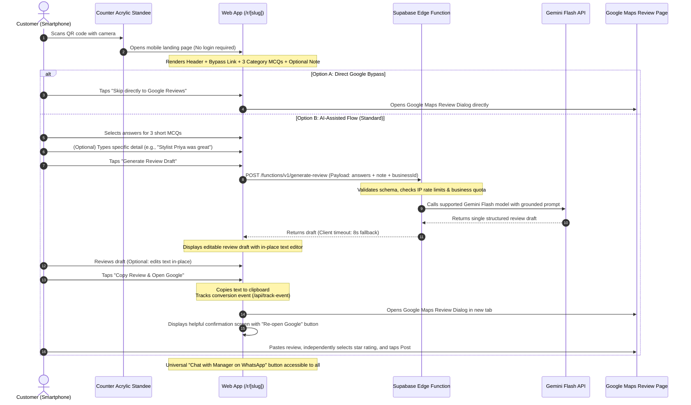

# Final MVP Decisions & Technical Architecture Specification
**Target SaaS:** Original AI-Powered QR Review & Customer Feedback SaaS for Local Indian Businesses  
**Document Reference:** `docs/research/MVP_DECISIONS.md`  
**Phase:** Phase 0 — Final Document Validation & Sign-Off  
**Date:** October 17, 2026  
**Author:** Senior SaaS Product Manager, Software Architect, Security Reviewer & Technical Business Analyst  
**Founder Target:** Solo Engineering Student (Revenue Hypothesis: INR 10,000–15,000/month)  

---

## 1. Executive Decision Summary

This document establishes the definitive product decisions, user journey specifications, architectural choices, and commercial roadmap for our original AI-powered QR Review SaaS.

### Core Strategic Decisions at a Glance:
1. **Product Positioning:** A **turnkey physical + digital review acceleration service**. We deliver a custom-printed, branded acrylic counter QR standee combined with an ultra-fast, mobile-first single-card AI review flow.
2. **Customer Flow:** Shortened from the industry standard 7-step wizard (EZReview) to a **lean Single-Card Flow**: 3 short category-specific MCQs $\to$ Optional Detail Note $\to$ Generate ONE concise editable draft $\to$ Customer Review & Edit $\to$ 1-Tap Copy & Open Google. A direct bypass link to Google Reviews is always prominently available.
3. **No In-App Pre-Rating:** Customers independently select their star rating directly on Google Maps. We do not require or solicit a preliminary star rating within our app, eliminating cognitive friction and removing any appearance of sentiment gating.
4. **AI Model Selection:** Evaluated currently supported Gemini Flash models from official documentation (`gemini-2.5-flash` / `gemini-3.5-flash-lite`). Generation latency is probabilistic and cannot be guaranteed; resilient asynchronous UI states, client timeouts (8–10s), and deterministic pre-written fallback templates are implemented.
5. **AI Quality & Factual Realism:** Claims of 100% factual fidelity or zero hallucinations are rejected. We enforce strict structured input mapping, negative constraint prompt rules, strict length limits (<60 words), and mandatory customer review and editing before copy/paste.
6. **AI Output Scope:** Generates **ONE concise, editable review draft** for MVP. Additional language variations (Hinglish, regional vernacular scripts) are categorized as post-MVP enhancements.
7. **Policy Adherence (Strict Anti-Gating):** Equal, unhindered Google review access for all customers regardless of sentiment. No positive review filtering, no negative review diversion, no invented experiences, and no automated posting. An optional direct contact channel to the business owner/manager (via WhatsApp) is **equally available to all customers**.
8. **Business Model & Unit Economics:** Retain **₹999 initial setup bundle** and **₹399/month recurring subscription** as test price hypotheses. We distinguish gross revenue, recurring revenue, direct physical fulfillment costs, fixed platform costs, founder operational time, operating surplus, and taxes. No income timeline is guaranteed.
9. **AI Usage & Fair-Use Limits:** Unlimited AI generation is not offered. We establish provisional fair-use limits (100–150 generations per business per month included in the ₹399/mo plan), business quota tracking, and anonymous endpoint rate limiting (max 10 generations per IP per hour).
10. **Hosting & Architecture:** Preferred direction is **React + Vite + TypeScript + Cloudflare Pages + Supabase (PostgreSQL, Auth, Edge Functions, RLS)**. We acknowledge free-tier limits, Supabase 7-day database inactivity pausing, production backup requirements, Edge Function execution constraints, and future commercial operating costs. Security is maintained through defense-in-depth, not described as "bulletproof."
11. **Target Market:** Pilot will focus exclusively on **salons and specialty cafes**. Healthcare and dental clinics are explicitly **deferred** to later stages due to sensitive health information (PHI), higher factual-accuracy risks, and regulatory sensitivity.
12. **Pilot Plan (3–5 Businesses):** Start with 3–5 local businesses. Compare the AI-assisted QR flow against a free direct-to-Google QR baseline to measure usability, completion, customer feedback, and merchant willingness to pay without unverified performance claims.

---

## 2. Corrected Competitor Benchmark Baseline

All pricing and technical benchmarks reflect directly verified numbers as of **October 17, 2026**:

| Metric | Google Free Review QR | GetReviewQR (`getreviewqr.com`) | EZReview (`ezreview.in`) | Our Target SaaS (MVP) |
| :--- | :--- | :--- | :--- | :--- |
| **Verification Date** | Oct 17, 2026 | Oct 17, 2026 (Live Chunk `17.po0br5i1cs.js`) | Oct 17, 2026 (Terms §7 & API Probes) | Oct 17, 2026 |
| **Starter Pricing** | Free forever | **₹199 / month** (`19900` paise) | **₹299 / 30-day access** (100 reviews) | **₹399 / month** (Hypothesis; 100–150 gen quota) |
| **Setup Package** | DIY print | None (Client self-prints PDF) | None (Digital QR image only) | **₹999 Setup Bundle** (Acrylic standee + Month 1) |
| **Billing Model** | Free | Monthly recurring (Razorpay / Lemon Squeezy) | One-time 30-day access (Manual re-purchase) | Recurring subscription (Razorpay Subscriptions) |
| **Customer Survey** | 0 MCQs (Blank box) | **0 MCQs** (Static suggestion cards) | **4–8 MCQs** (7-step complex wizard) | **3 Short MCQs** (Lean single-card flow) |
| **Pre-Star Rating** | On Google Maps | Mandatory in-app | Mandatory in-app | **None in App:** Independent selection on Google |
| **Physical Collateral** | Basic paper print | Client-side PDF generator (`jsPDF`) | None observed | **Delivered Acrylic Standee** + PDF Studio |
| **AI Draft Scope** | None | 3 canned suggestions | 3 generated drafts | **1 Concise Editable Draft** (Enhancements deferred) |
| **AI Accuracy** | N/A | Static templates | High hallucination rate (Invented facts) | **Strictly Grounded** + Mandatory user edit/approve |
| **Owner Contact** | None | None | None observed | **Universal WhatsApp link** equally open to all |

---

## 3. Customer Journey Specification

The customer journey is designed to minimize counter dwell time while capturing authentic visit details without sentiment gating.



### Detailed Functional Steps:

1. **Scan & Instant Load:**
   - URL structure: `https://[app-domain]/r/[business-slug]`
   - Zero authentication, zero account creation, zero tracking cookies.
   - Bundle budget: <80KB gzipped total payload. Loads rapidly on 4G cellular networks.
2. **The Unified Single Card:**
   - **Business Header:** Business logo/avatar, verified name, and locality (e.g., *"Urban Glow Salon, Koramangala"*).
   - **Direct Google Bypass Link:** Prominently positioned above the survey: *"Prefer to write your own? Skip directly to Google Reviews →"*.
   - **3 Short MCQs (Category-Specific):** Pre-configured based on business vertical (salon or cafe). Each question provides 3–4 concise emoji-tagged options + 1 neutral option (*"Not applicable / Not sure"*). Neutral choices are excluded from the AI prompt.
   - **Optional Personal Note:** 1-line text input (150 chars max) with contextual placeholder (e.g., *"Mention your stylist or dish (optional)"*).
3. **No In-App Star Rating:**
   - Customers are **not asked for a star rating** inside the web app.
   - The customer independently decides and selects their own star rating directly on Google Maps when they paste their review.
4. **Single Editable Review Draft:**
   - Generates **ONE concise draft (under 60 words)** focused directly on the user's affirmed selections.
   - Presented in an in-place `<textarea>` with an obvious "Edit text" affordance so the customer can revise words before copying.
5. **Robust Clipboard Copy & Google Handoff:**
   - Primary: Modern `navigator.clipboard.writeText()`.
   - Fallback: Hidden DOM `<textarea>` + `document.execCommand("copy")`.
   - Clear toast feedback: *"Review copied! Opening Google..."*.
   - Synchronous navigation: Opens official Google Review write URL (`https://search.google.com/local/writereview?placeid={placeId}`) in a new browser tab.
6. **Confirmation Screen:**
   - Clean confirmation view with 3-step visual instruction: 1. Google tab opened $\to$ 2. Tap stars and paste review $\to$ 3. Tap Post.
   - Persistent, obvious **"Re-open Google Reviews"** button in case the mobile browser suppressed the initial tab opening.
7. **Universal Owner Contact Channel (Strict Non-Gating):**
   - An optional link: *"Have private feedback or need to speak with the manager? Chat directly on WhatsApp →"*.
   - **Equally available to all customers at all times**, regardless of what options they selected in the survey.

---

## 4. AI Model, Quality & Anti-Hallucination Strategy

### A. Model Evaluation & Selection
In accordance with official Google Gemini documentation:
- Legacy models (such as Gemini 1.5 Flash) are superseded.
- Supported modern Flash models include:
  - `gemini-2.5-flash`: Best price-performance for general reasoning and grounded text generation.
  - `gemini-3.5-flash-lite`: Highly cost-efficient, optimized for high-volume text tasks, translation, and structured data processing.
  - `gemini-3.5-flash`: High-throughput foundational model for low-latency workloads.
- **Implementation Choice:** Use the official Google GenAI SDK (`@google/genai`) configured with `gemini-2.5-flash` or `gemini-3.5-flash-lite` via Supabase Edge Functions.
- **Latency Realism:** Generation latency is inherently variable depending on regional cellular routing, mobile network quality, and API load. **No latency guarantees (<2s or <3s) are made.**
- **Timeout & Deterministic Fallback:** If the API request exceeds 8 seconds or fails, the client immediately falls back to a deterministic, pre-written review draft assembled from a category template matrix matching the selected MCQs.

### B. Anti-Hallucination Prompt Architecture
Because LLMs are probabilistic engines and cannot guarantee "zero hallucinations," we enforce structural constraints:

```typescript
export const REVIEW_GENERATION_PROMPT = `
You are an AI assistant formatting a customer's real experience into a concise, natural Google review draft.

BUSINESS CONTEXT:
Name: {{businessName}}
Category: {{category}}

CUSTOMER-CONFIRMED VISIT FACTS:
{{#each responses}}
- {{question}}: {{selectedOption}}
{{/each}}
Optional Customer Note: {{optionalNote}}

NON-NEGOTIABLE GROUNDING RULES:
1. ONLY include factual claims directly supported by the confirmed visit facts above.
2. The reviewer is ALWAYS the individual customer (first-person "I"). NEVER invent third-party companions, family members, or relatives (e.g., DO NOT mention "my friend", "my wife", "my husband", or "my sister") unless explicitly typed in the Optional Customer Note.
3. NEVER invent pricing, billing, discounts, or cost claims unless affirmed in the inputs.
4. NEVER invent observations of waiting rooms, facilities, decor, or parking unless affirmed in the inputs.
5. NEVER invent prior visits, historical loyalty, or online reputation claims (e.g., DO NOT say "I have been coming here for years" or "I heard great things").
6. Keep the total length strictly under 60 words. Be direct, warm, and authentic.
7. Output format must be strictly a JSON object: {"reviewDraft": "concise review text here"}
`;
```

### C. Accuracy Quality Gates:
1. **Strict Input Sanitization:** Strip HTML, script tags, and prompt injection attempts from the optional 150-character note.
2. **Length Enclosure:** Strictly cap output at 60 words to eliminate LLM narrative embellishment.
3. **Mandatory Human-in-the-Loop:** The draft is presented to the customer as an editable draft. The customer must explicitly tap "Copy Review & Open Google" and paste it themselves, providing final human verification before publication.

---

## 5. Technical Architecture, Security & Privacy

### A. Three-Tier Interface Architecture

```
+---------------------------------------------------------------------------------------------------+
|                                  THREE-TIER UI PERMISSION MATRIX                                  |
|--------------------------+---------------------------------------+--------------------------------|
| ROLE                     | PERMISSION SCOPE                      | AUTHENTICATION REQUIREMENT     |
|--------------------------+---------------------------------------+--------------------------------|
| End Customer             | Public review landing page (/r/[slug])| Anonymous Public (No login)    |
| Business Owner           | Merchant Dashboard (/dashboard)       | Supabase Auth (Email OTP/Pass) |
| Super-Admin (Founder)    | Master Console (/admin)               | Supabase Auth + Admin Role     |
+---------------------------------------------------------------------------------------------------+
```

### B. Security & Privacy Specifications:
1. **Supabase Row Level Security (RLS):**
   - Mandatory RLS enabled across all database tables (`businesses`, `surveys`, `analytics_events`).
   - Tenant isolation: Merchants can only select, update, or delete records where `business.owner_id = auth.uid()`.
   - Public anonymous access: Strictly limited to `SELECT` on non-sensitive business profile fields (business name, logo URL, Place ID, active survey questions) matching `slug = :slug`. Anonymous write access is permitted only via server-validated Edge Functions.
2. **Secure Admin Privileges:**
   - Super-admin role enforced via server-side verification: Checked against an internal `admin_users` table with security-definer database functions or Supabase Auth custom claims (`app_metadata.role = 'super_admin'`).
   - Never rely on client-side state or query parameters to grant admin rights.
3. **Server-Side AI Credentials:**
   - The Google Gemini API key (`GEMINI_API_KEY`) is stored exclusively in Supabase Edge Function environment secrets.
   - It is never embedded in client bundles, Vite environment variables (`VITE_*`), or public repositories.
4. **Data Minimization & Customer Privacy:**
   - The customer review page collects **zero customer PII**: No names, email addresses, phone numbers, IP logs, or browser device fingerprints are stored in persistent customer logs.
   - Survey response records store only: `business_id`, timestamp, MCQ selection IDs, and optional note text.
   - Data retention policy: Survey responses older than 90 days are purged via automated database cron or retention policy.
5. **Anonymous Endpoint Abuse Prevention:**
   - Edge Functions enforce strict CORS headers restricting requests to our authorized domain.
   - Rate limiting per IP (maximum 10 generation requests per IP per hour) utilizing Redis / Upstash or Supabase Edge rate limiting.
   - Monthly fair-use quota per business (100–150 generations/month) tracked in the database; excess requests receive standard deterministic fallback templates without incurring AI API charges.
   - Optional Cloudflare Turnstile integration if automated scrapers/bots target the public endpoint.
6. **Realistic Security Testing:**
   - Continuous testing includes automated RLS policy unit tests, CORS restriction checks, Edge Function payload boundary tests, and `npm audit` dependency vulnerability scanning.
   - Security is managed through defense-in-depth and principle of least privilege, not assumed to be infallible.

---

## 6. MVP Scope Hierarchy

```
+---------------------------------------------------------------------------------------------------+
|                                     MVP SCOPE CATEGORIZATION                                      |
+---------------------------------------------------------------------------------------------------+
|                                                                                                   |
|  [TIER 1: WORKING PROTOTYPE - CORE FLOW]                                                          |
|  - Public customer landing page (/r/[slug]) with 3 category MCQs + optional note                  |
|  - No in-app star rating; independent star selection on Google Maps                               |
|  - Gemini Flash API generation producing ONE concise editable draft (<60 words)                   |
|  - Strict anti-hallucination prompt constraints & client-side deterministic fallback              |
|  - 1-tap clipboard copy (Clipboard API + fallback) and Google Maps review deep link              |
|  - Direct Google bypass link ("Skip to write directly on Google")                                |
|  - Universal, non-gated WhatsApp owner contact link                                               |
|                                                                                                   |
|  [TIER 2: PILOT READY - 3-5 LOCAL BUSINESSES]                                                     |
|  - Business Owner Dashboard (Auth, Google Place ID setup, WhatsApp number)                        |
|  - Downloadable A6 acrylic standee PDF template generator                                         |
|  - Granular funnel analytics: Visits, MCQ completions, Copy actions, Google clicks               |
|  - Multi-tenant Supabase PostgreSQL database with Row Level Security (RLS)                        |
|  - Super-Admin console to oversee merchant profiles, standee fulfillment, and API usage           |
|                                                                                                   |
|  [TIER 3: POST-PILOT ENHANCEMENTS]                                                                |
|  - Dual-draft generation (Quick Take + Hinglish Latin script)                                     |
|  - Automated Razorpay recurring subscription billing checkout                                     |
|  - Regional vernacular scripts (Hindi Devanagari, Marathi, etc.)                                  |
|  - Multi-location business support                                                                |
|                                                                                                   |
|  [TIER 4: FUTURE EXPANSIONS]                                                                      |
|  - Healthcare & Dental vertical expansion (after clinical compliance audit)                       |
|  - NFC tap-card counter standees                                                                  |
|  - WhatsApp automated review broadcast campaigns                                                 |
|                                                                                                   |
|  [TIER 5: EXPLICITLY OUT OF SCOPE - PROHIBITED OR OVER-COMPLEX]                                   |
|  - ❌ Negative Review Gating / Review Filtering (Violates Google & FTC rules)                     |
|  - ❌ Automatic Google Review Posting (Technically impossible; Google OAuth restriction)          |
|  - ❌ AI-Generated Fake Reviews (Prohibited under FTC 16 CFR Part 465)                           |
|  - ❌ Multi-step topic selection wizards (Causes counter drop-off)                                |
|  - ❌ Voice/Audio recording inputs (High ambient noise, high transcription cost)                  |
+---------------------------------------------------------------------------------------------------+
```

---

## 7. Business Model & Financial Unit Economics

### A. Commercial Offering (Test Price Hypotheses)
- **Turnkey Setup Package:** **₹999 one-time**
  - Includes: Custom graphic design, 1 high-grade 2mm acrylic counter standee (A6 size with heavy base), waterproof vinyl sticker printing, delivery/courier to merchant, QR configuration, and **Month 1 software access included**.
- **Recurring Monthly Subscription:** **₹399 / month** starting Month 2.
  - Includes: 100–150 AI review generations per month, mobile owner dashboard, analytics tracking, QR maintenance, and WhatsApp customer support.

---

### B. Detailed Financial Breakdown

#### 1. Initial Setup Unit Economics (₹999 One-Time):
| Cost Component | Cost (INR) | Operational Notes / Assumptions |
| :--- | :---: | :--- |
| **Acrylic Standee (A6 Size)** | ₹140 | 2mm clear acrylic T-standee from local wholesale supplier |
| **Vinyl Sticker Printing** | ₹40 | Glossy waterproof laminated vinyl print (front + back) |
| **Packaging Material** | ₹20 | Bubble mailer + protective cardboard reinforcement |
| **Delivery / Courier** | ₹60 | Local two-wheeler courier (Porter / Dunzo) or Speed Post |
| **Payment Gateway Fee (Setup)** | ₹24 | Razorpay: 2% + 18% GST on ₹999 = ₹23.58 |
| **Total Direct Fulfillment Cost** | **₹284** | Physical goods + shipping + transaction fee |
| **Setup Operating Surplus** | **₹715** | Upfront cash contribution per onboarded merchant |
| *Founder Labor Time* | *~1.5 hours* | Design prep, printer coordination, packaging, and setup |

---

#### 2. Monthly Recurring Unit Economics (₹399/Month per Active Merchant):
| Cost Component | Cost (INR) | Operational Notes / Assumptions |
| :--- | :---: | :--- |
| **Gemini Flash API** | ₹3.50 | ~150 generations $\times$ ~500 tokens $\times$ pricing rate |
| **Hosting & Database (Free Tier Phase)** | ₹0.00 | Cloudflare Pages + Supabase free tier (covers early pilot) |
| **Payment Gateway Processing Fee** | ₹9.42 | Razorpay: 2% + 18% GST on ₹399 = ₹9.42 |
| **Total Direct Monthly Cost** | **₹12.92** | Direct variable cost per subscriber |
| **Monthly Operating Surplus** | **₹386.08** | Gross operating surplus per active subscriber (~96.7% margin) |
| *Fixed Monthly Platform Costs* | *~₹100–₹150* | Domain name amortization; reserves for paid tier upgrades |
| *Founder Support Overhead* | *~15 mins/mo* | Merchant inquiries and WhatsApp check-in |

---

#### 3. Scaling Transition & Net Tax Realities:
- **Commercial Platform Transition:** When scaling beyond free-tier boundaries (or requiring 24/7 database uptime without 7-day inactivity pausing), upgrading to Supabase Pro adds ~$25/month (~₹2,100/month) as a fixed business operating expense.
- **Taxes:** Earnings are subject to applicable personal income tax or sole proprietorship tax regimes in India. Net profit after taxes is calculated after deducting allowable business operating expenses.
- **Timeline Realism:** Revenue milestones depend entirely on merchant acquisition velocity and churn rates. **Income targets (INR 10,000–15,000/month) are financial scenario targets, not guaranteed timelines.**

---

### C. Milestone Financial Scenarios (Illustrative Scenarios, Not Guarantees)

Assuming an estimated 15% monthly subscriber churn typical for micro-SMB SaaS in India:

| Scenario / Milestone | Active Subscribers | New Setup Packages / Mo | Recurring Revenue | Setup Revenue | Direct Costs | Operating Surplus |
| :--- | :---: | :---: | :---: | :---: | :---: | :---: |
| **Milestone 1: Pilot Validation** | 3–5 merchants | 4 setups | ₹0 (Month 1 included) | ₹3,996 | ₹1,136 | **₹2,860** |
| **Milestone 2: Initial Traction** | 12 merchants | 6 setups | ₹4,788 | ₹5,994 | ₹2,044 | **₹8,738** |
| **Milestone 3: Target Income Band** | 25 merchants | 8 setups | ₹9,975 | ₹7,992 | ₹2,935 | **₹15,032** |

---

## 8. Technical Architecture Evaluation & Hosting Realities

### Architecture Comparison:

| Dimension | Stack A: React + Vite + Cloudflare Pages + Supabase | Stack B: Next.js + Vercel Pro + Supabase |
| :--- | :--- | :--- |
| **Hosting Commercial Terms** | **100% Compliant**: Cloudflare Pages free tier permits commercial projects. | Vercel Hobby tier strictly prohibits commercial SaaS; requires Vercel Pro ($20/mo $\approx$ ₹1,650/mo). |
| **Cold Starts & Performance** | **Zero Frontend Cold Starts**: Pure static SPA assets deployed to Cloudflare global edge CDN. | Serverless function cold starts (800ms–2.5s) on Vercel unless kept warm. |
| **Multi-Tenant Isolation** | **PostgreSQL Row Level Security (RLS)**: Enforced directly at the database engine level. | RLS supported, but server components often bypass RLS via service roles. |
| **Solo Developer Maintenance** | High stability: Decoupled static frontend and serverless edge functions. | High maintenance: Next.js framework releases, SSR/SSG caching complexities. |

### Operational Hosting Realities & Constraints:
1. **Free-Tier Boundaries:**
   - Cloudflare Pages: Generous free build minutes and bandwidth.
   - Supabase Free Tier: 500MB database storage, 50,000 monthly active users, 500,000 Edge Function invocations/month. Sufficient for pilot and initial commercial traction.
2. **Database Inactivity Pausing:**
   - **Crucial Constraint:** Supabase pauses free-tier databases after 7 consecutive days of inactivity.
   - **Mitigation:** An automated scheduled health-check ping (via GitHub Actions or cron) ensures active status during pilot. Once paying merchants rely on counter QR availability, upgrading to Supabase Pro ($25/mo) is budgeted.
3. **Backup Strategy:**
   - Automated logical backups (`pg_dump`) executed via scheduled scripts to prevent data loss on free tiers where point-in-time recovery is unavailable.
4. **Edge Function Performance:**
   - Supabase Edge Functions run on Deno deploy. Cold-start latency (200–500ms) may occasionally occur on infrequent scans. Client UI uses immediate skeleton loading states.

---

## 9. Analytics Funnel & Attribution Distinction

The merchant dashboard must present an honest, transparent analytics funnel.

### Funnel Steps Tracked in Dashboard:
1. **QR Page Visits:** Raw scan count of visitors landing on `/r/[slug]`.
2. **Questionnaire Completion:** Number of customers who answer the 3 MCQs.
3. **AI Generation Success:** Number of review drafts successfully generated and displayed.
4. **Review Copy Actions:** Number of customers who tap "Copy Review & Open Google".
5. **Google Link Clicks:** Number of outbound redirects opened to the Google review URL.

### Mandatory Attribution Boundary:
> **Critical Operational Distinction:** An outbound Google link click **cannot be reliably attributed as a published Google review**.
> Google does not provide an external webhook or confirmation callback to indicate whether an anonymous user actually pasted and published their review on Google Maps. The merchant dashboard must clearly label conversion metrics as **"Copy & Handoff Clicks"** rather than "Published Google Reviews" to maintain merchant trust and compliance.

---

## 10. Pilot Validation Plan (3–5 Local Businesses)

### Pilot Objectives:
1. Validate customer willingness to scan, answer 3 MCQs, and copy an AI-drafted review.
2. Compare the AI-assisted QR standee against a **free direct-to-Google QR baseline** (measuring completion rate, review length, and customer drop-off).
3. Test physical standee durability and counter placement feasibility.
4. Measure merchant satisfaction and willingness to pay ₹399/month following the 14-day observation period.

### Target Pilot Cohort:
- **Verticals:** 2 Salons / Spas, 2 Specialty Cafes (Total: 4 local businesses). Healthcare clinics are explicitly deferred.
- **Duration:** 14 active operational days per business.
- **Methodology:** 
  - Install custom acrylic standee at the billing counter.
  - Track funnel metrics: Visits $\to$ MCQ completions $\to$ Copy actions $\to$ Outbound Google clicks.
  - Conduct 5 in-person customer usability observations per venue.
  - Compare merchant's net new public Google reviews during the pilot against historical monthly averages.

---

## 11. Decision Status

| Strategic Decision Area | Status | Operational Notes |
| :--- | :---: | :--- |
| **Turnkey Physical Standee + SaaS Offering** | `APPROVED` | Core commercial differentiator; high retention anchor for Indian SMBs. |
| **Single-Card Customer Flow (3 MCQs + Note)** | `APPROVED` | Minimizes counter dwell time; eliminates multi-step wizard abandonment. |
| **Elimination of In-App Pre-Star Rating** | `APPROVED` | Customer independently chooses star rating on Google Maps; zero gating risk. |
| **Single Concise Draft (<60 words) for MVP** | `APPROVED` | Simplifies flow, reduces API cost, speeds customer action. |
| **Strict Anti-Gating Policy & Universal Bypass Link** | `APPROVED` | Fully compliant with Google Maps Review Policy and FTC 16 CFR Part 465. |
| **Universal Owner WhatsApp Contact Link** | `APPROVED` | Feedback channel accessible to all customers regardless of sentiment. |
| **Pilot Verticals: Salons & Cafes** | `APPROVED` | Fast turnaround, high volume, low regulatory exposure. |
| **Healthcare & Dental Clinics Vertical** | `DEFERRED` | Postponed due to sensitive health data (PHI), medical liability, and factual risks. |
| **Multi-Language & Hinglish Dual Drafts** | `DEFERRED` | Categorized as Tier 3 post-pilot enhancements. |
| **Test Pricing: ₹999 Setup / ₹399 Recurring** | `PROVISIONAL` | Working hypotheses to be tested for merchant price sensitivity during pilot. |
| **Tech Stack: React + Vite + Cloudflare Pages + Supabase** | `PROVISIONAL` | Preferred architecture; validated against free-tier constraints and DB pausing. |
| **AI Model: Supported Gemini Flash via Edge Function** | `PROVISIONAL` | Using `gemini-2.5-flash` or `gemini-3.5-flash-lite` via `@google/genai` SDK. |
| **Fair-Use AI Quota (100–150 gens/mo per business)** | `REQUIRES VALIDATION` | To be calibrated against actual pilot monthly generation data. |
| **Conversion Superiority Over Free Google QR** | `REQUIRES VALIDATION` | Requires empirical A/B baseline testing during pilot before claiming superiority. |

---

## 12. Remaining Open Questions

1. **Physical Standee Production Turnaround:** Can local wholesale acrylic and vinyl print vendors consistently deliver 2mm A6 T-stands within 48 hours for ₹180 direct cost per unit?
2. **Customer Edit Frequency & Friction:** Does providing an editable `<textarea>` encourage authentic personalization, or does it introduce friction that slows down the handoff to Google Maps?
3. **Direct-to-Google QR Baseline Comparison:** Does the AI draft experience generate a statistically significant increase in completed Google reviews compared to a standard, free Google Review QR standee?
4. **WhatsApp Feedback Channel Utilization:** How frequently do customers utilize the universal WhatsApp feedback link, and do merchants find this side-channel operationally valuable?
5. **Subscription Conversion at Day 30:** What percentage of pilot merchants will transition from the setup package to the recurring ₹399/month subscription without extensive manual founder intervention?

---

*End of Final MVP Decisions & Technical Architecture Specification.*  
*Status: Validated for Phase 0 sign-off. Awaiting founder approval before Phase 1.*
